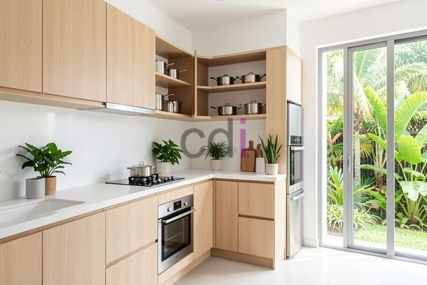

**Cara Hitung Harga Dapur Set Aluminium Terbaru 2026** - Mitra CDI di mana pun berada, pernahkah Anda membayangkan dapur yang rapi, fungsional, dan tahan lama? Dapur set aluminium menawarkan solusi cerdas untuk mewujudkan impian tersebut. Namun, sebelum memesan, penting untuk memahami bagaimana harga dapur set aluminium dihitung agar Anda mendapatkan penawaran yang sesuai dengan anggaran dan kebutuhan.

## Memahami Faktor Penentu Harga Dapur Set Aluminium

Anda mungkin bertanya-tanya, apa saja yang memengaruhi harga dapur set aluminium? Terdapat beberapa faktor utama yang perlu dipertimbangkan. Pertama, ukuran dapur Anda menjadi penentu utama. Semakin luas dapur, semakin banyak material dan waktu pengerjaan yang dibutuhkan, sehingga harga akan meningkat. Kedua, desain dapur set juga berpengaruh signifikan. Desain yang rumit dengan banyak detail tentu akan lebih mahal dibandingkan desain minimalis yang sederhana. 

Selain itu, kualitas material aluminium yang digunakan juga memengaruhi harga. Aluminium dengan ketebalan dan kualitas yang lebih baik akan lebih tahan lama dan memiliki harga yang lebih tinggi. Terakhir, perlengkapan tambahan seperti engsel *soft closing*, *handle*, dan *backsplash* juga dapat menambah biaya keseluruhan.

## Estimasi Harga Dapur Set Aluminium Berdasarkan Ukuran

Untuk memberikan gambaran yang lebih jelas, mari kita lihat estimasi harga berdasarkan ukuran dapur. Perlu diingat bahwa harga ini bersifat estimasi dan dapat berubah sewaktu-waktu — hubungi Kami untuk penawaran terbaru dan paling akurat sesuai kebutuhan proyek Mitra CDI.

Berikut adalah perkiraan harga untuk dapur set aluminium per meter persegi:

| Ukuran Dapur (m²) | Estimasi Harga (Rp) |
|---|---|
| 2 x 2 (4 m²) | 2.000.000 – 4.000.000 |
| 2 x 3 (6 m²) | 3.600.000 – 7.200.000 |
| 3 x 3 (9 m²) | 5.400.000 – 10.800.000 |

Estimasi harga di atas sudah termasuk material dan pemasangan. Namun, jika Anda membutuhkan desain khusus atau material tambahan, maka harga dapat disesuaikan. Kami di Creative Design Interior menawarkan layanan desain dapur set aluminium *custom* yang dapat disesuaikan dengan gaya dan kebutuhan Anda. Dengan pengalaman lebih dari 10 tahun, Kami memastikan hasil yang optimal dan memuaskan.

## Rincian Biaya dan Pilihan Finishing Dapur Set Aluminium

Selain ukuran dan desain, penting juga untuk memahami rincian biaya yang terlibat dalam pembuatan dapur set aluminium. Biaya ini meliputi:

*   **Material Aluminium:** Harga aluminium bervariasi tergantung jenis dan ketebalannya.
*   **Papan Melamin/HPL:** Papan melamin atau HPL digunakan untuk melapisi permukaan aluminium dan memberikan tampilan yang menarik.
*   **Aksesori:** Engsel, *handle*, dan rel laci juga memengaruhi biaya.
*   **Pemasangan:** Biaya pemasangan tergantung pada kompleksitas desain dan lokasi dapur.

Anda juga dapat memilih berbagai pilihan *finishing* untuk dapur set aluminium Anda, seperti warna, tekstur, dan motif. Pilihan *finishing* yang tersedia akan memengaruhi tampilan akhir dapur Anda. Kami menyediakan berbagai pilihan *finishing* yang dapat Anda pilih sesuai dengan preferensi Anda.

## Creative Design Interior: Solusi Dapur Set Aluminium All-in-One

Mencari solusi praktis untuk mewujudkan dapur impian Anda? Creative Design Interior hadir sebagai mitra terpercaya dalam pembuatan dapur set aluminium berkualitas. Kami menawarkan skema harga *all-in-one* yang sudah termasuk material, pengiriman, dan bongkar muat. Anda tidak perlu khawatir lagi tentang biaya tambahan yang tak terduga. Kami juga menyediakan gratis ongkir untuk wilayah layanan Kami, meliputi Jakarta, Bogor, Depok, Tangerang, Bekasi, Cikarang, Karawang, Bandung, Serang, Purwakarta, Cilegon, Cikampek, Subang, dan Rangkasbitung.

Dengan tim kerja berpengalaman dan sistem kerja terjadwal, Kami menjamin pengerjaan tepat waktu dan kualitas terjaga. Kami mengutamakan kepuasan pelanggan dan memberikan garansi produk dapat ditukar jika tidak sesuai spesifikasi, selama belum dipakai atau dibongkar dan maksimal 1 hari. Untuk memudahkan Anda, Kami menyediakan berbagai pilihan pembayaran: COD, transfer bank, DP 50%, transfer setelah barang terkirim, bayar bertahap, atau transfer setelah pekerjaan selesai. Jangan ragu untuk memanfaatkan opsi pembayaran yang paling nyaman bagi Anda.

Untuk konsultasi lebih lanjut, tombol **Telepon** dan **WhatsApp** di bawah halaman ini dapat langsung digunakan untuk menghubungi Kami.
