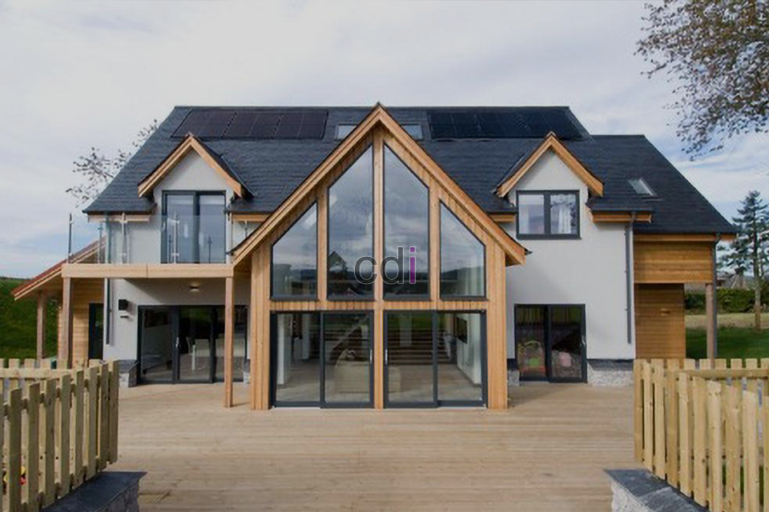

**Harga Dining Table Set: Cek Estimasi & Pilihan Terbaik 2026** - Halo Mitra CDI! Mencari set meja makan yang pas memang bisa bikin pusing, ya? Banyak hal yang perlu dipertimbangkan — mulai dari ukuran ruangan, gaya interior yang diinginkan, sampai kebutuhan sehari-hari. Nah, seringnya orang langsung beli tanpa memikirkan itu, dan akhirnya kurang cocok. Gimana kalau begitu?

## Mengenal Lebih Dekat: Pengaruh Material pada Harga Dining Table Set

Harga *dining table set* itu bisa sangat bervariasi, lho. Salah satu faktor utamanya adalah material yang dipakai. Setiap material punya kelebihan dan kekurangan masing-masing, baik dari segi tampilan, kekuatan, maupun harga. Beberapa material yang paling populer antara lain kayu solid, kayu lapis (plywood) dengan finishing HPL atau veneer, dan kombinasi besi dengan kaca.

Kayu solid seperti jati, mahoni, atau oak memang punya daya tarik tersendiri. Keindahannya alami dan kualitasnya terjamin. Tapi, tentu saja, harga *dining table set* dari kayu solid cenderung lebih tinggi. Misalnya, set meja makan kayu jati untuk 4 orang dengan desain minimalis bisa berada di kisaran Rp 8.000.000 sampai Rp 20.000.000, tergantung kualitas kayu, desain, dan finishing yang dipilih.

Sementara itu, *dining table set* yang menggunakan kayu lapis dilapisi HPL atau veneer bisa jadi pilihan yang lebih hemat di kantong. Material ini tetap menawarkan tampilan yang menarik dengan banyak pilihan warna dan motif. Harga *dining table set* berbahan plywood ini biasanya berkisar antara Rp 3.000.000 hingga Rp 10.000.000 untuk set 4 kursi.

Kombinasi material seperti besi dengan kaca atau marmer juga banyak dicari. Besi memberikan kesan modern dan industrial, sementara kaca atau marmer menyempurnakan tampilan dengan kemewahan. Untuk *dining table set* kombinasi ini, harganya bisa bervariasi antara Rp 4.000.000 hingga Rp 15.000.000, tergantung kualitas material dan desainnya.

## Custom Dining Table Set: Wujudkan Meja Makan Impian Bersama Creative Design Interior

Kami di Creative Design Interior mengerti banget bahwa setiap rumah dan keluarga punya kebutuhan yang beda-beda. Makanya, Kami menawarkan layanan *custom dining table set*. Ini adalah cara terbaik untuk mendapatkan set meja makan yang bener-bener sesuai dengan selera dan kebutuhan Anda. Anda bebas memilih material, ukuran, desain, dan finishing yang Anda inginkan.

Proses *custom* di tempat Kami dimulai dengan konsultasi. Kami akan mendengarkan kebutuhan dan gaya interior Anda dengan seksama. Setelah itu, tim desain Kami akan membuat sketsa desain yang bisa Anda tinjau dan revisi sampai benar-benar pas. Begitu desainnya sudah oke, Kami akan langsung memproduksinya dengan standar kualitas yang tinggi.

Soal harga layanan *custom*, tentu saja akan bervariasi tergantung pada kompleksitas desain, material yang dipilih, dan ukuran *dining table set* itu sendiri. harga ini bersifat estimasi – untuk penawaran terbaru dan paling akurat, yuk hubungi Kami langsung sesuai kebutuhan proyek Mitra CDI.

## Proses Pembelian Mudah & Pilihan Pembayaran Fleksibel

Kami berusaha mempermudah Anda dalam berbelanja. Tersedia beberapa pilihan pembayaran yang bisa Anda gunakan: COD (Cash on Delivery), transfer bank, DP 50%, transfer setelah barang diterima, bayar bertahap, atau transfer setelah pekerjaan selesai. Selain itu, Kami juga menawarkan gratis ongkir untuk wilayah tertentu.

Anda bisa cek daftar harga *dining table set* yang tersedia di halaman Daftar Harga Kami. Di sana Anda akan menemukan berbagai desain dan material dengan estimasi harga yang jelas. Jangan sungkan untuk menghubungi Kami kalau ada pertanyaan atau butuh bantuan memilih *dining table set* yang paling cocok.

Kami melayani area Jakarta, Bogor, Depok, Tangerang, Bekasi, Cikarang, Karawang, Bandung, Serang, Purwakarta, Cilegon, Cikampek, Subang, dan Rangkasbitung. Dengan pengalaman lebih dari 10 tahun di bidang furniture interior dan material bangunan, Kami berkomitmen untuk memberikan produk dan layanan terbaik bagi Anda. Tim Kami bekerja dengan sistem penjadwalan yang terstruktur, memastikan pengerjaan tepat waktu dan kualitasnya selalu terjaga. Kalau produknya tidak sesuai dengan spesifikasi, Anda bisa tukar—dengan syarat belum dipakai atau dibongkar, dan maksimal 1 hari setelah barang diterima.

Jangan ragu untuk berkonsultasi lebih lanjut!  Untuk itu, gunakan tombol **Telepon** atau **WhatsApp** di bawah halaman ini untuk langsung menghubungi Kami. [Atap Bondek Cor: Panduan Lengkap Kekuatan, Pemasangan, dan Estimasi Biaya 2026](/blog/atap-bondek-cor/) bisa juga menjadi referensi penting jika Anda sedang membangun atau merenovasi properti di (not detected).