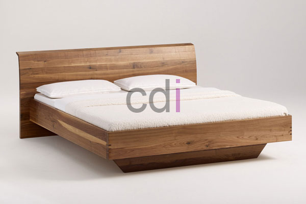

**Harga Dipan Kayu Jati Belanda [Terbaru]** - Hai Mitra CDI! Cari dipan impian? Kami punya solusinya! Dipan adalah salah satu perabot penting di rumah, tempat kita beristirahat dan memulihkan energi. Pilihan bahan dipan sangat beragam – kayu, besi, hingga material modern lainnya. Masing-masing punya kelebihan, tapi soal kualitas dan daya tahan, kayu tetap jadi favorit. Nah, di artikel ini, kita akan kupas tuntas soal dipan kayu jati belanda, termasuk harga terbarunya di (not detected). Gimana, tertarik untuk mempercantik kamar tidur Anda? Yuk, simak terus!

*Tempat Tidur Berkualitas dari Kayu Jati Belanda*

## Ragam Jenis Kayu untuk Dipan yang Awet dan Nyaman

Ada banyak sekali pilihan kayu yang bisa digunakan untuk membuat dipan. Tapi, tidak semua kayu cocok untuk tujuan ini. Berikut beberapa jenis kayu yang paling sering direkomendasikan karena kualitasnya:

### 1. Kayu Jati

Siapa sih yang tidak kenal kayu jati? Kayu ini sudah lama dikenal sebagai material premium untuk furniture. Kuat, kokoh, dan tahan lama, kayu jati menjamin dipan Anda awet bertahun-tahun. Banyak yang memilihnya karena mampu menghasilkan furniture berkelas dengan kualitas terjamin. 

Lalu ada kayu jati Belanda yang juga populer. Kayu ini punya keunggulan tersendiri dalam pembuatan dipan. Dijamin anti-rayap sehingga sangat tahan lama dan nyaman digunakan. Dipan dari kayu jati Belanda ini akan memberikan sentuhan artistik pada kamar Anda. Serat kayunya yang unik, apalagi jika dilapisi *clear coat*, akan menampilkan kesan klasik yang mewah.

### 2. Kayu Mahoni

Kayu mahoni juga sering kita jumpai dalam pembuatan furniture sehari-hari. Material ini sangat cocok dijadikan bahan untuk membuat dipan berkualitas. Kayu mahoni mudah ditemukan dan pertumbuhannya cepat, sehingga harganya relatif terjangkau.

### 3. Kayu Pinus

Kayu pinus juga menjadi pilihan populer untuk dipan. Kualitasnya cukup baik dan harganya bersahabat di kantong. Banyak masyarakat yang memilih dipan kayu pinus karena menawarkan keseimbangan antara kualitas dan harga yang menarik.

## Update Harga Dipan Kayu Jati Belanda di (not detected)

Harga dipan kayu jati belanda bervariasi, tergantung desain, ukuran, dan kualitas kayu yang digunakan. Semakin rumit desain dan berkualitas kayunya, tentu harganya akan semakin tinggi.

Seperti yang kita ketahui bersama, kayu jati belanda memang terkenal akan kualitas dan keawetannya. Dipan dari kayu ini akan bertahan lama dan memberikan kenyamanan maksimal. Untuk harga, dipan kayu jati Belanda di (not detected) bisa didapatkan dengan harga mulai dari Rp. 2,5 juta. Semakin tinggi harga, biasanya semakin baik kualitas dan detail finishing dipannya. Jangan ragu untuk menghubungi tim kami untuk mendapatkan penawaran terbaik dan informasi lebih lanjut! Dengan berbelanja di CDI, Anda dijamin mendapatkan dipan berkualitas yang sesuai dengan kebutuhan dan budget Anda. Ditambah lagi, kami selalu menyediakan layanan terbaik untuk setiap Mitra CDI di (not detected). Jangan tunda lagi, segera wujudkan kamar tidur impian Anda! [Jual Balok Kayu Jati Belanda Di Halim Perdana kusumah Jakarta](https://www.creative-designinterior.com/kayu/jual-balok-kayu-jati-belanda-di-halim-perdana-kusumah-jakarta/) — temukan koleksi balok jati belanda berkualitas untuk proyek DIY Anda!