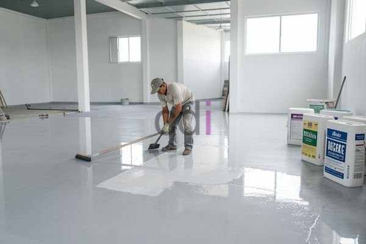

**Harga Epoxy 1000 Micron: Estimasi Biaya & Faktor Penting 2026** - Halo Mitra CDI! Apakah Anda sedang merencanakan pengecatan lantai atau permukaan di (not detected) dan mempertimbangkan epoxy? Memahami perkiraan biayanya sangat krusial, lho. Terutama jika Anda mengincar lapisan dengan ketebalan 1000 micron – pilihan yang sering direkomendasikan untuk area yang membutuhkan perlindungan ekstra dan tahan terhadap beban berat.

Memilih jenis lapisan lantai yang tepat memang butuh pertimbangan. Epoxy 1000 micron menawarkan kombinasi daya tahan tinggi, ketahanan terhadap bahan kimia, dan tampilan yang menarik. Nah, supaya Mitra CDI makin yakin, yuk kita bedah satu per satu faktor yang memengaruhi harga epoxy ini.

## Faktor-Faktor yang Mempengaruhi Biaya Epoxy 1000 Micron

Beberapa hal penting memengaruhi harga akhir aplikasi epoxy 1000 micron. Pertama, jenis resin epoxy yang digunakan. Ada berbagai macam resin epoxy yang tersedia, masing-masing dengan karakteristik dan harga berbeda. Misalnya, epoxy standar, epoxy novolac yang lebih tahan kimia, atau bahkan epoxy berbahan dasar air yang lebih ramah lingkungan. Pilihan tergantung kebutuhan spesifik proyek Anda.

Kemudian, luas area yang akan dilapisi juga berpengaruh besar. Semakin luas areanya, semakin banyak material dan waktu kerja yang dibutuhkan. Jangan juga lupakan persiapan permukaan. Apakah permukaan perlu diperbaiki kerusakannya? Apakah perlu dibersihkan secara intensif? Persiapan permukaan yang kurang baik bisa merusak hasil akhir dan justru menambah biaya perbaikan nantinya. Percayakan pada tenaga ahli untuk persiapan permukaan agar hasilnya optimal!

## Estimasi Biaya Aplikasi Epoxy 1000 Micron di (not detected)

Biar lebih jelas, berikut ini perkiraan biaya aplikasi epoxy 1000 micron di wilayah (not detected) pada tahun 2026. Perlu diingat, angka ini hanyalah estimasi awal dan bisa berubah tergantung kompleksitas proyek serta penyedia jasa yang Anda pilih.

Harga material epoxy 1000 micron sendiri berkisar antara Rp 300.000 hingga Rp 600.000 per meter persegi. Sementara, biaya tenaga kerja untuk pemasangan berkisar antara Rp 150.000 hingga Rp 300.000 per meter persegi, tergantung tingkat kesulitan dan lokasi proyek di (not detected).

Dengan demikian, total biaya aplikasi epoxy 1000 micron bisa berada di kisaran Rp 450.000 hingga Rp 900.000 per meter persegi. Untuk mendapatkan penawaran harga yang lebih akurat dan sesuai dengan kebutuhan proyek Anda, jangan ragu untuk menghubungi Kami. Kami siap memberikan konsultasi gratis!

## Perbandingan Epoxy 1000 Micron dengan Ketebalan Lainnya

Bingung memilih ketebalan epoxy yang tepat? Membandingkan perbedaan antara epoxy dengan ketebalan 500 micron, 1000 micron, dan 2000 micron bisa membantu Mitra CDI mengambil keputusan terbaik. Perhatikan tabel berikut:

<table class="table">
  <caption>Perbandingan Ketebalan Epoxy</caption>
  <thead>
    <tr><th>Ketebalan (micron)</th><th>Kekuatan</th><th>Ketahanan Kimia</th><th>Biaya (Estimasi/m²)</th></tr>
  </thead>
  <tbody>
    <tr><td>500</td><td>Sedang</td><td>Sedang</td><td>Rp 250.000 - Rp 400.000</td></tr>
    <tr><td>1000</td><td>Tinggi</td><td>Tinggi</td><td>Rp 450.000 - Rp 900.000</td></tr>
    <tr><td>2000</td><td>Sangat Tinggi</td><td>Sangat Tinggi</td><td>Rp 800.000 - Rp 1.500.000</td></tr>
  </tbody>
</table>

Epoxy 500 micron cocok untuk area dengan lalu lintas ringan dan kebutuhan perlindungan standar. Epoxy 1000 micron adalah pilihan yang tepat untuk area dengan lalu lintas sedang hingga tinggi, dan memerlukan perlindungan yang lebih baik terhadap abrasi dan bahan kimia. Sementara epoxy 2000 micron sangat ideal untuk area dengan lalu lintas berat, paparan bahan kimia ekstrem, atau kebutuhan daya tahan maksimal.

## Kenapa Harus Memilih Creative Design Interior untuk Aplikasi Epoxy di (not detected)?

Kami di Creative Design Interior sudah berpengalaman bertahun-tahun dalam aplikasi epoxy untuk berbagai keperluan. Tim profesional Kami siap membantu Mitra CDI memilih jenis epoxy yang paling sesuai, memastikan persiapan permukaan dilakukan dengan benar, dan mengaplikasikan lapisan epoxy dengan sempurna. Kami hanya menggunakan material berkualitas tinggi dan memberikan jaminan kualitas untuk setiap pengerjaan. Pelajari lebih lanjut tentang Epoxy Lantai dan Epoxy Coating: Panduan Lengkap Sebelum Aplikasi untuk persiapan yang lebih baik.

Butuh informasi lebih lanjut atau ingin bertanya-tanya? Jangan sungkan untuk menghubungi Kami melalui tombol **WhatsApp** atau **Telepon** yang ada di halaman ini. Kami siap membantu mewujudkan lantai impian Anda!