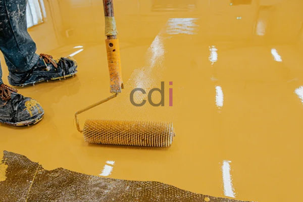

**Harga Epoxy Lantai 20kg: Estimasi & Pilihan Terbaik untuk Proyek Anda** - Hai Mitra CDI! Sedang mempertimbangkan epoxy untuk lantai bangunan Anda? Pilihan tepat! Lantai epoxy menawarkan kombinasi daya tahan, keindahan, dan kemudahan perawatan yang sulit ditandingi. Artikel ini akan mengupas tuntas perkiraan harga epoxy lantai 20kg, apa saja faktor yang mempengaruhinya, dan berbagai opsi yang bisa Anda pilih sesuai kebutuhan proyek Anda di (not detected). Yuk, kita bahas lebih lanjut!

## Memperkirakan Biaya Epoxy Lantai 20kg di Tahun 2026

Tentu saja, harga epoxy lantai 20kg tidaklah baku. Ada beberapa elemen penting yang memengaruhinya. Secara umum, harga epoxy resin murni per kilogram berkisar antara Rp 35.000 hingga Rp 75.000. Tapi ingat, 20kg resin saja belum cukup untuk aplikasi lantai yang optimal. Anda juga membutuhkan *hardener* (pengeras), mungkin pelarut (tergantung produk), dan material pengisi seperti pasir silika atau bubuk kuarsa untuk mencapai tingkat ketebalan dan kekerasan yang diinginkan.

Biaya proyek lantai epoxy keseluruhan tidak hanya soal material, lho. Biaya tenaga kerja pemasangan, persiapan permukaan lantai (pengamplasan, perbaikan keretakan), dan ongkos transportasi juga harus diperhitungkan. Sebagai patokan, harga aplikasi epoxy lantai secara keseluruhan bisa berkisar antara Rp 150.000 hingga Rp 400.000 per meter persegi, tergantung pada tingkat kesulitan proyek dan jenis epoxy yang Anda pilih. Perlu diingat, harga ini hanyalah estimasi — untuk penawaran yang paling akurat untuk proyek Anda di (not detected), segera hubungi Kami!

## Jenis-Jenis Epoxy Lantai Populer dan Estimasi Harganya

Mitra CDI perlu tahu bahwa ada banyak jenis epoxy lantai yang tersedia di pasaran, masing-masing dengan keunggulan dan harga yang berbeda. Berikut beberapa jenis yang paling banyak dicari:

*   **Epoxy Self-Leveling:** Memberikan permukaan akhir yang sangat halus dan rata. Ideal untuk area komersial atau industri yang membutuhkan lantai tanpa sambungan. Biasanya, jenis ini memiliki harga yang sedikit lebih tinggi.
*   **Epoxy Non-Slip:** Ditambahkan material anti-slip untuk meningkatkan daya cengkeram, sangat cocok untuk area yang berpotensi licin seperti dapur, kamar mandi, atau area produksi.
*   **Epoxy Metallic:** Mengandung pigmen metalik yang menciptakan efek visual yang memukau, sering digunakan dalam desain interior modern dan artistik.
*   **Epoxy Terazzo:** Menyerupai lantai terazzo tradisional, tapi dengan daya tahan dan perawatan yang jauh lebih mudah.

<table class="table">
  <caption>Perbandingan Harga dan Karakteristik Epoxy Lantai</caption>
  <thead>
    <tr><th>Jenis Epoxy</th><th>Harga per Kg (Estimasi)</th><th>Karakteristik Utama</th><th>Area Aplikasi</th></tr>
  </thead>
  <tbody>
    <tr><td>Epoxy Self-Leveling</td><td>Rp 60.000 - Rp 75.000</td><td>Permukaan halus, rata, tanpa sambungan</td><td>Gudang, pabrik, showroom</td></tr>
    <tr><td>Epoxy Non-Slip</td><td>Rp 50.000 - Rp 65.000</td><td>Daya cengkeram tinggi, tahan slip</td><td>Dapur, kamar mandi, area produksi</td></tr>
    <tr><td>Epoxy Metallic</td><td>Rp 70.000 - Rp 85.000</td><td>Efek visual metalik, modern</td><td>Ruang tamu, kafe, butik</td></tr>
    <tr><td>Epoxy Terazzo</td><td>Rp 55.000 - Rp 70.000</td><td>Menyerupai terazzo, tahan lama</td><td>Lobi, koridor, area publik</td></tr>
  </tbody>
</table>

Butuh informasi lebih rinci mengenai spesifikasi dan harga epoxy lantai? Anda bisa mengeceknya di Daftar Harga Kami. Di sana, Anda akan menemukan detail lengkapnya.

## Creative Design Interior: Partner Epoxy Lantai Lengkap untuk Anda

Di Creative Design Interior, Kami mengerti bahwa memilih dan memasang epoxy lantai bisa jadi cukup menantang. Karena itu, Kami hadir sebagai solusi *all-in-one*! Kami menyediakan material epoxy berkualitas tinggi, tenaga kerja profesional, dan layanan konsultasi yang siap membantu setiap langkah. Dengan pengalaman lebih dari 10 tahun di dunia desain interior dan konstruksi di (not detected), Kami telah berhasil menyelesaikan berbagai proyek epoxy lantai, dari hunian pribadi hingga fasilitas komersial.

Tim Kami bekerja dengan prosedur yang terstruktur, memastikan setiap proyek diselesaikan tepat waktu dan memenuhi standar kualitas yang Kami tetapkan. Kami juga menawarkan berbagai pilihan pembayaran yang fleksibel, termasuk COD, transfer bank, DP 50%, transfer setelah barang terkirim, bayar bertahap, atau transfer setelah pekerjaan selesai. Kami melayani berbagai wilayah termasuk Jakarta, Bogor, Depok, Tangerang, Bekasi, Cikarang, Karawang, Bandung, Serang, Purwakarta, Cilegon, Cikampek, Subang, dan Rangkasbitung, serta memberikan penawaran gratis ongkir untuk area tertentu.

## Pesan dan Konsultasi Epoxy Lantai? Mudah Saja!

Masih ragu epoxy jenis mana yang paling pas untuk projek Anda? Atau belum yakin dengan perkiraan biayanya? Jangan sungkan untuk berkonsultasi dengan Kami! Kami siap memberikan saran gratis dan membantu Anda memilih solusi terbaik. Jangan khawatir, produk Kami dapat ditukar jika tidak sesuai dengan spesifikasi, asalkan belum digunakan atau dibongkar dan diajukan maksimal dalam 1 hari. Kami berkomitmen untuk memberikan pengalaman yang menyenangkan dan memuaskan bagi setiap pelanggan Kami di (not detected).

Jangan tunda lagi! Segera hubungi Kami untuk mendapatkan konsultasi langsung dan penawaran terbaik untuk kebutuhan proyek Anda. Klik tombol **WhatsApp** atau **Telepon** di bawah ini untuk terhubung dengan tim Kami.