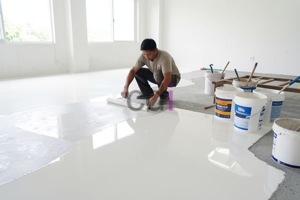

**Kenapa Harga Epoxy Per M2 Bervariasi? Panduan Lengkap 2026** - Halo Mitra CDI! Pernah bertanya-tanya, kenapa harga epoxy per meter persegi bisa beda-beda? Gimana cara memperkirakan biaya yang tepat untuk proyek Anda di (not detected)? Nah, memahami faktor-faktor yang memengaruhi harga ini penting banget sebelum mulai, lho. Di artikel ini, kita akan kupas tuntas semua hal yang perlu Anda tahu.

### Apa Saja yang Mempengaruhi Harga Epoxy?

Epoxy itu nggak cuma satu jenis, Mitra! Ada banyak varian dengan keunggulan dan harga yang berbeda. Misalnya, epoxy lantai industri pasti beda harganya dengan epoxy coating untuk garasi. Ketebalan lapisan juga berpengaruh besar. Semakin tebal lapisan yang Anda inginkan, semakin banyak material yang dibutuhkan, dan otomatis biayanya ikut naik.

Luas area aplikasi juga penting. Biasanya, proyek yang lebih besar bisa dapat harga per meter persegi lebih oke karena ada skala ekonomi. Tapi ingat, biaya transportasi dan persiapan permukaan harus tetap diperhitungkan, apalagi kalau lokasi proyek di (not detected) agak sulit dijangkau.

### Yuk, Bandingkan Jenis Epoxy & Estimasi Biayanya!

Supaya lebih jelas, ini dia perbandingan beberapa jenis epoxy populer dan perkiraan harganya per meter persegi. Perlu diingat, harga ini cuma estimasi dan bisa berubah sewaktu-waktu — untuk penawaran paling akurat sesuai proyek Anda, langsung saja hubungi tim Kami!

<table class="table">
  <caption>Estimasi Harga Epoxy Per M2 (2026)</caption>
  <thead>
    <tr><th>Jenis Epoxy</th><th>Ketebalan (mm)</th><th>Harga Per M2 (Estimasi)</th><th>Keterangan</th></tr>
  </thead>
  <tbody>
    <tr><td>Epoxy Self-Leveling</td><td>2-3</td><td>Rp 350.000 - Rp 600.000</td><td>Cocok untuk lantai industri, gudang, parkiran</td></tr>
    <tr><td>Epoxy Coating</td><td>0.2-0.5</td><td>Rp 200.000 - Rp 350.000</td><td>Ideal untuk lantai garasi, workshop, atau area yang membutuhkan perlindungan kimia</td></tr>
    <tr><td>Epoxy Terazzo</td><td>3-5</td><td>Rp 700.000 - Rp 1.200.000</td><td>Memberikan tampilan mewah dengan tekstur seperti batu terazzo</td></tr>
    <tr><td>Epoxy Metallic</td><td>2-3</td><td>Rp 600.000 - Rp 900.000</td><td>Menghasilkan efek visual metalik yang unik dan modern</td></tr>
  </tbody>
</table>

### Jangan Lupakan Biaya Lain-Lain!

Selain harga material dan pemasangan, ada beberapa biaya tambahan yang perlu Anda masukkan dalam anggaran. Contohnya, biaya persiapan permukaan seperti pengamplasan, menambal retakan, dan membersihkan lantai. Kondisi lantai yang kurang baik akan membutuhkan proses persiapan yang lebih rumit dan mahal.

Lalu, ada juga biaya tenaga kerja. Pemasangan epoxy butuh tukang yang ahli dan berpengalaman supaya hasilnya maksimal. Jadi, jangan ragu untuk minta beberapa penawaran dari penyedia jasa epoxy yang berbeda untuk membandingkan harga dan kualitas layanan, ya. Kalau Anda ingin tahu lebih banyak tentang aplikasi epoxy, Epoxy Lantai dan Epoxy Coating: Panduan Lengkap Sebelum Aplikasi bisa jadi referensi yang berguna.

### Pilih Penyedia Jasa Epoxy yang Terpercaya

Memilih penyedia jasa epoxy yang tepat itu krusial, Mitra. Pastikan mereka punya reputasi bagus, pengalaman yang relevan, dan portofolio proyek yang bisa Anda lihat. Minta juga referensi dari klien sebelumnya. Selain itu, cek apakah mereka menggunakan material epoxy berkualitas dan punya sertifikasi yang dibutuhkan. Di Creative Design Interior, Kami berkomitmen memberikan layanan terbaik dan solusi epoxy yang pas untuk kebutuhan Anda di (not detected). Kalau Anda lagi cari inspirasi untuk furniture unik, [Jual Meja Kayu Solid Utuh [Finishing Resin Epoxy]](/product/jual-meja-kayu-solid-utuh-antik/) bisa jadi pilihan menarik!

Ada pertanyaan lain? Jangan sungkan hubungi Kami melalui tombol **WhatsApp** atau **Telepon** yang ada di halaman ini. Kami siap membantu!