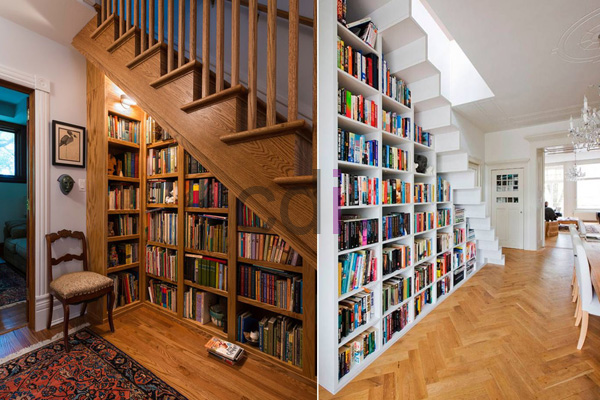

**Harga Etalase Rak Buku: Pilih Ukuran & Gaya Ideal Bersama CDI** - Mitra CDI yang terhormat, mencari etalase rak buku yang sesuai dengan kebutuhan dan anggaran Mitra adalah hal yang penting. Pemilihan yang tepat akan mempercantik ruangan sekaligus memberikan solusi penyimpanan yang efektif.

Etalase rak buku tidak hanya berfungsi sebagai tempat menyimpan koleksi buku, tetapi juga menjadi elemen dekoratif yang memperkaya estetika ruangan. Dengan desain yang tepat, etalase rak buku dapat menjadi focal point yang menarik perhatian. Mitra CDI dapat menyesuaikan desainnya sesuai dengan gaya interior yang diinginkan.

## Mempertimbangkan Faktor Penentu Harga Etalase Rak Buku

Mitra, harga etalase rak buku dipengaruhi oleh beberapa faktor utama. Pemahaman terhadap faktor-faktor ini akan membantu Mitra dalam membuat keputusan pembelian yang tepat. Pertama, material yang digunakan sangat berpengaruh terhadap harga. Material seperti kayu solid, MDF, particle board, atau kombinasi dengan kaca akan memiliki harga yang berbeda. Kayu solid umumnya memiliki harga yang lebih tinggi dibandingkan material lainnya karena kualitas dan keawetannya.

Selain material, ukuran etalase rak buku juga menjadi pertimbangan penting. Semakin besar ukuran etalase, semakin banyak material yang dibutuhkan, dan tentu saja, semakin tinggi pula harganya. Desain yang rumit dengan banyak detail juga akan meningkatkan biaya produksi. Kami di Creative Design Interior menawarkan berbagai pilihan ukuran dan desain yang dapat disesuaikan dengan kebutuhan dan preferensi Mitra.

## Ragam Desain Etalase Rak Buku dan Estimasi Biaya

Beragam desain etalase rak buku tersedia untuk memenuhi berbagai gaya interior. Untuk gaya minimalis, etalase rak buku dengan desain sederhana dan warna netral seperti putih atau abu-abu seringkali menjadi pilihan populer. Harga etalase rak buku minimalis dengan ukuran standar (tinggi 180 cm, lebar 80 cm, kedalaman 30 cm) berbahan MDF dengan finishing HPL biasanya berkisar antara Rp 1.500.000 hingga Rp 3.000.000. Harga ini bersifat estimasi dan dapat berubah sewaktu-waktu — hubungi Kami untuk penawaran terbaru dan paling akurat sesuai kebutuhan proyek Mitra CDI.

Sementara itu, untuk gaya klasik atau modern, etalase rak buku dengan desain yang lebih rumit dan penggunaan material kayu solid akan memiliki harga yang lebih tinggi. Etalase rak buku klasik dengan ukiran dan finishing cat duco berukuran serupa dapat mencapai harga Rp 4.000.000 hingga Rp 8.000.000 atau lebih, tergantung tingkat kerumitan desain dan kualitas kayu yang digunakan. Kami juga melayani pembuatan etalase rak buku custom sesuai desain Mitra.

## Kemudahan Pemesanan dan Pembayaran Etalase Rak Buku di CDI

Mitra CDI dapat dengan mudah memesan etalase rak buku custom sesuai dengan kebutuhan dan anggaran Mitra di Creative Design Interior. Kami menawarkan skema harga *all-in-one* yang sudah termasuk material, pengiriman, dan bongkar muat. Tersedia juga gratis ongkir untuk wilayah tertentu.

Kami memahami bahwa setiap pelanggan memiliki preferensi pembayaran yang berbeda. Oleh karena itu, Kami menyediakan berbagai pilihan pembayaran, termasuk COD, transfer bank, DP 50%, transfer setelah barang terkirim, bayar bertahap, atau transfer setelah pekerjaan selesai. Fleksibilitas ini memudahkan Mitra CDI dalam melakukan transaksi.

Apabila terdapat pertanyaan lain seputar topik ini, tombol **Telepon** dan **WhatsApp** di bawah halaman ini siap Kami jawab.
