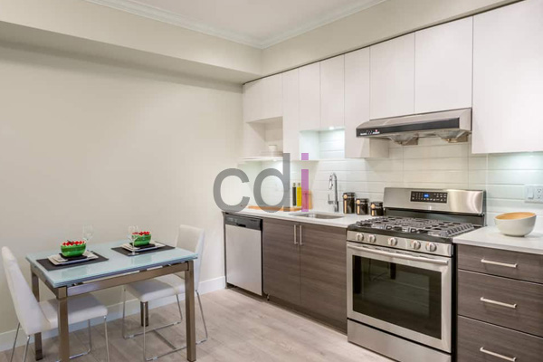

**Harga Furniture Kitchen Set: Pilihan Tepat untuk Dapur Impian Anda** - Mitra CDI yang budiman, apakah Anda sedang merencanakan renovasi dapur atau mendesain dapur baru? Salah satu pertimbangan utama tentu saja adalah biaya, khususnya harga furniture kitchen set yang sesuai dengan anggaran dan kebutuhan Anda.

Memilih furniture kitchen set yang tepat tidak hanya soal estetika, tetapi juga fungsionalitas, durabilitas, dan tentu saja, harga. Banyak faktor yang memengaruhi harga kitchen set, mulai dari material yang digunakan, desain yang dipilih, hingga ukuran dapur Anda. Kami akan membahas secara rinci mengenai faktor-faktor tersebut, estimasi harga, serta bagaimana Creative Design Interior dapat membantu Anda mewujudkan dapur impian tanpa menguras kantong.

## Memahami Faktor Penentu Harga Furniture Kitchen Set

Harga kitchen set bisa sangat bervariasi. Hal ini dipengaruhi oleh beberapa faktor penting yang perlu Anda ketahui. Pertama, **material**. Pilihan material sangat memengaruhi harga. Material seperti multipleks dengan finishing HPL cenderung lebih terjangkau dibandingkan solid wood (kayu solid) seperti kayu jati atau kayu mahoni. Material lain seperti MDF (Medium Density Fiberboard) juga sering digunakan karena harganya yang ekonomis, namun perlu diperhatikan kualitas finishingnya agar tahan lama.

Kedua, **desain dan kompleksitas**. Semakin kompleks desain kitchen set, semakin tinggi biayanya. Kitchen set dengan banyak laci, sudut-sudut yang rumit, atau penggunaan engsel *soft close* akan memerlukan lebih banyak material dan waktu pengerjaan. Desain minimalis cenderung lebih ekonomis dibandingkan desain klasik atau modern yang detail.

Ketiga, **ukuran dapur**. Tentu saja, semakin luas dapur Anda, semakin banyak material yang dibutuhkan, dan semakin tinggi harga kitchen set. Selain luas dapur, tinggi langit-langit dan tata letak ruangan juga memengaruhi harga.

## Estimasi Harga Furniture Kitchen Set di Tahun 2026

Untuk memberikan gambaran, berikut adalah estimasi harga furniture kitchen set berdasarkan material dan ukuran dapur (harga bersifat estimasi dan dapat berubah sewaktu-waktu — hubungi Kami untuk penawaran terbaru dan paling akurat sesuai kebutuhan proyek Mitra CDI):

| Material         | Ukuran Dapur (m²) | Estimasi Harga (Rp) |
|-----------------|-------------------|----------------------|
| Multipleks HPL   | 2x3               | 3.000.000 – 6.000.000 |
| Multipleks HPL   | 3x4               | 6.000.000 – 12.000.000 |
| MDF Finishing    | 2x3               | 4.000.000 – 8.000.000 |
| MDF Finishing    | 3x4               | 8.000.000 – 16.000.000 |
| Kayu Solid (Jati)| 2x3               | 10.000.000 – 20.000.000|
| Kayu Solid (Jati)| 3x4               | 20.000.000 – 40.000.000|

Perlu diingat bahwa harga di atas adalah estimasi kasar. Harga aktual dapat bervariasi tergantung pada detail desain, kualitas material, dan penyedia jasa. Untuk mendapatkan penawaran yang lebih akurat, sebaiknya konsultasikan langsung dengan penyedia jasa desain interior.

## Creative Design Interior: Solusi Kitchen Set Custom Sesuai Anggaran Anda

Creative Design Interior berpengalaman lebih dari 10 tahun dalam menyediakan jasa desain interior, pembuatan furniture custom, dan pengadaan material bangunan di wilayah Jabodetabek. Kami menawarkan solusi kitchen set custom yang disesuaikan dengan kebutuhan, selera, dan anggaran Anda.

Kami menyediakan berbagai pilihan material, mulai dari multipleks HPL, MDF, hingga kayu solid berkualitas tinggi. Tim desain kami akan membantu Anda merancang kitchen set yang fungsional, ergonomis, dan sesuai dengan gaya dapur Anda. Kami juga menawarkan skema harga *all in one* yang sudah termasuk material, pengiriman, dan bongkar muat. Tersedia gratis ongkir untuk wilayah layanan tertentu.

Untuk kemudahan transaksi, Kami menyediakan berbagai pilihan pembayaran: COD, transfer bank, DP 50%, transfer setelah barang terkirim, bayar bertahap, atau transfer setelah pekerjaan selesai. Produk dapat ditukar jika tidak sesuai spesifikasi, selama belum dipakai atau dibongkar dan maksimal 1 hari.

## Dapatkan Penawaran Harga Furniture Kitchen Set Terbaik

Apakah Anda tertarik untuk mengetahui lebih lanjut mengenai harga furniture kitchen set custom dari Creative Design Interior? Kunjungi halaman [daftar harga](/daftar-harga/) untuk melihat daftar harga lengkap dan detail produk Kami. Jangan ragu untuk menghubungi Kami jika Anda memiliki pertanyaan atau ingin berkonsultasi dengan tim ahli Kami.

Membutuhkan bantuan langsung untuk kebutuhan proyek Anda? Silakan klik tombol **WhatsApp** atau **Telepon** di bawah untuk berkonsultasi dengan tim Kami.
