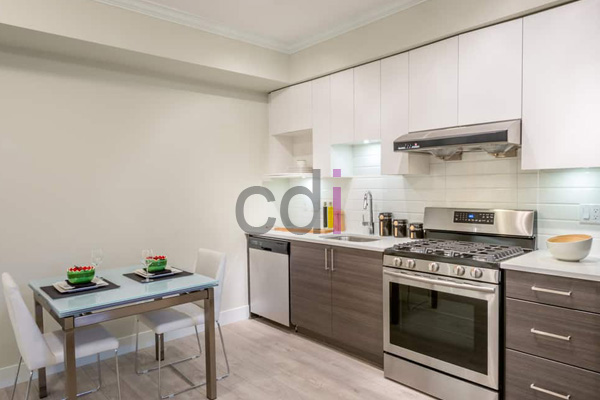

**Harga Furniture Kitchen Set: Pilihan Tepat untuk Dapur Impian Anda** - Hai Mitra CDI! Sedang memikirkan perombakan dapur? Atau mungkin punya ide untuk menciptakan dapur baru yang sesuai gaya Anda? Nah, harga furniture kitchen set pasti jadi pertimbangan penting, kan? Kami akan bantu Anda memahami seluk-beluknya.

Memilih kitchen set yang oke itu bukan cuma soal tampilan. Fungsi, kualitas material, dan—tentunya—harga, semuanya penting. Ada banyak hal yang bisa memengaruhi harga kitchen set, mulai dari bahan yang dipilih, desainnya, sampai ukuran dapur Anda. Di sini, kami akan bedah tuntas faktor-faktor itu, berikan perkiraan harga, dan tunjukkan bagaimana Creative Design Interior bisa mewujudkan dapur impian Anda tanpa bikin dompet jebol.

## Mengulik Faktor-Faktor yang Membentuk Harga Kitchen Set

Harga kitchen set itu dinamis, alias bisa naik turun. Beberapa faktor kunci yang mempengaruhinya antara lain: **material**. Bahan yang digunakan sangat menentukan harga. Misalnya, multipleks dengan finishing HPL biasanya lebih ramah di kantong daripada kayu solid seperti jati atau mahoni. Selain itu, ada MDF (Medium Density Fiberboard) yang cukup ekonomis, tapi penting untuk memastikan finishingnya berkualitas agar awet.

Selanjutnya, ada **desain dan tingkat kerumitan**. Semakin rumit desainnya, biayanya juga akan meningkat. Kitchen set dengan banyak laci, sudut-sudut yang menantang, atau penggunaan engsel *soft close* akan membutuhkan lebih banyak material dan waktu kerja. Desain yang simpel dan minimalis biasanya lebih terjangkau daripada desain yang detail dan rumit.

Terakhir, **ukuran dapur** juga berpengaruh. Semakin luas dapur Anda, semakin banyak material yang dibutuhkan, dan otomatis harganya akan lebih tinggi. Tidak hanya luas, tinggi langit-langit dan tata letak ruangan juga perlu diperhitungkan.

## Perkiraan Harga Furniture Kitchen Set di Tahun 2026

Supaya Anda punya gambaran, berikut perkiraan harga kitchen set berdasarkan material dan ukuran dapur (harga ini bisa berubah sewaktu-waktu, ya! Untuk penawaran paling akurat, hubungi Kami dan konsultasikan kebutuhan proyek Anda di (not detected)):

| Material         | Ukuran Dapur (m²) | Estimasi Harga (Rp) |
|-----------------|-------------------|----------------------|
| Multipleks HPL   | 2x3               | 3.000.000 – 6.000.000 |
| Multipleks HPL   | 3x4               | 6.000.000 – 12.000.000 |
| MDF Finishing    | 2x3               | 4.000.000 – 8.000.000 |
| MDF Finishing    | 3x4               | 8.000.000 – 16.000.000 |
| Kayu Solid (Jati)| 2x3               | 10.000.000 – 20.000.000|
| Kayu Solid (Jati)| 3x4               | 20.000.000 – 40.000.000|

Ingat, harga di atas hanyalah perkiraan. Harga final akan bergantung pada detail desain, kualitas material yang dipilih, dan penyedia jasa yang Anda gunakan. Jadi, sebaiknya konsultasikan langsung dengan ahlinya untuk mendapatkan penawaran yang lebih tepat. Biar lebih mudah, Anda bisa simak juga artikel kami mengenai [Harga Borong Kitchen Set Jabodetabek: Estimasi & Pilihan Terbaik 2026](/blog/harga-borong-kitchen-set/) untuk referensi tambahan.

## Creative Design Interior: Kitchen Set Custom Impian Anda, Kami Wujudkan!

Creative Design Interior sudah berpengalaman lebih dari 10 tahun membantu mewujudkan dapur impian di (not detected) dan sekitarnya. Kami ahli dalam desain interior, pembuatan furniture custom, dan penyediaan material bangunan berkualitas. Kami menawarkan solusi kitchen set custom yang sepenuhnya disesuaikan dengan kebutuhan, selera, dan tentunya, anggaran Anda.

Kami menyediakan berbagai pilihan material terbaik, mulai dari multipleks HPL yang ekonomis, MDF yang fleksibel, hingga kayu solid yang mewah. Tim desainer profesional kami siap membantu Anda merancang kitchen set yang fungsional, ergonomis, dan memukau. Selain itu, kami juga menawarkan skema harga *all in one* yang sudah termasuk material, pengiriman, dan pemasangan. Untuk wilayah tertentu, Kami juga menyediakan layanan gratis ongkos kirim!

Untuk kenyamanan Anda, Kami menyediakan beragam opsi pembayaran: COD, transfer bank, DP 50%, transfer setelah barang diterima, bayar secara bertahap, atau transfer setelah pekerjaan selesai. Jika produk yang Anda terima tidak sesuai dengan spesifikasi, Anda bisa melakukan penukaran, asalkan belum digunakan atau dibongkar dan maksimal dalam 1 hari.

## Yuk, Dapatkan Penawaran Harga Kitchen Set Custom Terbaik!

Tertarik untuk mengetahui lebih lanjut tentang harga furniture kitchen set custom dari Creative Design Interior di (not detected)? Kunjungi halaman daftar harga untuk melihat katalog lengkap dan detail produk Kami. Atau, jika Anda memiliki pertanyaan atau ingin berkonsultasi dengan tim ahli Kami, jangan ragu untuk menghubungi Kami. Anda juga bisa melihat inspirasi desain kitchen set minimalis di [Etalase Rak Piring Minimalis Jabodetabek: Pilihan Tepat untuk Dapur Modern](/blog/etalase-rak-piring-minimalis/) untuk mendapatkan ide.

Jangan tunda lagi! Dapur impian Anda sudah menanti. Klik tombol **WhatsApp** atau **Telepon** di bawah untuk segera berkonsultasi dengan tim Kami dan dapatkan penawaran terbaik! Kami siap membantu Anda mewujudkan kitchen set yang sempurna untuk rumah Anda di (not detected).