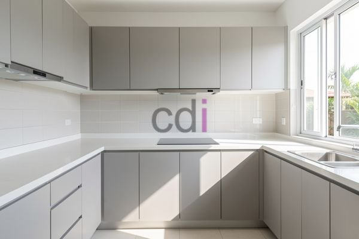

**Harga Kabinet Dapur Aluminium: Panduan Lengkap dan Estimasi Biaya 2026** - Hai Mitra CDI! Ingin mempercantik dapur Anda dengan kabinet aluminium yang modern dan tahan lama? Tentu saja! Artikel ini dirancang khusus untuk membantu Anda memahami seluk-beluk harga kabinet dapur aluminium, mulai dari faktor-faktor yang memengaruhi biaya hingga tips cerdas untuk mendapatkan penawaran terbaik. Yuk, simak penjelasannya!

## Apa Saja yang Mempengaruhi Harga Kabinet Dapur Aluminium?

Sebelum kita membahas angka, penting untuk memahami hal-hal yang bikin harga kabinet aluminium bisa naik turun. Ukuran dan kompleksitas desain dapur Anda adalah faktor utama. Semakin luas area dapur dan semakin rumit desain yang Anda inginkan – misalnya, banyak laci khusus atau sudut yang menantang – biasanya biayanya akan meningkat.

Kualitas material aluminium yang dipilih juga sangat berpengaruh. Ada berbagai jenis profil aluminium dengan ketebalan dan kualitas yang berbeda. Semakin tebal dan berkualitas tinggi profilnya, semakin tahan lama kabinet Anda, tapi tentu saja harganya juga lebih tinggi. Pilihan *finishing* seperti *powder coating* atau anodisasi juga ikut menentukan harga akhir. Jangan lewatkan tips memilih lemari kabinet terbaik untuk investasi jangka panjang yang cerdas.

Aksesori dan fitur tambahan juga berperan penting. Engsel *soft-close*, rel laci berkualitas tinggi, pencahayaan LED internal, dan sistem penyimpanan yang terorganisir akan meningkatkan fungsionalitas dapur Anda, tetapi juga menambah biaya.

## Estimasi Biaya Kabinet Dapur Aluminium Sesuai Ukuran Dapur Anda

Untuk memberi Anda gambaran yang lebih jelas, berikut adalah perkiraan harga kabinet dapur aluminium berdasarkan ukuran dapur. Perlu diingat, ini hanyalah estimasi dan bisa bervariasi tergantung pada detail desain dan material yang dipilih.

| Ukuran Dapur (Panjang x Lebar) | Estimasi Harga (Rp) |
|---|---|
| 2m x 2m | 8.000.000 – 15.000.000 |
| 2m x 3m | 12.000.000 – 22.000.000 |
| 3m x 3m | 18.000.000 – 35.000.000 |
| 3m x 4m | 24.000.000 – 45.000.000 |

Harga di atas belum termasuk biaya pemasangan. Biaya pemasangan umumnya berkisar antara 10% hingga 20% dari total biaya kabinet. Untuk informasi harga terkini dan penawaran khusus di (not detected), hubungi Kami melalui tombol **Telepon** atau **WhatsApp** di bawah.

## Aluminium vs. Material Kabinet Lain: Mana yang Terbaik untuk Anda?

Kabinet dapur aluminium memiliki keunggulan tersendiri dibandingkan material lain seperti kayu atau *particle board*. Aluminium sangat tahan terhadap rayap dan kerusakan akibat air, ringan, dan mudah dibersihkan. Meskipun demikian, tampilan aluminium mungkin tidak sehangat kayu.

Berikut perbandingan singkat antara aluminium, kayu, dan *particle board*:

<table class="table">
  <caption>Perbandingan Material Kabinet Dapur</caption>
  <thead>
    <tr><th>Material</th><th>Kelebihan</th><th>Kekurangan</th><th>Estimasi Harga (per meter lari)</th></tr>
  </thead>
  <tbody>
    <tr><td>Aluminium</td><td>Tahan rayap, tahan air, ringan, mudah dibersihkan</td><td>Kurang hangat secara visual, mungkin lebih mahal</td><td>Rp 800.000 - Rp 2.000.000</td></tr>
    <tr><td>Kayu Solid</td><td>Tampilan alami, kuat, tahan lama</td><td>Rentan terhadap rayap dan kelembapan, perawatan rutin diperlukan, mahal</td><td>Rp 1.500.000 - Rp 5.000.000</td></tr>
    <tr><td>Particle Board</td><td>Murah, mudah dibentuk</td><td>Tidak tahan air, mudah rusak, kurang tahan lama</td><td>Rp 300.000 - Rp 800.000</td></tr>
  </tbody>
</table>

## Tips Pintar Mendapatkan Harga Kabinet Dapur Aluminium Terbaik di (not detected)

Mau hemat dan tetap mendapatkan kabinet aluminium berkualitas? Ikuti tips berikut:

*   **Bandingkan Penawaran:** Dapatkan penawaran dari beberapa vendor di (not detected). Pastikan penawaran mencakup detail material, fabrikasi, pemasangan, dan pengiriman.
*   **Gunakan Jasa Desainer Interior:** Desainer interior berpengalaman bisa membantu Anda merancang kabinet sesuai anggaran dan kebutuhan, sekaligus memberikan rekomendasi material yang tepat.
*   **Negosiasi Harga:** Jangan ragu untuk bernegosiasi, terutama jika Anda memesan dalam jumlah besar.
*   **Perhatikan Promo:** Manfaatkan promo atau diskon yang sedang berlangsung.

Selalu ingat, investasi pada kabinet dapur adalah investasi jangka panjang. Pilih material dan desain yang sesuai dengan kebutuhan Anda dan pastikan Anda mendapatkan penawaran terbaik dari penyedia terpercaya di (not detected). [Yuk, intip juga harga kitchen set aluminium](/blog/harga-kitchen-set-aluminium/) untuk perbandingan lebih lengkap. [Ada juga informasi berguna tentang harga kabinet dapur atas](/blog/harga-kabinet-dapur-atas/) yang mungkin bisa menjadi pertimbangan tambahan!

Tim Kami di (not detected) siap membantu mewujudkan dapur impian Anda. Jangan sungkan untuk menghubungi Kami melalui tombol **Telepon** atau **WhatsApp** di bawah ini.