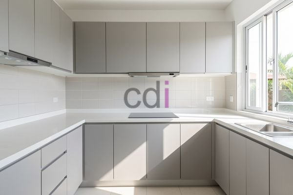

**Tersedia Harga Kabinet Dapur Atas: Estimasi Biaya 2026** - Mitra CDI yang kami hormati, tahukah Anda bahwa rata-rata dapur menghabiskan 30-50% anggaran renovasi rumah? Investasi pada kabinet dapur atas yang tepat akan meningkatkan fungsi dan estetika ruang memasak Anda secara signifikan. Artikel ini akan membahas secara detail mengenai faktor-faktor yang memengaruhi harga kabinet dapur atas dan estimasi biaya yang perlu Anda pertimbangkan.

## Faktor Penentu Harga Kabinet Dapur Atas

Harga kabinet dapur atas ditentukan oleh beberapa faktor utama. Material yang digunakan menjadi penentu harga paling signifikan. Pilihan material mulai dari multiplek dengan finishing HPL, MDF, kayu solid, hingga aluminium. Setiap material memiliki keunggulan dan kekurangan masing-masing, serta rentang harga yang berbeda. Ukuran dan desain kabinet juga berpengaruh. Kabinet dengan desain kompleks atau ukuran yang tidak standar akan membutuhkan lebih banyak material dan waktu pengerjaan, sehingga harganya akan lebih tinggi. 

Selain itu, kualitas hardware (engsel, rel laci, pegangan) juga memengaruhi harga. Hardware berkualitas tinggi akan membuat kabinet lebih awet dan nyaman digunakan. Proses finishing juga berperan penting. Finishing yang rapi dan tahan lama akan menambah nilai estetika dan proteksi kabinet, namun juga meningkatkan biaya. Kami di Creative Design Interior memahami pentingnya kualitas, sehingga Kami hanya menggunakan material dan hardware terbaik untuk memastikan kepuasan Anda. 

## Estimasi Harga Kabinet Dapur Atas Berdasarkan Material

Untuk memberikan gambaran yang lebih jelas, berikut adalah perkiraan harga kabinet dapur atas berdasarkan material (per meter persegi):

<table class="table">
  <caption>Estimasi Harga Kabinet Dapur Atas per Meter Persegi (2026)</caption>
  <thead>
    <tr><th>Material</th><th>Harga (Estimasi)</th><th>Kelebihan</th><th>Kekurangan</th></tr>
  </thead>
  <tbody>
    <tr><td>Multiplek HPL</td><td>Rp 400.000 - Rp 600.000</td><td>Harga terjangkau, banyak pilihan motif</td><td>Kurang tahan terhadap kelembapan, mudah tergores</td></tr>
    <tr><td>MDF</td><td>Rp 500.000 - Rp 800.000</td><td>Permukaan halus, mudah dibentuk</td><td>Tidak tahan air, mudah melengkung jika terkena air</td></tr>
    <tr><td>Kayu Solid (Meranti/Jati)</td><td>Rp 1.200.000 - Rp 2.500.000+</td><td>Kuat, tahan lama, tampilan mewah</td><td>Harga mahal, perawatan rutin diperlukan</td></tr>
    <tr><td>Aluminium</td><td>Rp 700.000 - Rp 1.500.000</td><td>Tahan air, ringan, tidak berkarat</td><td>Pilihan desain terbatas, kurang hangat</td></tr>
  </tbody>
</table>

Harga ini bersifat estimasi dan dapat berubah sewaktu-waktu — hubungi Kami untuk penawaran terbaru dan paling akurat sesuai kebutuhan proyek Mitra CDI. Perlu diingat bahwa harga di atas belum termasuk biaya pemasangan.

## Jasa Pembuatan Kabinet Dapur Atas Custom dari Creative Design Interior

Kami di Creative Design Interior menawarkan jasa pembuatan kabinet dapur atas custom sesuai dengan kebutuhan dan anggaran Anda. Keunggulan memilih layanan Kami adalah fleksibilitas dalam desain, penggunaan material berkualitas, dan pengerjaan yang rapi oleh tim yang berpengalaman. Kami menyediakan skema harga *all in one* yang sudah termasuk material, pengiriman, dan bongkar muat. Anda juga dapat menikmati gratis ongkir untuk wilayah layanan Kami di Jabodetabek dan sekitarnya.

Kami memahami bahwa setiap dapur memiliki karakter dan kebutuhan yang berbeda. Oleh karena itu, Kami menawarkan konsultasi gratis untuk membantu Anda merencanakan desain kabinet dapur atas yang ideal. Dengan pengalaman lebih dari 10 tahun di bidang jasa kitchen set dan pembuatan furniture interior, Kami siap mewujudkan dapur impian Anda. Kabinet yang Kami buat dapat ditukar jika tidak sesuai spesifikasi, selama belum dipakai atau dibongkar dan maksimal 1 hari.

## Kemudahan Pemesanan dan Pembayaran Kabinet Dapur Atas

Kemudahan pemesanan dan pembayaran adalah prioritas Kami. Anda dapat melihat daftar harga lengkap di [halaman Daftar Harga](/daftar-harga/). Kami menerima berbagai pilihan pembayaran, termasuk COD, transfer bank, DP 50%, transfer setelah barang terkirim, bayar bertahap, atau transfer setelah pekerjaan selesai. Tim kerja Kami berpengalaman dengan sistem kerja terjadwal agar pengerjaan tepat waktu dan kualitas terjaga. Jangan ragu untuk berkonsultasi dengan Kami terkait desain, material, dan estimasi biaya. Kami siap membantu Anda dalam setiap langkah.

Untuk konsultasi lebih lanjut, tombol **Telepon** dan **WhatsApp** di bawah halaman ini dapat langsung digunakan untuk menghubungi Kami.
