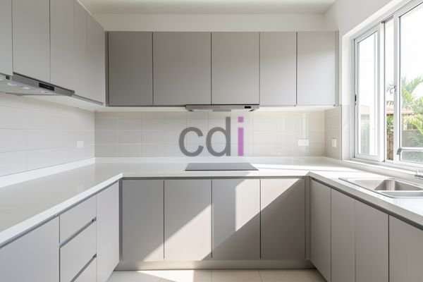

**Tersedia Harga Kabinet Dapur Atas: Estimasi Biaya 2026** - Hai Mitra CDI! Dapur adalah jantung rumah, bukan? Tak heran jika renovasi dapur seringkali jadi prioritas utama. Nah, salah satu elemen penting yang menentukan estetika dan fungsi dapur adalah kabinet atas. Artikel ini akan mengupas tuntas perkiraan biaya kabinet dapur atas di tahun 2026, sekaligus membantu Anda membuat keputusan yang tepat. Mari kita bahas!

## Apa Saja yang Mempengaruhi Harga Kabinet Dapur Atas?

Sebelum membahas angka, penting untuk memahami faktor-faktor yang memengaruhi harga kabinet dapur atas. Pilihan material adalah kunci. Mulai dari multiplek HPL yang ekonomis hingga kayu solid yang mewah, masing-masing memiliki harga dan karakteristik berbeda. Lalu, ukuran dan kompleksitas desain juga berperan. Semakin rumit desainnya, atau semakin banyak kabinet yang dibutuhkan, biaya tentu akan meningkat. 

Kualitas hardware – engsel, rel laci, pegangan – tidak boleh diabaikan. Hardware yang baik menjamin ketahanan dan kenyamanan penggunaan. Proses finishing juga berdampak besar pada tampilan dan daya tahan kabinet. Kami di Creative Design Interior (CDI) selalu mengutamakan kualitas, memastikan setiap produk yang Kami hasilkan tahan lama dan memuaskan Anda.

## Estimasi Harga Kabinet Dapur Atas Berdasarkan Material

Berikut adalah tabel estimasi harga kabinet dapur atas per meter persegi, berdasarkan pilihan material (harga berlaku tahun 2026):

<table class="table">
  <caption>Estimasi Harga Kabinet Dapur Atas per Meter Persegi (2026)</caption>
  <thead>
    <tr><th>Material</th><th>Harga (Estimasi)</th><th>Kelebihan</th><th>Kekurangan</th></tr>
  </thead>
  <tbody>
    <tr><td>Multiplek HPL</td><td>Rp 400.000 - Rp 600.000</td><td>Harga terjangkau, banyak pilihan motif</td><td>Kurang tahan terhadap kelembapan, mudah tergores</td></tr>
    <tr><td>MDF</td><td>Rp 500.000 - Rp 800.000</td><td>Permukaan halus, mudah dibentuk</td><td>Tidak tahan air, mudah melengkung jika terkena air</td></tr>
    <tr><td>Kayu Solid (Meranti/Jati)</td><td>Rp 1.200.000 - Rp 2.500.000+</td><td>Kuat, tahan lama, tampilan mewah</td><td>Harga mahal, perawatan rutin diperlukan</td></tr>
    <tr><td>Aluminium</td><td>Rp 700.000 - Rp 1.500.000</td><td>Tahan air, ringan, tidak berkarat</td><td>Pilihan desain terbatas, kurang hangat</td></tr>
  </tbody>
</table>

Perlu diingat, ini hanyalah estimasi. Biaya sebenarnya dapat bervariasi tergantung pada ukuran, desain, dan detail lainnya. Untuk mendapatkan penawaran paling akurat sesuai dengan kebutuhan Anda di (not detected), hubungi Kami hari ini! Daftar harga lengkap juga tersedia di .

## Mengapa Memilih Jasa Pembuatan Kabinet Dapur Atas Custom dari CDI?

Di Creative Design Interior, Kami menawarkan solusi kabinet dapur atas custom yang dirancang khusus untuk Anda. Bayangkan dapur impian Anda terwujud dengan kabinet yang pas ukurannya, sesuai gaya, dan memaksimalkan ruang yang ada. Kami paham betul bahwa setiap rumah dan selera berbeda.

Yang membuat Kami berbeda? Kami menawarkan fleksibilitas desain, penggunaan material berkualitas, dan hasil pengerjaan yang rapi oleh tim profesional. Kami bahkan menawarkan skema *all-in* yang mencakup material, pengiriman, instalasi, dan biaya bongkar muat.  Sebagai tambahan, Anda bisa menikmati promo gratis ongkir untuk wilayah (not detected) dan sekitarnya.  Kami juga memberikan garansi tukar barang jika tidak sesuai spesifikasi (selama belum dipakai atau dibongkar, maksimal 1 hari).

## Proses Pemesanan dan Pilihan Pembayaran yang Mudah

Pemesanan kabinet dapur atas custom dari CDI sangat mudah. Anda bisa mulai dengan melihat pilihan desain dan harga di halaman Daftar Harga. Kami menyediakan berbagai pilihan pembayaran yang fleksibel — COD, transfer bank, DP 50%, transfer setelah barang terkirim, bayar bertahap, atau transfer setelah pekerjaan selesai.

Tim Kami berkomitmen untuk menyelesaikan proyek tepat waktu dan dengan kualitas terbaik. Jangan ragu untuk berkonsultasi dengan Kami untuk membahas desain, material, dan estimasi biaya. Kami siap membantu Anda merencanakan dapur impian Anda di (not detected) dengan sempurna. Atau, jika Anda ingin melihat inspirasi desain kabinet dapur lainnya yang sudah Kami kerjakan, Anda bisa kunjungi artikel [Harga Kitchen Set Atas: Estimasi Biaya & Pilihan Terbaik 2026](/blog/harga-kitchen-set-atas/).

Untuk informasi lebih lanjut dan konsultasi gratis, gunakan tombol **Telepon** atau **WhatsApp** di bawah ini! Kami siap menjawab semua pertanyaan Anda.