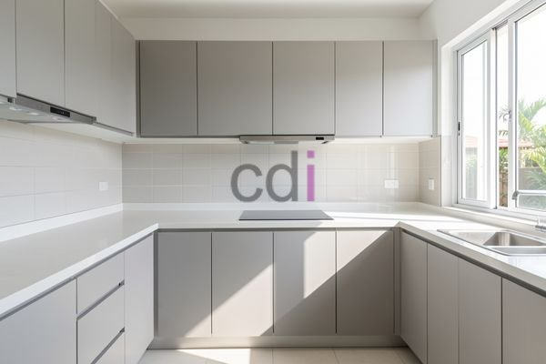

**Berapa Harga Kabinet Dapur Bawah? Estimasi Biaya & Tips Memilih** - Mitra CDI yang budiman, pernahkah Anda membayangkan dapur yang tertata rapi dengan kabinet yang sesuai kebutuhan? Tentu saja, mewujudkan dapur impian ini melibatkan pertimbangan anggaran yang matang. Salah satu komponen penting yang memengaruhi biaya adalah harga kabinet dapur bawah. Banyak yang merasa kesulitan memperkirakan harga yang sesuai dengan kualitas dan desain yang diinginkan.

### Memahami Faktor Penentu Harga Kabinet Dapur Bawah

Harga kabinet dapur bawah tidak bisa ditentukan satu angka pasti. Ada beberapa faktor utama yang memengaruhi biaya produksi dan pemasangan. Pertama, material yang digunakan. Material seperti multipleks yang dilapisi HPL akan memiliki harga yang berbeda dengan material solid surface atau aluminium. Kedua, ukuran dan desain kabinet. Semakin kompleks desain dan semakin banyak jumlah kabinet yang dibutuhkan, tentu saja biayanya akan meningkat. Ketiga, kualitas finishing. Finishing yang baik dengan lapisan anti air dan tahan gores akan menambah biaya, tetapi juga memperpanjang umur pakai kabinet Anda. Kami memahami bahwa setiap kebutuhan berbeda, oleh karena itu Kami menyediakan layanan konsultasi gratis untuk membantu Anda menentukan pilihan yang paling sesuai dengan anggaran dan preferensi Anda.

### Estimasi Harga Kabinet Dapur Bawah Berdasarkan Material

Untuk memberikan gambaran yang lebih jelas, berikut adalah estimasi harga kabinet dapur bawah berdasarkan material yang umum digunakan:

<table class="table">
  <caption>Estimasi Harga Kabinet Dapur Bawah (Per Meter)</caption>
  <thead>
    <tr><th>Material</th><th>Harga (Estimasi)</th><th>Kelebihan</th><th>Kekurangan</th></tr>
  </thead>
  <tbody>
    <tr><td>Multipleks HPL</td><td>Rp 500.000 - Rp 800.000</td><td>Harga relatif terjangkau, pilihan warna dan motif beragam</td><td>Kurang tahan terhadap air dan goresan</td></tr>
    <tr><td>Particle Board Melamin</td><td>Rp 400.000 - Rp 600.000</td><td>Pilihan warna beragam, harga sangat terjangkau</td><td>Tidak tahan air, mudah rusak jika terkena benturan</td></tr>
    <tr><td>Solid Surface</td><td>Rp 1.200.000 - Rp 2.500.000</td><td>Tahan air, mudah dibersihkan, tampilan mewah</td><td>Harga relatif mahal</td></tr>
    <tr><td>Aluminium</td><td>Rp 800.000 - Rp 1.500.000</td><td>Tahan air, tahan korosi, ringan</td><td>Pilihan warna terbatas, harga cukup tinggi</td></tr>
  </tbody>
</table>

Harga ini bersifat estimasi dan dapat berubah sewaktu-waktu — hubungi Kami untuk penawaran terbaru dan paling akurat sesuai kebutuhan proyek Mitra CDI. Perlu diingat bahwa harga tersebut dihitung per meter panjang kabinet.

### Apa yang Kami Siapkan untuk Kabinet Dapur Bawah Impian Anda?

Sebagai perusahaan jasa desain interior dan furniture custom, Kami di Creative Design Interior siap membantu Anda mewujudkan dapur impian Anda. Kami menawarkan layanan pembuatan kabinet dapur bawah custom sesuai dengan ukuran, desain, dan kebutuhan Anda. Selain itu, Kami juga menyediakan berbagai pilihan material berkualitas dengan harga yang kompetitif. Kami menggunakan material yang sudah teruji kekuatannya dan tahan lama, sehingga Anda tidak perlu khawatir soal kualitas. Kami juga memberikan layanan pemasangan yang rapi dan profesional oleh tim yang berpengalaman. Dengan layanan all in one Kami, Anda tidak perlu repot mencari tukang terpisah untuk pemasangan. [Lihat daftar harga lengkap kami di sini](/daftar-harga/).

### Kemudahan Pemesanan dan Pembayaran di Creative Design Interior

Kami memahami bahwa proses pemesanan dan pembayaran yang mudah adalah prioritas bagi Anda. Oleh karena itu, Kami menyediakan berbagai pilihan pembayaran yang fleksibel, termasuk COD, transfer bank, DP 50%, transfer setelah barang terkirim, bayar bertahap, dan transfer setelah pekerjaan selesai. Kami juga melayani pengiriman ke seluruh wilayah Jabodetabek, Bandung, Serang, Purwakarta, Cilegon, Cikampek, Subang, dan Rangkasbitung. Bahkan, Kami menawarkan gratis ongkir untuk area tertentu. Jangan ragu untuk menghubungi Kami melalui tombol **Telepon** atau **WhatsApp** untuk konsultasi gratis dan penawaran terbaik. Tim Kami siap membantu mewujudkan proyek Anda — silakan hubungi melalui tombol **Telepon** atau **WhatsApp** yang tersedia di bawah.
