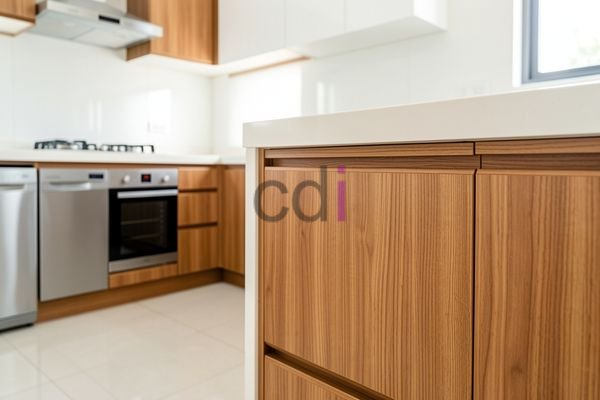

**Harga Kabinet Kitchen Set: Berapa Biaya yang Perlu Anda Siapkan?** - Hai Mitra CDI! Pernahkah Anda membayangkan dapur yang bukan hanya cantik, tapi juga sangat fungsional? Nah, langkah awal untuk mewujudkannya adalah memahami perkiraan biaya kabinet *kitchen set*. Investasi cerdas pada kabinet berkualitas akan membawa manfaat jangka panjang bagi kenyamanan dan estetika dapur Anda. Di artikel ini, Kami akan mengulas detail perkiraan biaya, faktor-faktor yang mempengaruhinya, dan bagaimana Creative Design Interior (CDI) bisa menjadi solusi tepat untuk mewujudkan dapur impian Anda dengan anggaran yang pas di kantong. Yuk, simak bersama!

## Estimasi Harga Kabinet Kitchen Set Berdasarkan Material

Saat membicarakan harga, material kabinet adalah penentu utama. Pilihan material yang berbeda menawarkan keunggulan dan biaya yang bervariasi. Untuk anggaran yang paling hemat, kabinet dari *particle board* atau MDF lapis HPL bisa menjadi solusi, dengan perkiraan harga sekitar Rp 800.000 hingga Rp 1.500.000 per meter lari. Material ini cocok untuk desain minimalis yang simpel dan modern.

Jika menginginkan ketahanan yang sedikit lebih baik, kabinet dengan material *plywood* lapis HPL menawarkan pilihan yang menarik dengan harga berkisar antara Rp 1.200.000 hingga Rp 2.000.000 per meter lari. Sementara itu, untuk sentuhan mewah dan kualitas tahan lama, kabinet dari kayu solid seperti Jati atau Merbau hadir sebagai opsi premium. Harga untuk material kayu solid ini dimulai dari Rp 3.000.000 hingga Rp 6.000.000 per meter lari, bergantung pada jenis kayu dan finishing yang dipilih. Perlu diingat bahwa harga-harga ini hanyalah estimasi awal dan bisa berubah sewaktu-waktu. Hubungi Kami untuk mendapatkan penawaran harga terbaru yang paling sesuai dengan kebutuhan proyek Anda di (not detected).

## Apa Saja yang Memengaruhi Harga Kabinet Kitchen Set?

Selain jenis material, ada beberapa faktor lain yang turut memengaruhi harga akhir kabinet *kitchen set*. Semakin rumit desain kabinet, misalnya dengan banyak laci, rak khusus, atau detail ukiran, akan membutuhkan proses pembuatan yang lebih intensif dan tentu saja, biaya yang lebih tinggi. Ukuran dapur juga menjadi pertimbangan penting. Semakin luas dapur, semakin banyak kabinet yang dibutuhkan, dan konsekuensinya adalah total biaya yang lebih besar.

Finishing kabinet juga berperan dalam menentukan harga. Pilihan seperti *melamine* cenderung lebih ekonomis dibandingkan dengan cat duco yang memberikan tampilan mewah dan daya tahan lebih baik, tetapi dengan harga yang lebih tinggi. Jangan lupakan juga biaya tambahan seperti pemasangan, pengiriman, dan biaya desain. Mempertimbangkan semua aspek ini secara matang akan membantu Anda membuat keputusan yang tepat dan menghindari biaya tak terduga.

## Creative Design Interior: Sahabat Terbaik untuk Dapur Impian Anda

Di Creative Design Interior, Kami memahami betul bahwa setiap dapur unik dan memiliki kebutuhan yang berbeda. Itulah mengapa Kami hadir dengan layanan custom *kitchen set* yang fleksibel dan terjangkau, dengan beragam pilihan material mulai dari *particle board* hingga kayu solid. Kami menawarkan solusi *all in one* yang mencakup material, desain, pembuatan, pengiriman, dan pemasangan. Dengan demikian, Anda tidak perlu repot mengurus detail teknis dan bisa fokus sepenuhnya pada mewujudkan dapur impian Anda.

Tim Kami yang berpengalaman bekerja dengan sistem terjadwal, memastikan pengerjaan tepat waktu dan kualitas terjamin. Kami juga memberikan jaminan kualitas produk. Produk Kami dapat ditukar jika tidak sesuai spesifikasi, dengan ketentuan belum dipakai atau dibongkar dan maksimal 1 hari sejak diterima. Pilihan pembayaran yang Kami sediakan pun beragam, termasuk COD, transfer bank, DP 50%, transfer setelah barang terkirim, bayar bertahap, atau transfer setelah pekerjaan selesai — semuanya dirancang untuk memudahkan Anda dalam mengatur anggaran. Untuk gambaran biaya, Anda bisa mengunjungi Daftar Harga. Atau, konsultasikan langsung desain dapur Anda dengan tim Kami untuk mendapatkan penawaran khusus.

## Maksimalkan Anggaran Anda dengan Kabinet Kitchen Set Custom di (not detected)

Memilih kabinet *kitchen set* custom dari Creative Design Interior memungkinkan Anda memaksimalkan anggaran dan mendapatkan dapur yang benar-benar sesuai dengan kebutuhan dan gaya Anda. Kami akan membantu Anda memilih material yang paling sesuai dengan anggaran dan desain yang diinginkan, serta memberikan saran desain cerdas untuk mengoptimalkan ruang dan fungsi dapur Anda. Dengan layanan custom, Anda tidak perlu membayar untuk fitur atau ukuran kabinet standar yang tidak sesuai kebutuhan. Kami dengan senang hati melayani proyek di Jakarta, Bogor, Depok, Tangerang, Bekasi, Cikarang, Karawang, Bandung, Serang, Purwakarta, Cilegon, Cikampek, Subang, dan Rangkasbitung, memastikan layanan Kami mudah dijangkau di seluruh Jabodetabek dan sekitarnya, termasuk di (not detected).

Butuh bantuan lebih lanjut untuk mewujudkan dapur impian di (not detected)? Jangan sungkan untuk klik tombol **WhatsApp** atau **Telepon** di bawah untuk berkonsultasi langsung dengan tim ahli Kami. Kami siap membantu!