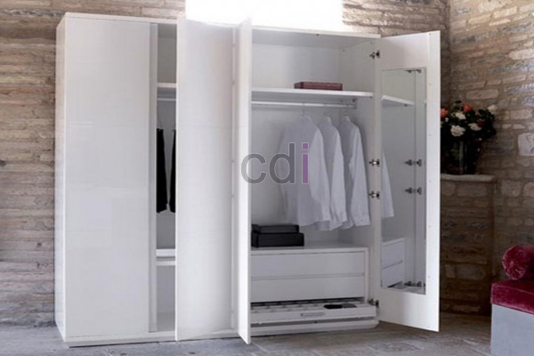

**Harga Kaca Lemari Pakaian: Estimasi Biaya & Pilihan Material 2026** - Mitra CDI yang budiman, pemilihan kaca untuk lemari pakaian bukan sekadar urusan estetika, melainkan juga menyangkut keamanan, ketahanan, dan tentu saja, anggaran. Pada tahun 2026, tren desain interior semakin menekankan fungsionalitas dan fleksibilitas, dan pemilihan kaca yang tepat menjadi kunci untuk mencapai keduanya. Kaca lemari pakaian yang berkualitas dapat meningkatkan nilai visual lemari Anda sekaligus menjamin keamanan barang-barang di dalamnya.

## Memahami Jenis-Jenis Kaca Lemari Pakaian & Harganya

Ada beberapa jenis kaca yang umum digunakan untuk lemari pakaian, masing-masing dengan karakteristik dan harga yang berbeda. Kaca bening adalah pilihan paling umum karena memberikan tampilan yang bersih dan minim gangguan visual. Kaca ini relatif terjangkau, dengan harga mulai dari Rp 80.000 hingga Rp 150.000 per meter persegi, tergantung ketebalan. Namun, kaca bening rentan pecah dan dapat berbahaya jika terkena benturan keras.

Sebagai alternatif yang lebih aman, kaca tempered menjadi pilihan populer. Kaca tempered memiliki kekuatan 5 kali lebih besar dari kaca biasa dan pecah menjadi butiran-butiran kecil yang tidak tajam, sehingga mengurangi risiko cedera. Harga kaca tempered berkisar antara Rp 180.000 hingga Rp 300.000 per meter persegi. Selain keamanan, kaca tempered juga tahan terhadap perubahan suhu ekstrem.

Pilihan lain adalah kaca reflektif, yang memberikan efek cermin dan menciptakan ilusi ruangan yang lebih luas. Kaca ini cocok untuk lemari pakaian di kamar tidur karena dapat membantu memaksimalkan pencahayaan dan memberikan kesan mewah. Harga kaca reflektif umumnya lebih mahal, yaitu antara Rp 250.000 hingga Rp 400.000 per meter persegi. Kami di Creative Design Interior menyediakan berbagai pilihan kaca berkualitas untuk menyesuaikan dengan kebutuhan dan anggaran Anda.

## Faktor-Faktor yang Mempengaruhi Harga Kaca Lemari Pakaian

Harga kaca lemari pakaian tidak hanya ditentukan oleh jenisnya, tetapi juga oleh beberapa faktor lain. Ketebalan kaca merupakan salah satu faktor utama. Kaca yang lebih tebal tentu lebih kuat dan tahan lama, tetapi juga lebih mahal. Umumnya, ketebalan kaca yang direkomendasikan untuk lemari pakaian adalah antara 3 mm hingga 6 mm.

Ukuran lemari juga berpengaruh terhadap harga. Semakin besar ukuran lemari, semakin banyak kaca yang dibutuhkan, dan semakin tinggi biayanya. Selain itu, proses pemasangan kaca juga dapat menambah biaya, terutama jika lemari memiliki desain yang rumit atau membutuhkan pemotongan kaca yang presisi.

Perlu diingat bahwa harga kaca dapat bervariasi tergantung pada lokasi geografis dan pemasok. Kami di Creative Design Interior berkomitmen untuk memberikan harga yang transparan dan kompetitif kepada pelanggan kami. Untuk mendapatkan penawaran terbaik, Anda dapat menghubungi Kami melalui tombol **Telepon** atau **WhatsApp** di bawah halaman ini.

## Solusi Custom Kaca Lemari Pakaian dari Creative Design Interior

Kami menawarkan solusi *custom* untuk memenuhi kebutuhan spesifik Anda. Kami memahami bahwa setiap rumah memiliki karakter dan gaya yang unik. Oleh karena itu, Kami menyediakan berbagai pilihan kaca, termasuk kaca bening, kaca tempered, kaca reflektif, dan kaca *frosted*, dengan berbagai ketebalan dan ukuran.

Layanan *all in one* Kami mencakup pengadaan material, pemotongan kaca sesuai desain Anda, dan pemasangan yang profesional. Skema harga Kami sudah termasuk material, pengiriman, dan bongkar muat, sehingga Anda tidak perlu khawatir tentang biaya tersembunyi. Kami juga menawarkan gratis ongkir untuk wilayah layanan Jabodetabek, Bandung, Serang, Purwakarta, Cilegon, Cikampek, Subang, dan Rangkasbitung.

Untuk memudahkan Anda dalam menentukan anggaran, Kami menyediakan daftar harga lengkap di halaman [Daftar Harga](/daftar-harga/). Kami juga menyediakan berbagai pilihan pembayaran, termasuk COD, transfer bank, DP 50%, transfer setelah barang terkirim, bayar bertahap, atau transfer setelah pekerjaan selesai. Tim kerja Kami yang berpengalaman akan memastikan bahwa pengerjaan lemari pakaian Anda tepat waktu dan berkualitas tinggi. Produk dapat ditukar jika tidak sesuai spesifikasi, selama belum dipakai atau dibongkar dan maksimal 1 hari.

Apabila terdapat pertanyaan lain seputar topik ini, tombol **Telepon** dan **WhatsApp** di bawah halaman ini siap Kami jawab.
