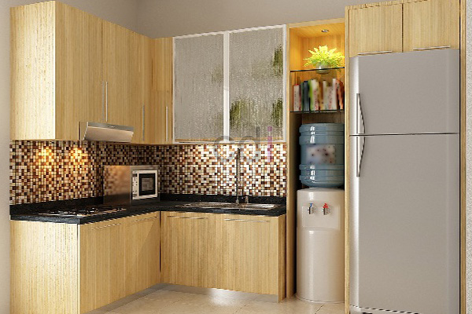

**Harga Kitchen Set Aluminium: Panduan Lengkap dan Estimasi Biaya 2026** - Hai Mitra CDI! Lagi mempertimbangkan mempercantik dapur dengan kitchen set aluminium? Nah, Anda datang ke tempat yang tepat! Artikel ini akan mengulas tuntas soal harga, keunggulan, dan faktor-faktor yang memengaruhi biaya pembuatan kitchen set aluminium. Yuk, simak selengkapnya!

## Kenapa Kitchen Set Aluminium Jadi Pilihan Utama?

Banyak yang melirik kitchen set aluminium karena sejumlah alasan yang menarik. Selain tampilannya yang modern dan minimalis, material ini ringan, kuat, dan tentu saja, tahan karat. Anda tak perlu khawatir lagi soal rayap atau kerusakan akibat lembap seperti yang sering terjadi pada kitchen set kayu.  Aluminium juga mudah sekali dibersihkan, lho!

Desainnya pun fleksibel, bisa dipadukan dengan berbagai gaya interior. Pilihan warna dan *finishing* juga beragam – mulai dari yang netral seperti putih dan abu-abu, hingga warna-warna cerah yang bisa bikin dapur Anda makin hidup. Material ini juga serasi dipadukan dengan *HPL* (High-Pressure Laminate) atau *backsplash* keramik favorit Anda.

## Kisaran Harga Kitchen Set Aluminium Per Meter Persegi

Sebagai gambaran awal, berikut perkiraan harga kitchen set aluminium per meter persegi di wilayah (not detected) pada tahun 2026:

*   **Kitchen Set Aluminium Sederhana (Rangka Aluminium Hollow, Pintu HPL):** Mulai dari Rp 2.500.000 hingga Rp 3.500.000 per meter persegi.
*   **Kitchen Set Aluminium Standar (Rangka Aluminium Hollow, Pintu Melamik/PVC):** Berkisar antara Rp 3.500.000 – Rp 4.500.000 per meter persegi.
*   **Kitchen Set Aluminium Premium (Rangka Aluminium Profile, Pintu Aluminium Composite Panel/ACP):** Dengan harga Rp 4.500.000 – Rp 7.000.000 per meter persegi.

Perlu diingat, harga ini hanya estimasi ya, Mitra. Untuk penawaran paling akurat sesuai dengan skala dan desain proyek Anda, silakan hubungi Kami.  Biaya pemasangan biasanya dihitung terpisah.

## Apa Saja yang Memengaruhi Harga Kitchen Set Aluminium?

Ada beberapa hal penting yang bisa bikin harga kitchen set aluminium naik atau turun:

*   **Ukuran & Desain:** Ukuran dapur dan kerumitan desain tentu saja berpengaruh. Semakin besar dan kompleks, semakin tinggi biayanya.
*   **Jenis Aluminium:** Jenis aluminium yang digunakan juga penting. Aluminium *profile* umumnya lebih mahal daripada aluminium *hollow*.
*   **Material Pintu & Finishing:** Pilihan material pintu (HPL, melamik, ACP) dan jenis *finishing* (powder coating, anodizing) akan sangat menentukan harga.
*   **Aksesori Tambahan:** Mau menambahkan fitur-fitur keren seperti *soft close hinge*, laci *blum*, lampu LED, atau *rak piring*? Siap-siap ada tambahan biaya ya.
*   **Lokasi & Jasa Pemasangan:** Biaya pemasangan bisa berbeda-beda, tergantung lokasi di (not detected) dan juga reputasi penyedia jasa.

## Kitchen Set Aluminium vs. Material Lain: Mana yang Terbaik?

Bingung milih antara aluminium, kayu, atau stainless steel?  Berikut ini perbandingan singkatnya:

<table class="table">
  <caption>Perbandingan Material Kitchen Set</caption>
  <thead>
    <tr><th>Material</th><th>Kelebihan</th><th>Kekurangan</th><th>Estimasi Harga (per m²)</th></tr>
  </thead>
  <tbody>
    <tr><td>Aluminium</td><td>Tahan karat, ringan, mudah dibersihkan, tampilan modern</td><td>Kurang tahan terhadap benturan keras, pilihan desain terbatas</td><td>Rp 2.500.000 – Rp 7.000.000</td></tr>
    <tr><td>Kayu Solid</td><td>Tampilan alami, kuat, tahan lama</td><td>Rentan terhadap rayap dan kelembapan, perawatan intensif, harga mahal</td><td>Rp 5.000.000 – Rp 15.000.000</td></tr>
    <tr><td>Stainless Steel</td><td>Sangat tahan lama, higienis, tampilan modern</td><td>Harga mahal, rentan terhadap goresan, perawatan khusus</td><td>Rp 6.000.000 – Rp 10.000.000</td></tr>
    <tr><td>HPL (Multipleks)</td><td>Pilihan warna dan motif beragam, harga terjangkau</td><td>Tidak tahan air, mudah tergores, kurang tahan lama</td><td>Rp 1.500.000 – Rp 3.000.000</td></tr>
  </tbody>
</table>

Dengan mempertimbangkan kelebihan dan kekurangan masing-masing, Anda bisa memilih kitchen set yang paling pas dengan kebutuhan dan budget Anda. Kalau Anda mencari solusi yang awet, mudah dirawat, dan bergaya modern, kitchen set aluminium adalah pilihan yang cerdas.  Jangan lupa, Anda juga bisa melihat inspirasi desain kitchen set custom di (not detected) di sini.

Tim Kami siap mendengarkan kebutuhan Anda dan mewujudkan dapur impian Anda! Hubungi Kami sekarang juga melalui tombol **Telepon** atau **WhatsApp** di bawah ini.  Kami akan berikan penawaran terbaik untuk proyek Anda di (not detected).