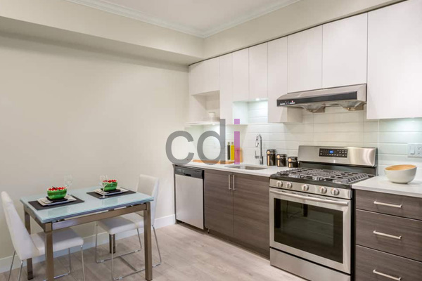

**Harga Kitchen Set Atas: Estimasi Biaya & Pilihan Terbaik 2026** - Mitra CDI, memahami perkiraan biaya untuk kitchen set atas merupakan langkah awal yang krusial sebelum memulai renovasi dapur. Kitchen set atas tidak hanya meningkatkan fungsionalitas dapur, tetapi juga memberikan estetika yang menarik. Kami menyediakan solusi custom kitchen set atas yang dapat disesuaikan dengan kebutuhan dan anggaran Mitra CDI.

## Estimasi Harga Kitchen Set Atas Berdasarkan Material

Harga kitchen set atas sangat dipengaruhi oleh material yang digunakan. Material yang berbeda menawarkan tingkat durabilitas, tampilan estetika, dan tentu saja, harga yang berbeda pula. Secara umum, material yang sering digunakan antara lain multipleks, MDF (Medium Density Fiberboard), particle board, dan kayu solid.

Multipleks merupakan pilihan populer karena kekuatannya yang baik dan relatif terjangkau. Estimasi harga kitchen set atas berbahan multipleks dengan finishing HPL (High Pressure Laminate) berkisar antara Rp 800.000 hingga Rp 1.500.000 per meter lari. MDF menawarkan permukaan yang lebih halus dan cocok untuk finishing cat duco, namun kurang tahan terhadap kelembaban. Harga kitchen set atas berbahan MDF dengan finishing cat duco berkisar antara Rp 1.200.000 hingga Rp 2.000.000 per meter lari. Particle board adalah pilihan yang paling ekonomis, namun kurang tahan lama. Harga kitchen set atas berbahan particle board dengan finishing melamin berkisar antara Rp 500.000 hingga Rp 800.000 per meter lari. Sementara itu, kayu solid menawarkan kualitas dan keindahan alami, tetapi juga merupakan pilihan yang paling mahal. Harga kitchen set atas berbahan kayu solid berkisar antara Rp 2.500.000 hingga Rp 5.000.000 per meter lari, tergantung jenis kayu yang digunakan.

Harga ini bersifat estimasi dan dapat berubah sewaktu-waktu — hubungi Kami untuk penawaran terbaru dan paling akurat sesuai kebutuhan proyek Mitra CDI.

## Faktor Lain yang Mempengaruhi Harga Kitchen Set Atas

Selain material, terdapat beberapa faktor lain yang dapat mempengaruhi harga kitchen set atas. Ukuran dan kompleksitas desain merupakan faktor utama. Kitchen set atas dengan desain yang rumit dan banyak detail akan membutuhkan waktu dan tenaga kerja yang lebih banyak, sehingga harganya akan lebih tinggi.

Kualitas hardware (engsel, rel, handle) juga berperan penting. Hardware yang berkualitas baik akan memastikan kitchen set atas tahan lama dan berfungsi dengan baik. Pilihan finishing juga mempengaruhi harga. Finishing cat duco cenderung lebih mahal daripada finishing HPL atau melamin.

Ketersediaan akses ke lokasi pemasangan juga dapat mempengaruhi biaya pengiriman dan pemasangan. Kami melayani pemasangan di wilayah Jakarta, Bogor, Depok, Tangerang, Bekasi, Cikarang, Karawang, Bandung, Serang, Purwakarta, Cilegon, Cikampek, Subang, dan Rangkasbitung. Dengan pengalaman lebih dari 10 tahun, Kami dapat memberikan rekomendasi material dan desain yang paling sesuai dengan anggaran dan kebutuhan Mitra CDI.

## Skema Harga All-In-One dari Creative Design Interior

Kami di Creative Design Interior memahami bahwa Mitra CDI menginginkan kepastian harga tanpa biaya tersembunyi. Oleh karena itu, Kami menawarkan skema harga *all-in-one* yang sudah termasuk material, pengiriman, dan bongkar muat. Skema ini memberikan transparansi dan kemudahan dalam perencanaan anggaran.

Kami juga menyediakan berbagai pilihan pembayaran yang fleksibel, termasuk COD, transfer bank, DP 50%, transfer setelah barang terkirim, bayar bertahap, atau transfer setelah pekerjaan selesai. Kami juga menawarkan gratis ongkir (dengan ketentuan yang berlaku). Tim kerja berpengalaman Kami bekerja dengan sistem terjadwal agar pengerjaan tepat waktu dan kualitas terjaga.

## Konsultasi dan Pemesanan Kitchen Set Atas Custom

Setelah memahami perkiraan harga dan faktor-faktor yang mempengaruhinya, Mitra CDI dapat berkonsultasi dengan tim desain Kami untuk mendapatkan desain kitchen set atas yang sesuai dengan kebutuhan dan selera. Kami menawarkan layanan custom kitchen set atas yang dapat disesuaikan dengan ukuran, bentuk, dan gaya dapur Mitra CDI. 

Untuk mendapatkan daftar harga yang lebih rinci, Mitra CDI dapat mengunjungi halaman [Daftar Harga](/daftar-harga/). Kami siap membantu Mitra CDI mewujudkan dapur impian dengan kitchen set atas berkualitas tinggi dan harga yang kompetitif. Jangan ragu untuk menghubungi Kami melalui tombol **Telepon** dan **WhatsApp** di bawah halaman ini untuk mendapatkan penawaran terbaik.

Apabila terdapat pertanyaan lain seputar topik ini, tombol **Telepon** dan **WhatsApp** di bawah halaman ini siap Kami jawab.
