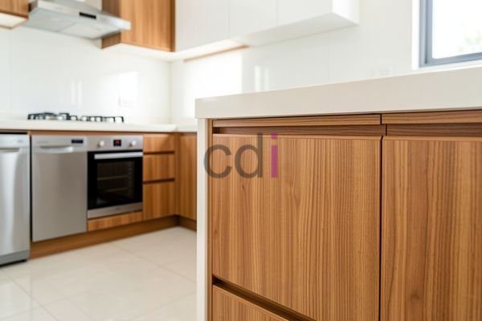

**Harga Kitchen Set Bawah: Estimasi Biaya & Tips Pemilihan** - Hai Mitra CDI! Renovasi dapur? Pikiran pertama mungkin soal biaya, ya? Nah, kitchen set bawah itu bagian penting yang menentukan tampilan dan fungsi dapur. Memilih yang tepat bukan cuma soal cantik, tapi juga kenyamanan saat memasak. Yuk, kita bahas estimasi biayanya!

## Estimasi Harga Kitchen Set Bawah Berdasarkan Material

Pertimbangan pertama yang perlu dipikirkan adalah material. Harga kitchen set bawah sangat dipengaruhi oleh jenis material yang digunakan. Setiap material punya kelebihan dan kekurangan, serta harga yang berbeda-beda. Ini beberapa pilihan yang umum:

*   **Multipleks (MDF/HPL):** Pilihan ekonomis dan banyak disukai. Kitchen set bawah berbahan multipleks dengan lapisan HPL (High-Pressure Laminate) biasanya harganya terjangkau, mulai dari Rp 800.000 hingga Rp 1.500.000 per meter lari. Kuat menahan goresan dan mudah dibersihkan, jadi praktis banget untuk sehari-hari. Tapi, perlu diingat, material ini kurang tahan lembap dibandingkan yang lain.
*   **Kayu Solid:** Mau tampilan alami dan awet? Kayu solid adalah jawabannya. Material ini menawarkan kekuatan dan keindahan yang tak tertandingi, meskipun harganya memang lebih tinggi. Harga kitchen set bawah berbahan kayu solid berkisar antara Rp 2.000.000 hingga Rp 5.000.000 per meter lari, bergantung jenis kayunya (misalnya jati, mahoni, atau merbau).
*   **Aluminium:** Kitchen set bawah berbahan aluminium menawarkan daya tahan tinggi dan anti karat. Cocok untuk dapur yang lembap. Harga kitchen set bawah aluminium biasanya berkisar antara Rp 1.200.000 hingga Rp 2.500.000 per meter lari.

Perlu diingat, harga ini bersifat estimasi dan bisa berubah sewaktu-waktu. Untuk penawaran terbaru dan paling akurat sesuai kebutuhan proyek Mitra CDI di (not detected), silakan hubungi Kami.

## Faktor-Faktor Lain yang Mempengaruhi Harga Kitchen Set Bawah

Selain material, ada beberapa hal lain yang memengaruhi harga kitchen set bawah. Pertimbangkan hal-hal ini agar anggaran Mitra bisa dialokasikan dengan efektif:

*   **Ukuran dan Desain:** Semakin kompleks desainnya dan semakin besar ukurannya, semakin tinggi biayanya. Desain custom dengan banyak detail atau fitur khusus tentu lebih mahal dari desain standar.
*   **Aksesori dan Perlengkapan:** Pemasangan aksesori tambahan seperti engsel *soft close*, laci *telescopic*, dan lampu LED akan menambah biaya. Tapi, aksesori ini justru meningkatkan fungsi dan kenyamanan kitchen set Mitra CDI.
*   **Finishing:** Pilihan *finishing* (misalnya *lacquer*, *melamine*, atau *veneer*) juga memengaruhi harga. *Finishing* yang mewah dan tahan lama biasanya lebih mahal.

## Creative Design Interior: Mitra Terbaik untuk Kitchen Set Bawah di (not detected)

Kami di Creative Design Interior sudah berpengalaman lebih dari 10 tahun dalam mendesain interior, membuat furniture custom, dan menyediakan material bangunan. Kami menawarkan solusi kitchen set bawah yang bisa disesuaikan dengan kebutuhan dan anggaran Mitra CDI. Kami sediakan skema harga *all in one* yang sudah termasuk material, ongkir, dan bongkar muat. Oh ya, kami juga menawarkan gratis ongkir untuk wilayah tertentu di (not detected)!

Untuk kemudahan Mitra, Kami menyediakan beragam pilihan pembayaran: COD, transfer bank, DP 50%, transfer setelah barang terkirim, bayar bertahap, atau transfer setelah pekerjaan selesai. Dengan begitu, Mitra CDI bisa mengatur pembayaran sesuai kemampuan finansial.

## Konsultasi dan Pemesanan Kitchen Set Bawah Impian Mitra

Tertarik untuk tahu lebih banyak tentang layanan Kami? Kunjungi halaman Daftar Harga untuk informasi lebih detail. Tim Kami yang berpengalaman siap membantu Mitra CDI merancang dan mewujudkan kitchen set bawah impian Mitra. [Biaya Bikin Kitchen Set: Estimasi, Material, dan Tips Hemat di Jabodetabek](/blog/biaya-bikin-kitchen-set/) bisa jadi referensi tambahan.

Jangan ragu menghubungi Kami melalui tombol **WhatsApp** atau **Telepon** pada halaman ini, ya! Kami siap menjawab pertanyaan Mitra.