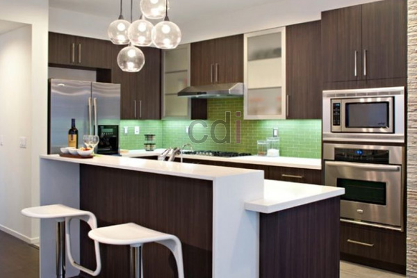

**Harga Kitchen Set Dekoruma Jabodetabek: Estimasi & Pilihan Terbaik 2026** - Mitra CDI yang budiman, seringkali ketika merencanakan renovasi dapur, pertanyaan mengenai biaya menjadi pertimbangan utama. Banyak Mitra CDI yang langsung mencari referensi harga kitchen set Dekoruma sebagai gambaran awal. Namun, perlu diingat bahwa harga kitchen set Dekoruma hanyalah salah satu opsi, dan seringkali tidak mencerminkan fleksibilitas desain yang diinginkan. Kami memahami bahwa setiap dapur memiliki karakteristik unik dan kebutuhan yang berbeda, sehingga solusi custom seringkali menjadi pilihan yang lebih tepat.

## Estimasi Harga Kitchen Set Dekoruma dan Perbandingannya dengan Custom

Bagi banyak Mitra, kitchen set Dekoruma menawarkan kemudahan dalam pemesanan dan kepastian harga. Akan tetapi, penting untuk memahami ruang lingkup yang ditawarkan. Harga kitchen set Dekoruma umumnya bersifat standar dan kurang mengakomodasi perubahan desain signifikan. Estimasi harga kitchen set Dekoruma dapat bervariasi tergantung pada ukuran dapur, material yang digunakan, dan fitur tambahan yang dipilih. Secara umum, biaya dapat berkisar antara Rp 2.500.000 hingga Rp 8.000.000 per meter persegi. Angka ini bersifat estimasi dan dapat berubah sewaktu-waktu — hubungi Kami untuk penawaran terbaru dan paling akurat sesuai kebutuhan proyek Mitra CDI.

Sebagai perbandingan, kitchen set custom dari Creative Design Interior menawarkan keunggulan dalam hal fleksibilitas desain dan kualitas material. Kami menyediakan berbagai pilihan material, mulai dari MDF, multipleks, hingga kayu solid, yang dapat disesuaikan dengan anggaran dan preferensi Mitra. Dengan kitchen set custom, Mitra CDI mendapatkan desain yang benar-benar sesuai dengan kebutuhan dan gaya dapur impian. Selain itu, Kami juga memberikan garansi pada setiap produk yang Kami hasilkan. 

## Keuntungan Memilih Kitchen Set Custom dari Creative Design Interior

Salah satu keuntungan utama memilih kitchen set custom adalah kemampuan untuk memaksimalkan ruang yang tersedia. Kami akan melakukan survei lokasi secara langsung untuk mengukur dimensi dapur dan memberikan rekomendasi desain yang paling optimal. Dengan desain yang tepat, Mitra CDI dapat memanfaatkan setiap sudut ruangan untuk penyimpanan dan area kerja yang efisien.

Selain itu, Kami juga menawarkan skema harga *all in one* yang mencakup material, pengiriman, dan bongkar muat. Hal ini memberikan kemudahan dan transparansi biaya bagi Mitra CDI. Kami juga melayani wilayah Jakarta, Bogor, Depok, Tangerang, Bekasi, Cikarang, Karawang, Bandung, Serang, Purwakarta, Cilegon, Cikampek, Subang, dan Rangkasbitung. Untuk memudahkan Mitra, Kami menyediakan berbagai pilihan pembayaran, termasuk COD, transfer bank, DP 50%, transfer setelah barang terkirim, bayar bertahap, atau transfer setelah pekerjaan selesai.

## Material Kitchen Set: Pilihan dan Perbandingannya

Memilih material yang tepat sangat penting dalam menentukan kualitas dan daya tahan kitchen set. Berikut adalah tabel perbandingan beberapa material kitchen set yang umum digunakan:

<table class="table">
  <caption>Perbandingan Material Kitchen Set</caption>
  <thead>
    <tr><th>Material</th><th>Kelebihan</th><th>Kekurangan</th><th>Estimasi Harga per Meter (Rp)</th></tr>
  </thead>
  <tbody>
    <tr><td>MDF (Medium Density Fiberboard)</td><td>Harga terjangkau, mudah dibentuk, permukaan halus</td><td>Kurang tahan air, mudah rusak jika terkena benturan</td><td>500.000 - 1.500.000</td></tr>
    <tr><td>Multipleks</td><td>Lebih kuat dari MDF, tahan terhadap kelembaban</td><td>Harga lebih mahal dari MDF, perlu dilapisi finishing yang baik</td><td>1.000.000 - 2.500.000</td></tr>
    <tr><td>Kayu Solid</td><td>Tahan lama, tampilan alami, kuat</td><td>Harga paling mahal, membutuhkan perawatan khusus</td><td>3.000.000 - 8.000.000+</td></tr>
  </tbody>
</table>

Perlu diingat bahwa estimasi harga di atas bersifat fleksibel dan dapat berubah sesuai dengan tingkat kesulitan desain dan finishing yang dipilih. Kami di Creative Design Interior siap membantu Mitra CDI dalam memilih material yang paling sesuai dengan anggaran dan kebutuhan. Untuk informasi lebih detail mengenai daftar harga, Mitra CDI dapat mengunjungi halaman [Daftar Harga](/daftar-harga/).

## Konsultasi Gratis dan Pemesanan Kitchen Set Impian Mitra

Kami memahami bahwa memilih kitchen set yang tepat membutuhkan pertimbangan matang. Oleh karena itu, Kami menawarkan layanan konsultasi gratis dengan tim desain interior Kami yang berpengalaman. Kami akan mendengarkan kebutuhan Mitra CDI, memberikan rekomendasi desain yang optimal, dan menghitung estimasi biaya secara akurat.

Jangan ragu untuk menghubungi Kami melalui tombol **Telepon** atau **WhatsApp** di bawah halaman ini untuk mendapatkan penawaran terbaik dan mewujudkan dapur impian Mitra CDI. Apabila terdapat pertanyaan lain seputar topik ini, tombol **Telepon** dan **WhatsApp** di bawah halaman ini siap Kami jawab.
