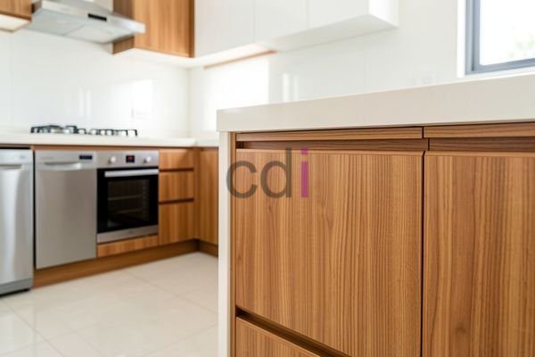

**Harga Kitchen Set Duco: Berapa Biaya yang Perlu Anda Siapkan?** - Mitra CDI di mana pun berada, pernahkah Mitra merasa bingung saat ingin memperbarui tampilan dapur? Memilih desain, material, hingga memperkirakan biaya seringkali menjadi tantangan tersendiri. Kitchen set duco, dengan tampilan elegan dan modernnya, menjadi pilihan populer. Namun, berapa sebenarnya harga yang perlu disiapkan untuk mewujudkan dapur impian dengan kitchen set duco? Kami akan membahasnya secara mendalam dalam artikel ini.

## Estimasi Harga Kitchen Set Duco Berdasarkan Ukuran dan Desain

Harga kitchen set duco sangat bervariasi, tergantung pada beberapa faktor utama. Ukuran dapur merupakan faktor penentu yang signifikan. Semakin luas area dapur, semakin banyak material yang dibutuhkan, dan tentu saja, semakin tinggi biayanya. Selain itu, kompleksitas desain juga berpengaruh. Desain minimalis dengan bentuk sederhana umumnya lebih terjangkau dibandingkan desain dengan banyak detail, laci, dan rak.

Secara umum, untuk kitchen set duco dengan ukuran standar (misalnya 3 meter x 2 meter) dengan desain sederhana, estimasi harga berkisar antara Rp 3.000.000 hingga Rp 7.000.000 per meter. Angka ini bersifat estimasi dan dapat berubah sewaktu-waktu — hubungi Kami untuk penawaran terbaru dan paling akurat sesuai kebutuhan proyek Mitra CDI. Harga ini biasanya sudah termasuk material dasar (multipleks atau MDF), finishing duco, serta pemasangan.

## Material dan Finishing Duco: Pengaruhnya Terhadap Harga

Finishing duco sendiri memiliki beberapa tingkatan kualitas yang memengaruhi harga. Duco standar memberikan tampilan yang baik dengan harga yang relatif terjangkau. Namun, untuk hasil yang lebih mewah dan tahan lama, Mitra dapat memilih duco premium yang memiliki daya tahan lebih tinggi terhadap goresan dan perubahan cuaca. 

Jenis material dasar juga berpengaruh. Multipleks memiliki harga yang lebih ekonomis dibandingkan MDF. Namun, MDF memiliki permukaan yang lebih halus dan ideal untuk finishing duco. Pilihan hardware (engsel, rel laci, handle) juga memengaruhi harga. Hardware berkualitas tinggi akan meningkatkan fungsionalitas dan estetika kitchen set, tetapi tentu saja dengan harga yang lebih tinggi.

## Tips Mendapatkan Harga Kitchen Set Duco Terbaik dari Creative Design Interior

Sebagai perusahaan yang berpengalaman lebih dari 10 tahun dalam pembuatan furniture custom, Kami di Creative Design Interior memahami pentingnya mendapatkan harga yang sesuai dengan anggaran Mitra. Kami menawarkan skema harga *all in one* yang sudah termasuk material, pengiriman, dan bongkar muat. Selain itu, Kami juga menyediakan gratis ongkir untuk beberapa wilayah layanan Kami.

Untuk mengetahui perkiraan biaya sesuai dengan kebutuhan dapur Mitra, Kami sarankan untuk mengunjungi halaman [Daftar Harga](/daftar-harga/). Di sana, Mitra dapat melihat contoh harga kitchen set dengan berbagai ukuran dan desain. Namun, untuk mendapatkan penawaran yang paling akurat, Kami sarankan untuk berkonsultasi langsung dengan tim Kami. Kami akan membantu Mitra merencanakan desain dapur yang sesuai dengan anggaran dan preferensi estetika Mitra.

## Kemudahan Pemesanan dan Pembayaran di Creative Design Interior

Kami memahami bahwa proses pemesanan dan pembayaran haruslah mudah dan nyaman bagi Mitra. Oleh karena itu, Kami menyediakan berbagai pilihan pembayaran, termasuk COD, transfer bank, DP 50%, transfer setelah barang terkirim, bayar bertahap, atau transfer setelah pekerjaan selesai.

Tim kerja Kami berpengalaman dengan sistem kerja terjadwal agar pengerjaan tepat waktu dan kualitas terjaga. Kami juga menjamin kepuasan Mitra dengan menyediakan layanan penggantian produk jika tidak sesuai spesifikasi, selama belum dipakai atau dibongkar dan maksimal 1 hari. Kami melayani wilayah Jakarta, Bogor, Depok, Tangerang, Bekasi, Cikarang, Karawang, Bandung, Serang, Purwakarta, Cilegon, Cikampek, Subang, dan Rangkasbitung. Jam operasional Kami Senin sampai Sabtu pukul 08.00 sampai 17.00.

Membutuhkan bantuan langsung untuk kebutuhan proyek Mitra CDI? Silakan klik tombol **WhatsApp** atau **Telepon** di bawah untuk berkonsultasi dengan tim Kami.
