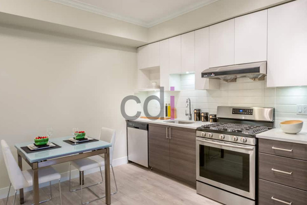

**Harga Kitchen Set Gantung: Pilihan Hemat Ruang & Biaya** - Mitra CDI yang berbahagia, banyak pemilik rumah di Jabodetabek yang menghadapi tantangan keterbatasan ruang di dapur. Kitchen set gantung sering menjadi solusi yang populer, namun seringkali muncul pertanyaan mengenai biayanya. Pemilihan material yang tepat, ukuran yang sesuai kebutuhan, dan desain yang efisien akan sangat berpengaruh pada harga akhir.

### Memahami Faktor Penentu Harga Kitchen Set Gantung

Anda mungkin sudah memiliki gambaran tentang kitchen set gantung yang diinginkan, namun penting untuk memahami faktor-faktor yang memengaruhi harga. Material merupakan penentu utama. Pilihan material seperti multipleks dengan finishing HPL, MDF, atau kayu solid akan memiliki rentang harga yang berbeda. Multipleks HPL umumnya menjadi opsi yang paling ekonomis, sementara kayu solid menawarkan durabilitas dan estetika premium dengan harga yang lebih tinggi.

Selain material, ukuran dan kompleksitas desain juga memengaruhi biaya. Kitchen set gantung dengan banyak laci, rak terbuka, atau desain yang rumit tentu membutuhkan lebih banyak material dan tenaga kerja, sehingga harganya akan lebih mahal. Perhatikan juga kualitas aksesoris yang digunakan, seperti engsel, rel laci, dan handle, karena hal ini juga berkontribusi pada biaya keseluruhan. Kami di Creative Design Interior selalu menawarkan pilihan material dan desain yang sesuai dengan anggaran Anda.

### Estimasi Harga Kitchen Set Gantung Berdasarkan Material

Untuk memberikan gambaran yang lebih jelas, berikut adalah estimasi harga kitchen set gantung berdasarkan material per meter persegi (harga ini bersifat estimasi dan dapat berubah sewaktu-waktu — hubungi Kami untuk penawaran terbaru dan paling akurat sesuai kebutuhan proyek Mitra CDI):

<table class="table">
  <caption>Estimasi Harga Kitchen Set Gantung Per Meter Persegi (2026)</caption>
  <thead>
    <tr><th>Material</th><th>Harga (Estimasi)</th><th>Kelebihan</th><th>Kekurangan</th></tr>
  </thead>
  <tbody>
    <tr><td>Multipleks HPL</td><td>Rp 800.000 – Rp 1.200.000</td><td>Ekonomis, banyak pilihan warna</td><td>Kurang tahan terhadap kelembapan tinggi</td></tr>
    <tr><td>MDF</td><td>Rp 1.000.000 – Rp 1.500.000</td><td>Permukaan halus, mudah dibentuk</td><td>Tidak sekuat multipleks, rentan terhadap kerusakan jika terkena air</td></tr>
    <tr><td>Kayu Solid (Meranti/Jati)</td><td>Rp 2.000.000 – Rp 4.000.000+</td><td>Tahan lama, tampilan mewah</td><td>Harga lebih mahal, membutuhkan perawatan rutin</td></tr>
  </tbody>
</table>

Perlu diingat bahwa harga di atas merupakan estimasi kasar. Harga sebenarnya akan bervariasi tergantung pada kompleksitas desain, jumlah kabinet, dan biaya pemasangan. Untuk mendapatkan penawaran yang lebih akurat, sebaiknya Anda berkonsultasi langsung dengan penyedia jasa kitchen set.

### Kitchen Set Gantung Custom: Solusi Tepat untuk Dapur Anda

Kami di Creative Design Interior memahami bahwa setiap dapur memiliki karakteristik unik. Oleh karena itu, Kami menawarkan layanan pembuatan kitchen set gantung custom yang dapat disesuaikan dengan kebutuhan dan preferensi Anda. Dengan kitchen set custom, Anda dapat memaksimalkan ruang yang tersedia, memilih material yang sesuai dengan anggaran, dan menciptakan desain yang sesuai dengan gaya interior rumah Anda.

Kami berpengalaman lebih dari 10 tahun dalam pembuatan kitchen set, furniture interior, dan pengadaan material bangunan. Tim kerja Kami berpengalaman dengan sistem kerja terjadwal agar pengerjaan tepat waktu dan kualitas terjaga. Selain kitchen set, Kami juga menyediakan layanan pembuatan furniture custom lainnya seperti lemari, meja, dan dipan. Untuk kemudahan Anda, Kami menawarkan skema harga *all in one* yang sudah termasuk material, pengiriman, dan bongkar muat. Tersedia pula gratis ongkir (ketentuan mengikuti wilayah layanan) untuk wilayah Jakarta, Bogor, Depok, Tangerang, Bekasi, Cikarang, Karawang, Bandung, Serang, Purwakarta, Cilegon, Cikampek, Subang, dan Rangkasbitung.

Jika Anda mencari solusi praktis dan hemat biaya untuk dapur Anda, kitchen set gantung custom dari Creative Design Interior adalah pilihan yang tepat. Jangan ragu untuk mengunjungi halaman [daftar harga](/daftar-harga/) Kami untuk mendapatkan informasi lebih lanjut mengenai daftar harga kitchen set dan layanan lainnya.

Membutuhkan bantuan langsung untuk kebutuhan proyek Anda? Silakan klik tombol **WhatsApp** atau **Telepon** di bawah untuk berkonsultasi dengan tim Kami.
