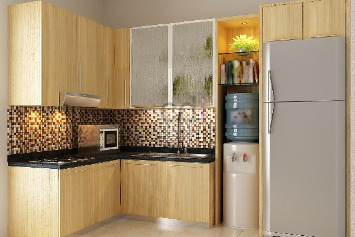

**Cara Menentukan Harga Kitchen Set Jadi Sesuai Budget** - Mitra CDI yang kami hormati, dapur merupakan jantung dari sebuah rumah. Memiliki kitchen set yang fungsional dan estetis tentu menjadi dambaan setiap pemilik rumah. Di tahun 2026, dengan perkembangan tren desain interior yang dinamis, menentukan harga kitchen set jadi menjadi hal yang krusial. Lebih dari 70% renovasi rumah di Jabodetabek melibatkan pembaruan kitchen set, menunjukkan permintaan yang signifikan untuk layanan ini. Oleh karena itu, memahami faktor-faktor yang memengaruhi harga sangatlah penting agar Mitra CDI dapat membuat perencanaan anggaran yang tepat.

## Faktor-Faktor yang Mempengaruhi Harga Kitchen Set Jadi

Terdapat beberapa faktor utama yang memengaruhi harga kitchen set jadi. Pertama, material yang digunakan memiliki dampak signifikan. Material seperti multipleks dilapisi HPL cenderung lebih ekonomis, sementara material solid surface, kayu solid, atau stainless steel akan menghasilkan biaya yang lebih tinggi. Pemilihan material harus disesuaikan dengan kebutuhan, gaya desain, dan tentu saja, anggaran yang tersedia. Kedua, ukuran dan kompleksitas desain juga berpengaruh. Kitchen set dengan ukuran besar dan desain yang rumit, seperti banyak laci, sudut-sudut unik, atau penggunaan engsel *soft closing*, umumnya memerlukan biaya lebih besar.

Selain itu, lokasi dan reputasi penyedia jasa juga turut memengaruhi harga. Kitchen set yang disediakan oleh perusahaan dengan reputasi baik dan pengalaman lebih dari 10 tahun di bidang furniture custom, seperti Creative Design Interior, mungkin menawarkan harga yang sedikit lebih tinggi, namun menjamin kualitas dan layanan purna jual yang lebih baik. Kami menyediakan skema harga *all in one* yang mencakup material, pengiriman, dan bongkar muat, sehingga Mitra CDI tidak perlu khawatir akan biaya tambahan yang tak terduga.

## Estimasi Harga Kitchen Set Jadi Berdasarkan Material

Untuk memberikan gambaran yang lebih jelas, berikut adalah estimasi harga kitchen set jadi berdasarkan material per meter persegi (harga ini bersifat estimasi dan dapat berubah sewaktu-waktu — hubungi Kami untuk penawaran terbaru dan paling akurat sesuai kebutuhan proyek Mitra CDI):

<table class="table">
  <caption>Estimasi Harga Kitchen Set Jadi Per Meter Persegi</caption>
  <thead>
    <tr><th>Material</th><th>Harga (Estimasi)</th><th>Kelebihan</th><th>Kekurangan</th></tr>
  </thead>
  <tbody>
    <tr><td>Multipleks HPL</td><td>Rp 800.000 - Rp 1.500.000</td><td>Ekonomis, pilihan warna banyak</td><td>Kurang tahan terhadap air dan panas</td></tr>
    <tr><td>MDF HPL</td><td>Rp 900.000 - Rp 1.700.000</td><td>Permukaan halus, mudah dibentuk</td><td>Kurang kuat menahan beban berat</td></tr>
    <tr><td>Kayu Solid (Jati, Mahoni)</td><td>Rp 2.000.000 - Rp 4.000.000</td><td>Awet, tampilan mewah</td><td>Harga mahal, perlu perawatan rutin</td></tr>
    <tr><td>Solid Surface (Corian, Himax)</td><td>Rp 1.800.000 - Rp 3.500.000</td><td>Tahan air, mudah dibersihkan, tampilan modern</td><td>Harga relatif mahal</td></tr>
  </tbody>
</table>

Perlu diingat bahwa harga di atas hanyalah estimasi dasar. Biaya tambahan seperti pemasangan, biaya transportasi (tergantung wilayah layanan Kami yang meliputi Jakarta, Bogor, Depok, Tangerang, Bekasi, Cikarang, Karawang, Bandung, Serang, Purwakarta, Cilegon, Cikampek, Subang, dan Rangkasbitung), dan aksesoris (engsel, rel laci, handle) juga perlu diperhitungkan.

## Memilih Penyedia Jasa Kitchen Set yang Tepat

Memilih penyedia jasa yang tepat sangatlah penting untuk memastikan kualitas dan kepuasan Mitra CDI. Creative Design Interior menawarkan berbagai pilihan pembayaran yang fleksibel, termasuk COD, transfer bank, DP 50%, transfer setelah barang terkirim, bayar bertahap, atau transfer setelah pekerjaan selesai. Kami juga menyediakan layanan konsultasi gratis untuk membantu Mitra CDI menentukan desain dan material yang paling sesuai.

Kami memiliki tim kerja berpengalaman dengan sistem kerja terjadwal, sehingga pengerjaan dapat diselesaikan tepat waktu dan kualitasnya terjaga. Produk dapat ditukar jika tidak sesuai spesifikasi, selama belum dipakai atau dibongkar dan maksimal 1 hari. Untuk mengetahui daftar harga lengkap dan detail lainnya, Mitra CDI dapat mengunjungi [halaman Daftar Harga](/daftar-harga/). Kami juga siap membantu melalui tombol **Telepon** dan **WhatsApp** di bawah halaman ini.

## Kreativitas Desain dan Keunggulan Memesan Kitchen Set Jadi

Selain mempertimbangkan harga, kreativitas desain juga merupakan faktor penting. Kitchen set yang dirancang dengan baik tidak hanya fungsional tetapi juga dapat meningkatkan estetika dapur secara keseluruhan. Kami di Creative Design Interior siap membantu Mitra CDI mewujudkan desain impian. Jangan ragu untuk berkonsultasi dengan tim desain Kami untuk mendapatkan solusi terbaik. Memesan kitchen set jadi dari Kami memberikan kemudahan karena Mitra CDI tidak perlu repot mengurus detail teknis dan proses instalasi. Tim Kami akan menangani semuanya, sehingga Mitra CDI dapat fokus pada hal-hal lain yang lebih penting. Apabila terdapat pertanyaan lain seputar topik ini, tombol **Telepon** dan **WhatsApp** di bawah halaman ini siap Kami jawab.
