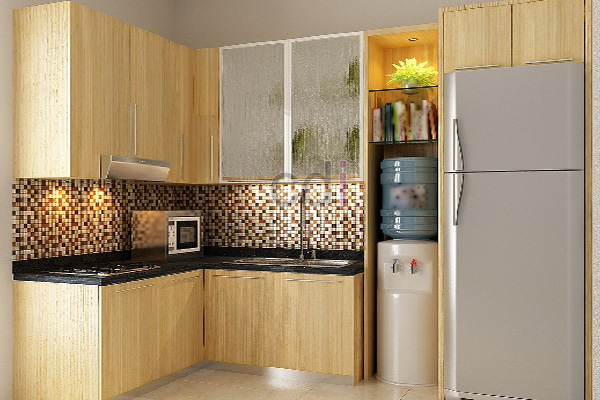

**Harga Kitchen Set Jati: Estimasi Biaya & Pilihan Terbaik 2026** - Hai Mitra CDI! Merencanakan dapur impian dengan kitchen set jati? Bagus sekali! Investasi pada kitchen set jati bukan cuma soal keindahan, tapi juga tentang kualitas dan ketahanan jangka panjang. Di (not detected), permintaan akan furniture jati terus meningkat — lho, ini menunjukkan semakin banyak yang sadar betapa berharganya dapur yang nyaman dan awet. Yuk, kita bahas estimasi biaya dan pilihan terbaiknya untuk tahun 2026!

## Menghitung Estimasi Biaya Kitchen Set Jati: Ukuran & Desain Berperan Penting

Harga kitchen set jati itu dinamis, Mitra. Tentu saja ada banyak faktor yang mempengaruhinya. Utamanya adalah ukuran dapur, kompleksitas desain yang diinginkan, dan grade kayu jati yang dipilih. Sebagai gambaran, untuk dapur berukuran 2x3 meter, Anda bisa memperkirakan biaya kitchen set jati dengan desain standar mulai dari Rp 15.000.000 hingga Rp 30.000.000. Nah, kalau dapur Anda lebih luas—misalnya 3x4 meter—angka tersebut bisa meningkat menjadi Rp 30.000.000 hingga Rp 60.000.000, tergantung apakah Anda menambahkan fitur seperti *island* atau *breakfast bar*.

Desain juga berpengaruh besar. Desain minimalis yang simpel biasanya lebih terjangkau dibandingkan desain klasik atau modern yang detail dan rumit. Soal kayu jati, kualitasnya beda-beda. Kayu jati TPK (Tumbuh Pada Kayu) dengan serat rapat dan warna coklat kemerahan punya harga yang lebih premium. Jangan khawatir! Kami di Creative Design Interior menyediakan berbagai pilihan kayu jati berkualitas, disesuaikan dengan anggaran dan selera Anda.

## Kenapa Kitchen Set Jati Lebih Unggul Dibanding Pilihan Lain?

Dibandingkan material lain, kitchen set jati benar-benar unggul dalam hal daya tahan. Bayangkan saja: kayu jati mampu menahan cuaca ekstrem dan serangan hama. Kalau dibandingkan dengan MDF atau *particle board*, kitchen set jati bisa bertahan jauh lebih lama. Ini karena kayu jati memiliki kandungan minyak alami yang bertindak sebagai pengawet, sehingga lebih tahan terhadap kelembaban dan jamur.

Berikut perbandingan singkatnya:

<table class="table">
  <caption>Perbandingan Kitchen Set Jati dengan Material Lain</caption>
  <thead>
    <tr><th>Material</th><th>Ketahanan</th><th>Umur Pakai</th><th>Harga (Estimasi)</th><th>Perawatan</th></tr>
  </thead>
  <tbody>
    <tr><td>Jati</td><td>Sangat Tinggi</td><td>20+ Tahun</td><td>Rp 15.000.000 - Rp 60.000.000+</td><td>Perawatan berkala dengan oil/wax</td></tr>
    <tr><td>MDF</td><td>Sedang</td><td>5-10 Tahun</td><td>Rp 5.000.000 - Rp 15.000.000</td><td>Perawatan hati-hati agar tidak basah</td></tr>
    <tr><td>Particle Board</td><td>Rendah</td><td>3-7 Tahun</td><td>Rp 3.000.000 - Rp 8.000.000</td><td>Sangat rentan terhadap kelembaban</td></tr>
  </tbody>
</table>

Selain kuat, kitchen set jati juga memberikan kesan mewah dan elegan pada dapur Anda. Tekstur alami serat kayunya menciptakan suasana yang hangat dan indah — sesuatu yang sulit ditiru oleh material lain. Untuk sekadar melihat referensi dan estimasi harga, Anda bisa cek langsung daftar harga di situs kami.

## Pembayaran Fleksibel & Layanan Lengkap dari Creative Design Interior (not detected)

Kami mengerti bahwa setiap proyek berbeda. Karena itu, Creative Design Interior menawarkan berbagai opsi pembayaran yang fleksibel, termasuk COD, transfer bank, DP 50%, transfer setelah barang dikirim, bayar bertahap, atau full payment setelah pekerjaan selesai. Lebih dari itu, kami juga memberikan layanan *all-in-one* yang meliputi material, pengiriman, dan pemasangan, sehingga Anda tidak perlu pusing mengurus detail logistiknya.

Dengan pengalaman lebih dari 10 tahun di bidang kitchen set, furniture interior, dan pengadaan material bangunan di (not detected), kami berkomitmen memberikan kualitas terbaik dengan harga yang kompetitif. Tim kami terdiri dari tenaga profesional yang bekerja secara terstruktur agar pengerjaan tepat waktu dan hasilnya memuaskan. Kami juga memberikan garansi produk — jika ada ketidaksesuaian dengan spesifikasi, Anda bisa melakukan penukaran (selama belum dipakai dan belum dibongkar, maksimal 1 hari).

Kami siap melayani proyek Anda di Jakarta, Bogor, Depok, Tangerang, Bekasi, Cikarang, Karawang, Bandung, Serang, Purwakarta, Cilegon, Cikampek, Subang, dan Rangkasbitung. Untuk konsultasi lebih lanjut dan penawaran khusus, hubungi kami sekarang juga melalui tombol **Telepon** atau **WhatsApp** di bawah!

Butuh informasi tambahan mengenai layanan pengerjaan? Silakan hubungi kami melalui tombol **Telepon** atau **WhatsApp** yang ada di bawah. Kami siap membantu mewujudkan dapur impian Anda! [Harga Borong Kitchen Set Jabodetabek: Estimasi & Pilihan Terbaik 2026](/blog/harga-borong-kitchen-set/) bisa menjadi referensi tambahan bagi Mitra yang ingin mencari opsi borongan.