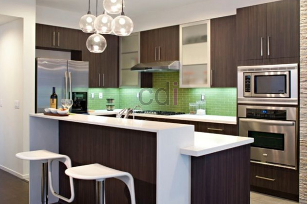

**Harga Kitchen Set Matrix: Berapa Biaya yang Perlu Anda Siapkan?** - Hai Mitra CDI! Memikirkan renovasi dapur atau membangun dapur baru? Pertanyaan soal biaya pasti jadi perhatian utama, ya? Nah, kitchen set matrix merupakan salah satu pilihan populer karena desainnya yang modern dan fleksibel. Tapi, berapa sih biaya yang perlu Anda siapkan? Artikel ini akan mengulas tuntas perkiraan harga kitchen set matrix, lengkap dengan faktor-faktor yang mempengaruhinya. Kita fokus pada kebutuhan Mitra di area (not detected) dan sekitarnya ya.

## Faktor yang Mempengaruhi Harga Kitchen Set Matrix

Harga kitchen set matrix itu dinamis, lho. Ada beberapa hal yang bikin harganya bisa naik turun. Material jadi penentu penting. Multipleks HPL dan MDF HPL biasanya lebih terjangkau dibandingkan solid surface atau stainless steel. Lalu, ukuran dapur Anda, desain yang dipilih (apakah simpel atau banyak detail), dan kerumitan pengerjaan juga berpengaruh signifikan.  Di Creative Design Interior, kami selalu berusaha transparan soal biaya dan memberikan rekomendasi material terbaik sesuai anggaran Anda.

Sebagai gambaran awal, harga kitchen set matrix dengan material multipleks dan HPL biasanya berkisar antara Rp 2.000.000 hingga Rp 3.500.000 per meter persegi. Kalau Anda ingin yang lebih premium dengan solid surface, harganya bisa mencapai Rp 4.000.000 hingga Rp 7.000.000 per meter persegi. Perlu diingat, angka ini hanya estimasi dan bisa berubah tergantung spesifikasi detail. Untuk penawaran harga yang paling akurat untuk proyek Anda di (not detected), jangan ragu untuk menghubungi Kami. Jangan lupa pertimbangkan juga biaya tambahan seperti pemasangan dan pengiriman.

## Pilihan Material Kitchen Set Matrix dan Estimasi Biaya

Yuk, kita intip perbandingan beberapa material populer untuk kitchen set matrix beserta perkiraan biayanya:

<table class="table">
  <caption>Perbandingan Estimasi Biaya Material Kitchen Set Matrix</caption>
  <thead>
    <tr><th>Material</th><th>Harga Per Meter Persegi (Estimasi)</th><th>Kelebihan</th><th>Kekurangan</th></tr>
  </thead>
  <tbody>
    <tr><td>Multipleks HPL</td><td>Rp 2.000.000 - Rp 3.500.000</td><td>Harga terjangkau, pilihan warna dan motif beragam</td><td>Kurang tahan terhadap kelembapan dan panas tinggi</td></tr>
    <tr><td>MDF HPL</td><td>Rp 1.800.000 - Rp 3.000.000</td><td>Permukaan halus, mudah dibentuk</td><td>Kurang kuat dari multipleks, rentan terhadap kerusakan jika terkena air</td></tr>
    <tr><td>Solid Surface</td><td>Rp 4.000.000 - Rp 7.000.000</td><td>Tahan lama, tidak berpori, mudah dibersihkan</td><td>Harga relatif mahal</td></tr>
    <tr><td>Stainless Steel</td><td>Rp 3.500.000 - Rp 6.000.000</td><td>Higienis, tahan karat, kuat</td><td>Perawatan membutuhkan cairan khusus, tampilan cenderung industrial</td></tr>
  </tbody>
</table>

Kami di Creative Design Interior menyediakan beragam pilihan material berkualitas dengan harga bersaing. Tim ahli Kami siap membantu Anda memilih material yang paling cocok dengan kebutuhan dan anggaran Anda. Kami juga menawarkan layanan desain 3D untuk memvisualisasikan kitchen set impian Anda sebelum mulai produksi. Bayangkan dapur baru Anda di (not detected) tanpa perlu repot!

## Creative Design Interior: Solusi Kitchen Set Matrix Lengkap untuk Mitra

Dengan pengalaman lebih dari 10 tahun di bidang desain interior dan pembuatan furniture custom, Creative Design Interior hadir sebagai mitra terpercaya Anda. Kami menawarkan solusi *all-in-one* yang mencakup material, pengerjaan, pengiriman, dan bongkar muat. Jadi, Anda tidak perlu khawatir lagi soal biaya tersembunyi. Kami juga memberikan fasilitas gratis ongkir untuk area Jabodetabek, Bandung, Serang, Purwakarta, Cilegon, Cikampek, Subang, dan Rangkasbitung.

Nah, soal pembayaran juga fleksibel kok! Anda bisa pilih COD, transfer bank, DP 50%, transfer setelah barang sampai, bayar secara bertahap, atau transfer setelah pekerjaan selesai. Tim Kami yang berpengalaman bekerja dengan jadwal teratur untuk memastikan pengerjaan tepat waktu dengan kualitas terbaik. Kalau ada yang kurang sesuai pesanan, tenang saja, produk bisa ditukar (dengan syarat belum dipakai atau dibongkar dan maksimal 1 hari).  Penasaran dengan penawaran dan promo terbaru Kami? Yuk, kunjungi halaman daftar harga Kami sekarang!

Butuh konsultasi langsung untuk proyek Anda di (not detected)? Jangan sungkan klik tombol **WhatsApp** atau **Telepon** di bawah ini untuk berbicara dengan tim Kami. Kami siap membantu mewujudkan kitchen set impian Anda! [Harga Kabinet Kitchen Set: Berapa Biaya yang Perlu Anda Siapkan?](/blog/harga-kabinet-kitchen-set/) bisa jadi referensi tambahan juga, lho.