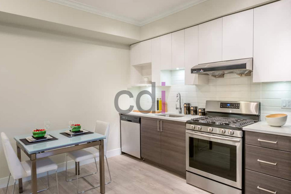

**Harga Kitchen Set Metric: Dapatkan Penawaran Terbaik untuk Dapur Idaman** - Mitra CDI yang budiman, banyak pemilik rumah mengalami kesulitan dalam menentukan anggaran yang tepat untuk renovasi dapur, khususnya saat hendak mengganti atau memasang *kitchen set*. Estimasi biaya yang tidak akurat seringkali menjadi kendala utama, menyebabkan proyek terbengkalai atau melebihi *budget* yang dialokasikan. Hal ini diperparah dengan kurangnya transparansi harga dari penyedia jasa, yang membuat Mitra CDI merasa ragu dan khawatir akan biaya tersembunyi.

### Memahami Pengaruh Material pada Harga Kitchen Set Metric

Pemilihan material merupakan faktor penting yang memengaruhi harga *kitchen set metric*. Material yang berbeda memiliki karakteristik, kelebihan, dan kekurangan masing-masing, serta tentu saja, harga yang bervariasi. Sebagai contoh, *kitchen set* dengan material kayu solid seperti jati atau mahoni umumnya memiliki harga yang lebih tinggi dibandingkan dengan material *particle board* atau MDF. Namun, perlu diingat bahwa harga bukanlah satu-satunya pertimbangan. Daya tahan, estetika, dan kemudahan perawatan juga perlu diperhatikan.

Kami memahami bahwa setiap Mitra CDI memiliki preferensi dan kebutuhan yang berbeda. Oleh karena itu, kami menyediakan beragam pilihan material, mulai dari yang ekonomis hingga yang premium, sehingga Mitra CDI dapat memilih material yang paling sesuai dengan *budget* dan gaya desain dapur. Selain itu, Kami juga memberikan konsultasi gratis untuk membantu Mitra CDI menentukan material yang paling tepat.

### Estimasi Harga Kitchen Set Metric Berdasarkan Ukuran dan Desain

Estimasi harga *kitchen set metric* sangat bergantung pada ukuran dapur dan kompleksitas desain. Secara umum, harga dihitung per meter persegi. Untuk *kitchen set* sederhana dengan material *particle board* dan desain standar, harga per meter persegi berkisar antara Rp 1.800.000 hingga Rp 2.500.000. Sementara itu, *kitchen set* dengan material kayu solid dan desain yang lebih kompleks dapat mencapai Rp 4.000.000 hingga Rp 7.000.000 per meter persegi.

Sebagai ilustrasi, misalkan Mitra CDI memiliki dapur berukuran 3 meter x 2 meter (6 meter persegi) dan menginginkan *kitchen set* dengan material MDF dan desain minimalis. Maka, estimasi biayanya adalah 6 meter persegi x Rp 2.000.000/meter persegi = Rp 12.000.000. Perlu diingat bahwa angka ini hanyalah estimasi dan dapat berubah tergantung pada detail desain dan spesifikasi material yang dipilih. Kami selalu memberikan rincian harga yang jelas dan transparan sebelum memulai pengerjaan.

### Layanan All-in-One untuk Kitchen Set Metric dari Creative Design Interior

Kami di Creative Design Interior menawarkan layanan *all-in-one* untuk pembuatan *kitchen set metric*. Artinya, harga yang Kami tawarkan sudah termasuk material, desain, pengiriman, dan pemasangan. Dengan layanan ini, Mitra CDI tidak perlu repot mencari penyedia jasa yang berbeda untuk setiap tahapan pengerjaan. Kami menyediakan tim yang berpengalaman dan terpercaya untuk memastikan bahwa *kitchen set* Mitra CDI terpasang dengan rapi dan sesuai dengan harapan.

Sebagai tambahan, Kami juga menyediakan opsi pembayaran yang fleksibel, termasuk COD, transfer bank, DP 50%, transfer setelah barang terkirim, bayar bertahap, atau transfer setelah pekerjaan selesai. Kami berusaha untuk memberikan kemudahan bagi Mitra CDI dalam proses pembayaran. Untuk informasi lebih lanjut mengenai daftar harga, Mitra CDI dapat mengunjungi halaman [Daftar Harga](/daftar-harga/).

Kami melayani wilayah Jakarta, Bogor, Depok, Tangerang, Bekasi, Cikarang, Karawang, Bandung, Serang, Purwakarta, Cilegon, Cikampek, Subang, dan Rangkasbitung. Dengan pengalaman lebih dari 10 tahun di bidang jasa *kitchen set*, pembuatan *furniture* interior, dan pengadaan material bangunan, Kami berkomitmen untuk memberikan solusi terbaik bagi kebutuhan Mitra CDI. Tim kerja Kami berpengalaman dengan sistem kerja terjadwal agar pengerjaan tepat waktu dan kualitas terjaga. Produk dapat ditukar jika tidak sesuai spesifikasi, selama belum dipakai atau dibongkar dan maksimal 1 hari.

Apabila masih terdapat hal yang ingin ditanyakan, jangan ragu menghubungi Kami melalui tombol **WhatsApp** atau **Telepon** pada halaman ini.
