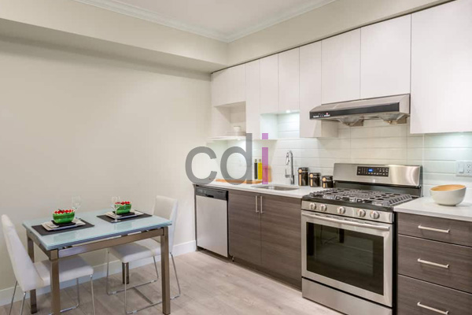

**Harga Kitchen Set Modern: Cek Estimasi & Pesan Custom** - Hai Mitra CDI! Apakah Anda sedang merencanakan renovasi dapur dan mencari tahu perkiraan biaya *kitchen set* modern? Nah, Anda berada di tempat yang tepat! Kami di Creative Design Interior seringkali menerima pertanyaan tentang anggaran yang diperlukan untuk mewujudkan dapur impian. Memperkirakan biaya memang krusial, apalagi dengan banyaknya pilihan material, desain, dan ukuran yang tersedia. Yuk, simak panduan lengkap ini untuk memahami kisaran harga dan cara mendapatkan penawaran terbaik untuk dapur Anda di (not detected).

### Faktor-Faktor yang Mempengaruhi Harga Kitchen Set Modern

Harga *kitchen set* modern itu dinamis, tidak ada angka pasti yang berlaku untuk semua orang. Beberapa faktor utama yang memengaruhi harga akhir antara lain pilihan material. Kayu solid, *multipleks* berlapis *HPL*, atau *stainless steel*—masing-masing memiliki harga yang berbeda. Desain juga berperan penting; desain yang rumit tentu membutuhkan biaya lebih besar daripada desain minimalis yang simpel. Ukuran dapur dan jumlah kabinet yang Anda butuhkan juga akan berdampak pada total biaya. Sebagai gambaran, untuk dapur berukuran kecil dengan desain minimalis, estimasi harga *kitchen set* modern dimulai dari Rp3.500.000 per meter. Sementara itu, untuk dapur yang lebih luas dan desain yang kompleks, harga bisa mencapai Rp10.000.000 atau lebih per meter. Perlu diingat, ini hanya estimasi—untuk mendapatkan penawaran paling akurat sesuai kebutuhan proyek di (not detected), jangan ragu untuk menghubungi Kami.

### Pilihan Material dan Perbandingan Harganya

Dalam pembuatan *kitchen set* modern, ada berbagai material yang bisa Anda pilih. Masing-masing memiliki kelebihan dan kekurangan, serta rentang harga yang bervariasi. *Multipleks* dengan lapisan *HPL* adalah pilihan ekonomis dan populer, tersedia dalam banyak warna dan motif. Kisaran harga *kitchen set* dari material ini adalah antara Rp3.500.000 hingga Rp6.000.000 per meter. Kalau Anda menginginkan tampilan yang lebih mewah dan tahan lama, kayu solid bisa menjadi pilihan. Harganya berkisar antara Rp7.000.000 hingga Rp12.000.000 per meter. Sementara itu, *stainless steel* menawarkan kesan higienis dan modern, cocok untuk dapur minimalis. *Kitchen set* berbahan *stainless steel* biasanya berharga antara Rp6.000.000 hingga Rp10.000.000 per meter.

### Kemudahan Pesan Kitchen Set Modern Custom di Creative Design Interior

Creative Design Interior hadir untuk mewujudkan dapur impian Anda! Kami menyediakan layanan pembuatan *kitchen set* modern *custom* yang bisa disesuaikan dengan kebutuhan dan anggaran Anda. Kami menawarkan skema harga *all in one* yang sudah mencakup material, pengiriman, dan bongkar muat, jadi Anda tidak perlu khawatir biaya tak terduga. Kami juga menyediakan berbagai pilihan pembayaran yang fleksibel—mulai dari COD, transfer bank, DP 50%, transfer setelah barang diterima, hingga opsi bayar bertahap. Ditambah lagi, Kami menawarkan gratis ongkir dengan ketentuan wilayah layanan yang berlaku. Jangan ragu untuk mengunjungi halaman Daftar Harga Kami untuk mengetahui daftar harga lengkap, atau berkonsultasi langsung dengan tim ahli Kami untuk mendapatkan penawaran terbaik yang sesuai dengan proyek Anda di (not detected).

### Area Layanan Kami: Jabodetabek & Sekitarnya

Jangan khawatir soal lokasi! Kami melayani pembuatan dan pemasangan *kitchen set* modern di seluruh wilayah Jabodetabek (Jakarta, Bogor, Depok, Tangerang, Bekasi), serta daerah sekitar seperti Cikarang, Karawang, Bandung, Serang, Purwakarta, Cilegon, Cikampek, Subang, dan Rangkasbitung. Dengan pengalaman lebih dari 10 tahun di bidang *kitchen set*, *furniture* interior, dan pengadaan material bangunan, Kami berkomitmen memberikan layanan terbaik bagi Mitra CDI. Tim ahli Kami bekerja dengan sistem yang terstruktur untuk memastikan pengerjaan tepat waktu dan kualitas terjamin. Kami juga memberikan garansi produk bisa ditukar jika tidak sesuai spesifikasi, dengan syarat belum digunakan atau dibongkar dan maksimal 1 hari setelah pengiriman.

Tertarik untuk memulai renovasi dapur Anda? Atau ingin bertanya lebih lanjut? Jangan sungkan untuk menghubungi Kami — tombol **Telepon** dan **WhatsApp** di bawah sudah siap membantu! Kami akan dengan senang hati memberikan konsultasi gratis dan penawaran terbaik untuk dapur Anda di (not detected). [Harga Custom Kitchen Set Di Baktijaya Depok](/kitchen/harga-custom-kitchen-set-di-baktijaya-depok/) adalah salah satu contoh layanan Kami yang bisa Anda manfaatkan.