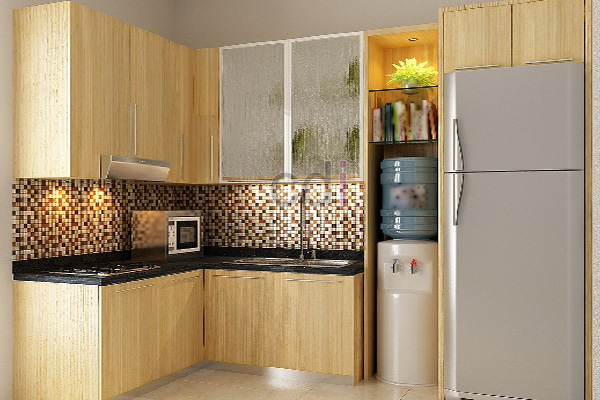

**Harga Kitchen Set Portable: Pilih Ukuran dan Material Terbaik** - Mitra CDI, banyak pemilik rumah, terutama dengan ruang dapur terbatas, menghadapi tantangan dalam memaksimalkan fungsi dan estetika dapur mereka. Salah satu kesalahan umum adalah memilih kitchen set yang terlalu besar atau tidak sesuai dengan tata letak ruangan, sehingga membuat dapur terasa sempit dan tidak nyaman. Selain itu, kurangnya pertimbangan terhadap material yang digunakan dapat menyebabkan kitchen set cepat rusak atau sulit dirawat.

### Memahami Harga Kitchen Set Portable

Harga kitchen set portable bervariasi signifikan, bergantung pada beberapa faktor utama. Ukuran adalah penentu harga paling mendasar—semakin luas area yang dicakup, semakin tinggi pula biayanya. Material yang digunakan juga memiliki pengaruh besar. Material seperti multipleks dengan finishing *melamine* cenderung lebih terjangkau dibandingkan material solid surface atau *stainless steel*. Selanjutnya, kompleksitas desain turut memengaruhi harga; desain yang rumit dengan banyak detail membutuhkan proses pengerjaan yang lebih lama dan presisi, sehingga biaya produksinya meningkat.

Sebagai gambaran, untuk kitchen set portable dengan ukuran standar (2 meter x 1.5 meter) dengan material multipleks berkualitas baik dan finishing *melamine*, Anda dapat memperkirakan harga mulai dari Rp 3.000.000 hingga Rp 7.000.000. Harga ini bersifat estimasi dan dapat berubah sewaktu-waktu — hubungi Kami untuk penawaran terbaru dan paling akurat sesuai kebutuhan proyek Anda.

### Perbandingan Material Kitchen Set Portable

Pemilihan material yang tepat sangat krusial untuk memastikan kitchen set portable Anda tahan lama dan sesuai dengan anggaran. Berikut adalah perbandingan beberapa material umum:

<table class="table">
  <caption>Perbandingan Material Kitchen Set Portable</caption>
  <thead>
    <tr><th>Material</th><th>Kelebihan</th><th>Kekurangan</th><th>Estimasi Harga (per meter persegi)</th></tr>
  </thead>
  <tbody>
    <tr><td>Multipleks</td><td>Terjangkau, ringan, mudah dibentuk</td><td>Kurang tahan lama, rentan terhadap kelembapan</td><td>Rp 300.000 - Rp 500.000</td></tr>
    <tr><td>Particle Board</td><td>Lebih murah dari multipleks, permukaan halus</td><td>Sangat rentan terhadap kelembapan, mudah rusak</td><td>Rp 200.000 - Rp 400.000</td></tr>
    <tr><td>Solid Surface</td><td>Tahan lama, tampilan mewah, mudah dibersihkan</td><td>Harga mahal, membutuhkan pengerjaan profesional</td><td>Rp 800.000 - Rp 1.500.000</td></tr>
    <tr><td>Stainless Steel</td><td>Higienis, tahan karat, sangat awet</td><td>Harga sangat mahal, tampilan dingin</td><td>Rp 1.200.000 - Rp 2.000.000</td></tr>
  </tbody>
</table>

### Solusi Kitchen Set Portable dari Creative Design Interior

Kami di Creative Design Interior (CDI) memahami betul kebutuhan Anda akan kitchen set portable yang berkualitas, fungsional, dan sesuai dengan anggaran. Dengan pengalaman lebih dari 10 tahun di bidang jasa kitchen set dan pembuatan furniture interior, Kami menawarkan solusi yang dirancang khusus untuk memenuhi kebutuhan Anda. Kami menyediakan berbagai pilihan material, ukuran, dan desain yang dapat disesuaikan dengan preferensi dan ruang dapur Anda.

Kami mengutamakan penggunaan material berkualitas tinggi dan proses pengerjaan yang cermat untuk menghasilkan kitchen set portable yang tahan lama dan estetis. Skema harga *all in one* Kami mencakup material, pengiriman, dan bongkar muat. Kami juga menyediakan gratis ongkir untuk wilayah layanan tertentu.  Jika Anda sedang mencari kitchen set portable di area Jakarta, Bogor, Depok, Tangerang, Bekasi, Cikarang, Karawang, Bandung, Serang, Purwakarta, Cilegon, Cikampek, Subang, dan Rangkasbitung, Kami siap membantu Anda.

Untuk melihat daftar harga lengkap dan detail produk Kami, Anda dapat mengunjungi halaman [Daftar Harga](/daftar-harga/). Kami juga menyediakan pilihan pembayaran yang fleksibel, termasuk COD, transfer bank, DP 50%, transfer setelah barang terkirim, bayar bertahap, atau transfer setelah pekerjaan selesai.

Apabila terdapat pertanyaan lain seputar topik ini, tombol **Telepon** dan **WhatsApp** di bawah halaman ini siap Kami jawab.
