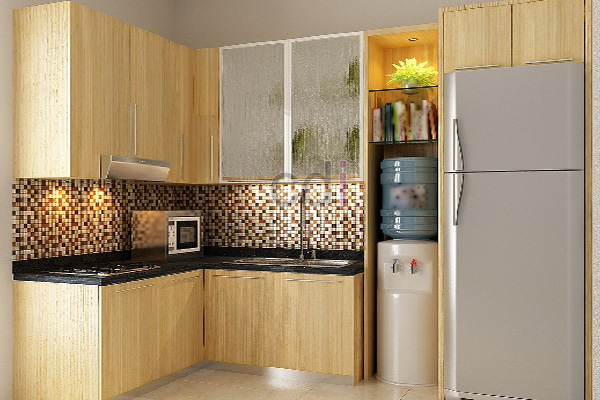

**Harga Kitchen Set Solo: Estimasi & Tips Pemilihan Terbaik 2026** - Hai Mitra CDI! Memikirkan tampilan dapur idaman yang rapi, fungsional, dan sesuai *budget*? Banyak yang menganggap mewujudkannya butuh biaya besar. Padahal, dengan perencanaan matang dan pemilihan material yang tepat, dapur impian bisa jadi kenyataan tanpa bikin kantong jebol. Artikel ini akan mengupas tuntas estimasi harga *kitchen set solo*, lengkap dengan tips memilih yang paling pas untukmu. Yuk, simak bersama!

## Apa Saja yang Mempengaruhi Harga Kitchen Set Solo?

Beberapa hal penting berperan dalam menentukan harga *kitchen set*. Memahami faktor-faktor ini akan membantumu mengambil keputusan terbaik dan mendapatkan penawaran yang paling sesuai. Pertama dan utama adalah material. Pilihan material sangat beragam, mulai dari *multipleks* yang ekonomis hingga *solid surface* yang mewah. Material yang dipilih jelas berpengaruh signifikan pada estimasi harga *kitchen set solo* yang akan kamu dapatkan.

Selain material, ukuran dapur serta kompleksitas desain juga krusial. Semakin luas dapur dan rumit desainnya, harga cenderung meningkat. Misalnya, *kitchen set* dengan banyak laci, rak sudut, atau fitur eksklusif lainnya membutuhkan lebih banyak material dan waktu pengerjaan. Jangan lupakan juga kualitas *hardware* seperti engsel *slow close* dan rel laci *soft close*. Investasi pada *hardware* berkualitas memang menambah biaya, tetapi menjamin kenyamanan dan ketahanan jangka panjang.

## Estimasi Harga Kitchen Set Solo Berdasarkan Jenis Material

Supaya lebih jelas, berikut adalah perkiraan harga *kitchen set solo* berdasarkan material yang lazim digunakan. Perlu diingat, harga ini hanyalah estimasi dan bisa berubah sewaktu-waktu — hubungi Kami untuk mendapatkan penawaran terbaru dan paling akurat sesuai kebutuhan proyekmu di (not detected).

| Material          | Harga per Meter Lari (Estimasi) | Kelebihan                               | Kekurangan                            |
|-------------------|----------------------------------|-----------------------------------------|---------------------------------------|
| Multipleks (HPL)  | Rp 800.000 – Rp 1.500.000       | Ekonomis, pilihan warna dan motif banyak | Kurang tahan air, mudah tergores       |
| MDF (HPL)         | Rp 1.200.000 – Rp 2.000.000      | Permukaan halus, mudah dibentuk         | Rentan terhadap kelembapan, tidak tahan lama|
| Particle Board (HPL)| Rp 700.000 – Rp 1.200.000       | Paling ekonomis                          | Kekuatan rendah, mudah rusak          |
| Kayu Solid        | Rp 2.500.000 – Rp 5.000.000+     | Kuat, tahan lama, tampilan mewah        | Harga mahal, perawatan khusus        |
| Stainless Steel   | Rp 3.000.000 – Rp 6.000.000+     | Higienis, tahan karat, mudah dibersihkan | Harga mahal, tampilan dingin         |

Sebagai gambaran, untuk dapur berukuran 3x2 meter dengan desain sederhana menggunakan material *multipleks* HPL, perkiraan biayanya antara Rp 4.800.000 sampai Rp 9.000.000. Jika kamu menginginkan material yang lebih premium seperti kayu solid, budgetnya bisa mencapai Rp 15.000.000 atau lebih.

## Creative Design Interior: Kitchen Set Custom untuk Dapur Impianmu

Di Creative Design Interior, Kami mengerti betul bahwa setiap dapur itu unik. Karena itu, Kami menawarkan layanan *kitchen set custom* yang dirancang khusus sesuai selera dan anggaranmu. Kami sudah berpengalaman lebih dari 10 tahun dalam pembuatan *kitchen set*, *furniture* interior, dan pengadaan material bangunan berkualitas di wilayah (not detected) dan sekitarnya.

Kami menyediakan berbagai pilihan material terbaik, termasuk *multipleks*, MDF, *particle board*, kayu solid, dan *stainless steel*. Tim ahli Kami akan memastikan setiap detail pengerjaan dikerjakan dengan teliti dan presisi, menghasilkan *kitchen set* yang awet dan fungsional. Kami juga menawarkan skema harga *all-in* yang mencakup material, pengiriman, dan pemasangan. Dengan begitu, kamu tak perlu khawatir ada biaya tambahan yang tak terduga.

## Pemesanan & Pembayaran Kitchen Set Mudah Bersama CDI

Kami berkomitmen memberikan pengalaman pemesanan dan pembayaran yang semudah mungkin. Kamu bisa memilih dari berbagai opsi pembayaran yang tersedia, seperti COD, transfer bank, DP 50%, transfer setelah barang sampai di (not detected), bayar cicilan, atau transfer setelah pekerjaan selesai. Selain itu, Kami juga menawarkan gratis ongkir untuk area layanan tertentu.

Ingin mendapatkan penawaran harga yang lebih akurat dan disesuaikan dengan kebutuhanmu? Jangan ragu untuk menghubungi Kami! Kamu bisa kunjungi halaman Daftar Harga untuk mendapatkan perkiraan biaya, atau langsung konsultasi dengan tim Kami melalui tombol WhatsApp atau Telepon di bawah halaman ini. Kami siap membantu mewujudkan dapur impianmu di (not detected).

Untuk informasi lebih lanjut, tombol **Telepon** dan **WhatsApp** yang tersedia di halaman ini bisa langsung kamu gunakan untuk menghubungi Kami. [Harga Borong Kitchen Set Jabodetabek: Estimasi & Pilihan Terbaik 2026](/blog/harga-borong-kitchen-set/) – Kalau kamu tertarik dengan opsi borongan, artikel ini bisa jadi referensi awal.