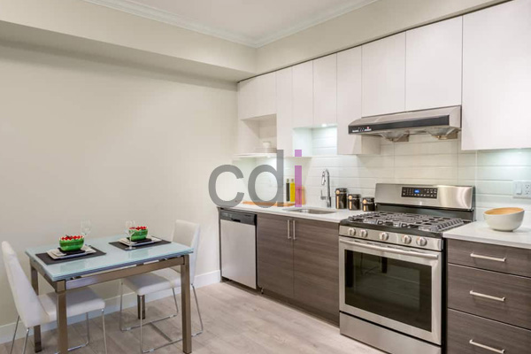

**Berapa Harga Kitchen Set Stainless? Panduan Terkini 2026** - Mitra CDI di mana pun berada, banyak pemilik rumah mengalami kesulitan dalam menentukan anggaran yang tepat untuk kitchen set stainless. Kesalahan umum terjadi karena kurangnya pemahaman mengenai faktor-faktor yang memengaruhi harga, serta perbedaan signifikan antara penawaran dari berbagai penyedia. Artikel ini akan memberikan panduan lengkap mengenai harga kitchen set stainless, mulai dari estimasi biaya hingga pertimbangan penting dalam memilih material dan desain.

## Memahami Faktor Penentu Harga Kitchen Set Stainless

Harga kitchen set stainless dipengaruhi oleh beberapa faktor utama. Pertama, ukuran dan kompleksitas desain memainkan peran krusial. Semakin besar ukuran kitchen set dan semakin rumit desainnya, tentu saja biaya yang dibutuhkan akan semakin tinggi. Material stainless steel yang digunakan juga bervariasi. Terdapat beberapa grade stainless steel, mulai dari yang standar hingga yang premium dengan ketahanan korosi dan tampilan yang lebih baik. Ketebalan stainless steel juga memengaruhi harga; grade 304 dengan ketebalan 0,8mm umumnya menjadi pilihan standar untuk kitchen set residensial.

Faktor lainnya adalah fitur tambahan yang Anda inginkan. Apakah Anda memerlukan rak piring tarik, laci dengan *soft closing*, atau pencahayaan LED terintegrasi? Setiap fitur tambahan akan menambah biaya produksi. Terakhir, biaya pemasangan juga perlu diperhitungkan. Pemasangan yang rapi dan aman membutuhkan tenaga ahli yang berpengalaman.

## Estimasi Harga Kitchen Set Stainless Berdasarkan Ukuran

Untuk memberikan gambaran yang lebih jelas, berikut adalah estimasi harga kitchen set stainless berdasarkan ukuran:

| Ukuran Kitchen Set | Estimasi Harga (Rp) |
|---|---|
| Kitchen Set Mini (2m x 1m) | 3.000.000 – 7.000.000 |
| Kitchen Set Standar (3m x 2m) | 7.000.000 – 15.000.000 |
| Kitchen Set Besar (4m x 3m) | 15.000.000 – 30.000.000+ |

Harga ini bersifat estimasi dan dapat berubah sewaktu-waktu — hubungi Kami untuk penawaran terbaru dan paling akurat sesuai kebutuhan proyek Anda. Perlu diingat bahwa harga di atas belum termasuk biaya pemasangan, yang biasanya berkisar antara 5% hingga 10% dari total harga kitchen set.

## Apa yang Kami Siapkan untuk Kebutuhan Kitchen Set Stainless Anda

Kami di Creative Design Interior telah berpengalaman lebih dari 10 tahun dalam pembuatan kitchen set stainless custom. Kami menyediakan berbagai pilihan desain dan material stainless steel berkualitas tinggi. Tim kami yang berpengalaman akan membantu Anda merancang kitchen set yang sesuai dengan gaya dan anggaran Anda. Kami menawarkan skema harga *all in one* yang mencakup material, pengiriman, dan bongkar muat. Selain itu, tersedia gratis ongkir untuk wilayah tertentu. Kami juga menyediakan beragam pilihan pembayaran fleksibel, seperti COD, transfer bank, DP 50%, transfer setelah barang terkirim, bayar bertahap, atau transfer setelah pekerjaan selesai.

Apabila Anda sedang mencari solusi praktis untuk mewujudkan dapur impian Anda, Kami siap membantu. Konsultasikan kebutuhan Anda dengan tim Kami melalui tombol **Telepon** atau **WhatsApp** di bawah halaman ini, dan dapatkan penawaran harga terbaik.

## Kemudahan Pemesanan dan Pembayaran Kitchen Set Stainless

Kami memahami bahwa proses pemesanan dan pembayaran haruslah semudah mungkin. Oleh karena itu, Kami menyediakan layanan konsultasi gratis untuk membantu Anda menentukan desain dan material yang tepat. Setelah desain disetujui, Kami akan memberikan estimasi harga yang rinci dan transparan. Proses pembayaran juga fleksibel, memungkinkan Anda memilih metode yang paling sesuai dengan preferensi Anda. Jika Anda berada di wilayah Jakarta, Bogor, Depok, Tangerang, Bekasi, Cikarang, Karawang, Bandung, Serang, Purwakarta, Cilegon, Cikampek, Subang, dan Rangkasbitung, Kami siap melayani Anda. [Daftar harga](/daftar-harga/) lengkap tersedia di situs web Kami.

Apabila terdapat pertanyaan lain seputar topik ini, tombol **Telepon** dan **WhatsApp** di bawah halaman ini siap Kami jawab.
