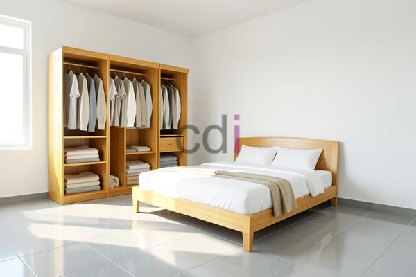

**Harga Lemari 3 Susun: Sebelum Membeli, Cek Estimasi Biaya & Pilihan Terbaik** - Mitra CDI yang terhormat, pernahkah Mitra mempertimbangkan kebutuhan ruang penyimpanan tambahan di rumah? Lemari 3 susun seringkali menjadi solusi praktis untuk mengatasi keterbatasan ruang, terutama di kamar tidur atau ruang keluarga. Pilihan material dan desain yang beragam tentu memengaruhi harga lemari 3 susun yang tersedia di pasaran.

### Memahami Faktor Penentu Harga Lemari 3 Susun

Mitra, terdapat beberapa faktor utama yang berkontribusi pada variasi harga lemari 3 susun. Material merupakan penentu harga yang signifikan. Lemari dengan material kayu solid, seperti kayu jati atau mahoni, umumnya memiliki harga yang lebih tinggi dibandingkan lemari yang terbuat dari material partikel board atau MDF (Medium Density Fiberboard). Selain itu, ukuran lemari juga berpengaruh; lemari dengan dimensi lebih besar tentu membutuhkan lebih banyak material dan tenaga kerja, sehingga harganya pun meningkat.

Kualitas finishing juga menjadi pertimbangan penting. Finishing yang rapi dan tahan lama, seperti lapisan *melamine* atau *lacquer*, akan meningkatkan nilai jual lemari. Desain lemari juga memainkan peran, terutama jika Mitra menginginkan lemari dengan desain custom atau memiliki fitur tambahan seperti laci, cermin, atau gantungan baju. Kami di Creative Design Interior memahami betul bahwa setiap rumah memiliki karakteristik unik. Oleh karena itu, Kami menawarkan layanan konsultasi gratis untuk membantu Mitra menentukan pilihan lemari 3 susun yang paling sesuai dengan kebutuhan dan anggaran.

### Estimasi Harga Lemari 3 Susun Berdasarkan Material

Untuk memberikan gambaran yang lebih jelas, berikut adalah estimasi harga lemari 3 susun berdasarkan material yang umum digunakan:

<table class="table">
  <caption>Estimasi Harga Lemari 3 Susun</caption>
  <thead>
    <tr><th>Material</th><th>Estimasi Harga (Rp)</th><th>Kelebihan</th><th>Kekurangan</th></tr>
  </thead>
  <tbody>
    <tr><td>Particle Board</td><td>500.000 - 1.500.000</td><td>Harga terjangkau, ringan</td><td>Kurang tahan lama, rentan terhadap kelembaban</td></tr>
    <tr><td>MDF</td><td>800.000 - 2.500.000</td><td>Permukaan halus, mudah dicat</td><td>Kurang kuat, mudah melengkung jika terkena air</td></tr>
    <tr><td>Kayu Solid (Jati/Mahoni)</td><td>3.000.000 - 8.000.000+</td><td>Tahan lama, tampilan elegan</td><td>Harga mahal, membutuhkan perawatan khusus</td></tr>
  </tbody>
</table>

Harga ini bersifat estimasi dan dapat berubah sewaktu-waktu — hubungi Kami untuk penawaran terbaru dan paling akurat sesuai kebutuhan proyek Mitra CDI. Perlu diingat bahwa harga di atas adalah kisaran umum dan dapat bervariasi tergantung pada ukuran, desain, dan kualitas finishing lemari.

### Layanan Custom Lemari 3 Susun dari Creative Design Interior

Sebagai perusahaan yang telah berpengalaman lebih dari 10 tahun di bidang desain interior dan pembuatan *furniture custom*, Kami di Creative Design Interior siap membantu Mitra mewujudkan lemari 3 susun impian. Kami melayani pembuatan lemari 3 susun dengan desain custom sesuai dengan keinginan dan kebutuhan Mitra. Dengan skema harga *all in one*, Mitra tidak perlu khawatir akan biaya tambahan; harga yang Kami berikan sudah termasuk material, pengiriman, dan bongkar muat.

Kami menyediakan berbagai pilihan material, mulai dari partikel board, MDF, hingga kayu solid berkualitas tinggi. Tim kerja Kami yang berpengalaman akan memastikan pengerjaan tepat waktu dan kualitas terjaga. Produk dapat ditukar jika tidak sesuai spesifikasi, selama belum dipakai atau dibongkar dan maksimal 1 hari.  Kami juga melayani jasa pembuatan lemari bawah tangga, seperti di [Harga Custom Lemari Bawah Tangga Di Babelan Bekasi](/lemari/harga-custom-lemari-bawah-tangga-di-babelan-bekasi/), [Harga Custom Lemari Bawah Tangga Di Banyusari Karawang](/lemari/harga-custom-lemari-bawah-tangga-di-banyusari-karawang/) atau wilayah lainnya di Jabodetabek. Jangan ragu untuk berkonsultasi dengan tim desain Kami untuk mendapatkan inspirasi dan penawaran terbaik.

### Kemudahan Pemesanan dan Pembayaran

Memesan lemari 3 susun custom dari Creative Design Interior sangat mudah. Mitra dapat menghubungi Kami melalui tombol **Telepon** atau **WhatsApp** yang tersedia di bawah halaman ini untuk berkonsultasi dan mendapatkan penawaran harga. Kami menyediakan berbagai pilihan pembayaran yang fleksibel, termasuk COD, transfer bank, DP 50%, transfer setelah barang terkirim, bayar bertahap, atau transfer setelah pekerjaan selesai. Kami melayani seluruh wilayah Jabodetabek, termasuk Jakarta, Bogor, Depok, Tangerang, Bekasi, Cikarang, Karawang, Bandung, Serang, Purwakarta, Cilegon, Cikampek, Subang, dan Rangkasbitung.  Apabila Mitra sedang mencari solusi penyimpanan yang lebih ringkas, mungkin Lemari Plastik 4 Susun: Pilihan Terbaik untuk Penyimpanan Efisien di Rumah Anda bisa menjadi alternatif yang menarik.

Apabila terdapat pertanyaan lain seputar topik ini, tombol **Telepon** dan **WhatsApp** di bawah halaman ini siap Kami jawab.
