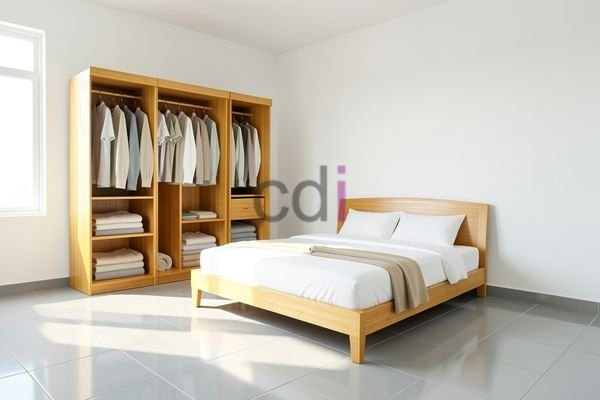

**Harga Lemari 5 Susun Jabodetabek: Tips & Estimasi Biaya 2026** - Hai Mitra CDI! Sedang memikirkan solusi penyimpanan yang cerdas dan efisien di rumah atau kantor? Lemari 5 susun bisa jadi jawabannya! Dengan kapasitas luas dan desain yang mengoptimalkan ruang vertikal, lemari ini sangat ideal untuk berbagai kebutuhan. Yuk, simak panduan lengkapnya di artikel ini!

Memiliki lemari 5 susun bukan sekadar menambah ruang penyimpanan, tapi juga elemen penting dalam menciptakan hunian yang terorganisir. Memilih lemari yang tepat melibatkan pertimbangan matang. Kami akan mengulas berbagai faktor yang memengaruhi harga serta memberikan estimasi biaya yang relevan untuk Mitra CDI di wilayah (not detected).

## Apa Saja yang Memengaruhi Harga Lemari 5 Susun?

Tentu saja, ada beberapa hal yang berperan penting dalam menentukan harga sebuah lemari 5 susun. Material adalah faktor utama. Kayu solid seperti jati atau mahoni biasanya menawarkan kualitas dan estetika premium, tetapi harganya pun lebih tinggi. Pilihan lain seperti multipleks atau *particle board* bisa menjadi alternatif yang lebih ramah di kantong.

Selain material, ukuran lemari juga signifikan. Semakin besar dimensinya, semakin banyak material yang digunakan, dan ini akan memengaruhi harga total. Desain dan fitur tambahan seperti laci dengan rel berkualitas tinggi atau mekanisme *soft close* juga akan menambah nilai jual produk. Jangan lupakan kualitas *hardware* (engsel, handle) karena ini juga berkontribusi pada ketahanan dan tampilan lemari.

## Kisaran Harga Lemari 5 Susun Berdasarkan Material

Agar Mitra CDI mendapatkan gambaran yang lebih jelas, berikut adalah estimasi harga lemari 5 susun berdasarkan pilihan material. Perlu diingat, harga ini hanyalah perkiraan dan dapat berubah sewaktu-waktu. Untuk penawaran paling akurat dan sesuai kebutuhan Mitra, jangan ragu untuk menghubungi Kami.

<table class="table">
  <caption>Estimasi Harga Lemari 5 Susun Berdasarkan Material (2026)</caption>
  <thead>
    <tr><th>Material</th><th>Harga (Estimasi)</th><th>Kelebihan</th><th>Kekurangan</th></tr>
  </thead>
  <tbody>
    <tr><td>Kayu Solid (Jati/Mahoni)</td><td>Rp 3.000.000 – Rp 8.000.000+</td><td>Tahan lama, tampilan mewah, nilai investasi</td><td>Harga tinggi, membutuhkan perawatan rutin</td></tr>
    <tr><td>Multipleks</td><td>Rp 1.500.000 – Rp 4.000.000+</td><td>Lebih terjangkau, cukup kuat, mudah diproses</td><td>Kurang tahan lama dibandingkan kayu solid, rentan terhadap kelembaban</td></tr>
    <tr><td>Particle Board</td><td>Rp 800.000 – Rp 2.500.000+</td><td>Harga paling terjangkau, pilihan warna dan motif beragam</td><td>Kurang kuat, mudah rusak jika terkena air, tidak tahan lama</td></tr>
  </tbody>
</table>

Sebagai catatan, harga di atas masih bisa bervariasi tergantung pada ukuran, desain, dan tingkat finishing lemari yang Mitra inginkan. 

## Realisasikan Lemari Impian dengan Solusi Custom dari CDI

Kami di Creative Design Interior (CDI) siap mewujudkan lemari 5 susun sesuai dengan impian Mitra! Dengan layanan *custom*, Mitra bebas menentukan material, ukuran, desain, dan fitur tambahan sesuai selera dan kebutuhan. Keuntungan utama menggunakan layanan *custom* Kami adalah mendapatkan lemari yang pas di ruang Mitra dan selaras dengan gaya interior rumah Anda.

Kami telah berpengalaman lebih dari 10 tahun dalam mendesain dan memproduksi *kitchen set*, furniture interior, serta menyediakan material bangunan berkualitas di wilayah (not detected) dan sekitarnya. Tim ahli Kami bekerja dengan sistem terjadwal untuk memastikan pengerjaan tepat waktu dan kualitas tetap terjaga. Kami juga memberikan jaminan kenyamanan dengan kebijakan penukaran produk jika tidak sesuai spesifikasi (selama belum digunakan atau dibongkar, dan maksimal 1 hari).

## Pemesanan Mudah & Pilihan Pembayaran Fleksibel

Kami mengerti pentingnya kemudahan dalam berbelanja. Itulah mengapa Kami menyediakan berbagai pilihan pembayaran yang fleksibel, seperti COD, transfer bank, DP 50%, transfer setelah barang terkirim, bayar bertahap, atau transfer setelah pekerjaan selesai. Kami bahkan menawarkan gratis ongkir untuk wilayah tertentu! 

Untuk informasi lebih lengkap mengenai harga, Mitra bisa mengunjungi halaman Daftar Harga. Jika ada pertanyaan atau ingin langsung memesan lemari 5 susun *custom*, silakan hubungi Kami melalui tombol **Telepon** atau **WhatsApp** yang tersedia di bawah halaman ini. Kami selalu siap membantu Mitra CDI mencapai hunian idaman! [Harga Kaca Lemari Pakaian: Estimasi Biaya & Pilihan Material 2026](/blog/harga-kaca-lemari-pakaian/) mungkin juga bisa memberikan inspirasi tambahan.

Jangan sungkan untuk menghubungi Kami melalui tombol **Telepon** atau **WhatsApp** di bawah ini jika ada yang ingin ditanyakan. Kami siap melayani Mitra CDI dengan sepenuh hati.