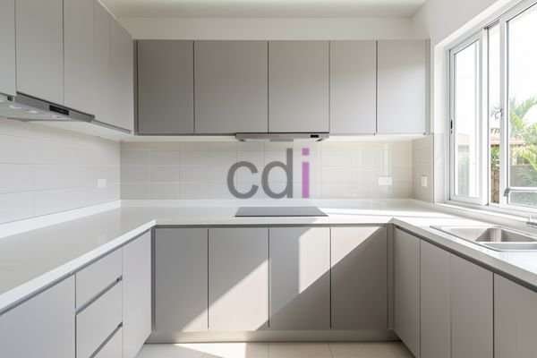

**Harga Lemari Aluminium Dapur: Sebelum Memesan, Cek Estimasi 2026** - Mitra CDI dimana saja berada, pernahkah Anda merasa dapur terasa sempit dan berantakan? Penyimpanan yang tidak memadai seringkali menjadi masalah utama. Lemari aluminium dapur hadir sebagai solusi praktis dan tahan lama untuk mengatasi masalah tersebut. Artikel ini akan membahas secara rinci mengenai perkiraan biaya yang perlu Anda ketahui sebelum memutuskan untuk memasang lemari aluminium di dapur Anda.

## Memahami Faktor yang Mempengaruhi Harga Lemari Aluminium Dapur

Tentu saja, harga lemari aluminium dapur tidaklah baku. Ada beberapa faktor penting yang memengaruhi besaran biaya yang perlu Anda persiapkan. Salah satu faktor utama adalah ukuran lemari. Semakin besar dimensi lemari yang Anda inginkan, tentu saja akan semakin banyak material yang dibutuhkan dan semakin tinggi biayanya. Pertimbangkan luas dapur Anda dan kebutuhan penyimpanan yang Anda miliki untuk menentukan ukuran yang paling sesuai.

Selain ukuran, desain lemari juga berperan penting dalam menentukan harga. Desain yang sederhana dengan bentuk standar umumnya akan lebih terjangkau dibandingkan desain yang rumit dengan banyak detail tambahan seperti ukiran atau kombinasi warna. Kami di Creative Design Interior menawarkan berbagai pilihan desain yang dapat disesuaikan dengan gaya dan anggaran Anda.

## Estimasi Harga Lemari Aluminium Dapur Berdasarkan Ukuran dan Spesifikasi

Untuk memberikan gambaran yang lebih jelas, berikut adalah perkiraan harga lemari aluminium dapur berdasarkan ukuran dan spesifikasi umum. Harga ini bersifat estimasi dan dapat berubah sewaktu-waktu — hubungi Kami untuk penawaran terbaru dan paling akurat sesuai kebutuhan proyek Mitra CDI.

Secara umum, harga lemari aluminium dapur per meter persegi berkisar antara Rp 3.500.000 hingga Rp 7.000.000, tergantung pada beberapa hal seperti:

*   **Ketebalan Aluminium:** Semakin tebal aluminium yang digunakan, semakin kokoh dan tahan lama lemari tersebut, namun harganya juga akan lebih mahal.
*   **Jenis Finishing:** Pilihan finishing seperti powder coating atau anodizing juga akan memengaruhi harga. Powder coating biasanya lebih terjangkau, sedangkan anodizing menawarkan ketahanan yang lebih baik terhadap korosi.
*   **Aksesori:** Penambahan aksesori seperti engsel *soft close*, *handle* modern, atau lampu LED di dalam lemari akan menambah biaya produksi.

Sebagai contoh, untuk lemari aluminium dapur dengan ukuran 2 meter x 2 meter dan spesifikasi standar (aluminium standar, finishing powder coating, engsel biasa), perkiraan biayanya adalah sekitar Rp 14.000.000 – Rp 28.000.000.

## Memilih Penyedia Jasa Kitchen Set Aluminium Terpercaya

Memilih penyedia jasa yang tepat akan sangat memengaruhi kualitas dan harga lemari aluminium dapur yang Anda dapatkan. Pastikan penyedia jasa tersebut memiliki pengalaman yang cukup dalam pembuatan *kitchen set* aluminium, serta menawarkan layanan konsultasi dan desain yang profesional. Kami, Creative Design Interior, telah berpengalaman lebih dari 10 tahun dalam bidang jasa *kitchen set*, pembuatan *furniture* interior, dan pengadaan material bangunan. Tim kami siap membantu Anda merancang dan mewujudkan dapur impian Anda.

Kami menawarkan skema harga *all in one* yang sudah termasuk material, pengiriman, dan bongkar muat. Selain itu, tersedia pula gratis ongkir untuk wilayah layanan Kami. Untuk memudahkan Anda, Kami menyediakan pilihan pembayaran yang fleksibel, seperti COD, transfer bank, DP 50%, transfer setelah barang terkirim, bayar bertahap, atau transfer setelah pekerjaan selesai. Jangan ragu untuk menghubungi kami untuk mendapatkan penawaran terbaik.

Untuk konsultasi lebih lanjut, tombol **Telepon** dan **WhatsApp** di bawah halaman ini dapat langsung digunakan untuk menghubungi Kami.
