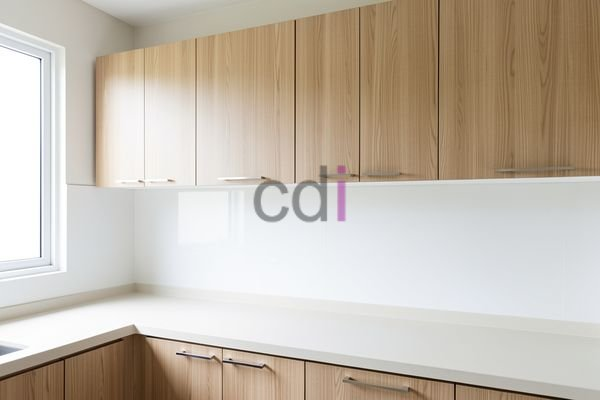

**Harga Lemari Atas Dapur: Estimasi Biaya & Tips Pemilihan 2026** - Hai Mitra CDI! Renovasi dapur sedang direncanakan? Nah, mengetahui perkiraan biaya lemari atas dapur adalah langkah cerdas sebelum mulai berburu desain impian. Memilih lemari yang tepat bukan hanya soal tampilan, tapi juga fungsi dan bagaimana ruang dapur dimaksimalkan. 

Dapur yang tertata rapi jelas bikin kegiatan memasak lebih nyaman dan menyenangkan, kan? Kami dari Creative Design Interior (CDI) memahami betul kebutuhan Mitra akan solusi penyimpanan yang efisien dan berkualitas. Artikel ini akan mengulas secara mendetail mengenai estimasi harga lemari atas dapur, apa saja faktor yang memengaruhi biaya, dan bagaimana memilih lemari yang pas dengan budget dan gaya dapur Anda. Yuk, simak bersama!

## Estimasi Harga Lemari Atas Dapur Berdasarkan Jenis Material

Material lemari atas dapur punya peran besar dalam menentukan harga. Setiap material menawarkan kelebihan dan kekurangan yang berbeda, sekaligus kisaran harga yang bervariasi. Beberapa material populer yang sering jadi pilihan antara lain:

*   **Multipleks (MDF/HDF):** Pilihan ekonomis dan mudah dibentuk, menjadikannya favorit banyak orang. Harga lemari atas dapur berbahan multipleks umumnya berkisar antara Rp400.000 hingga Rp800.000 per meter lari, tergantung ketebalan dan lapisan finishingnya.
*   **Kayu Solid:** Jika Anda menginginkan keindahan alami dan ketahanan jangka panjang, kayu solid seperti jati, mahoni, atau merbau adalah jawabannya. Tentu saja, harganya pun lebih tinggi, mulai dari Rp1.200.000 hingga Rp3.000.000 per meter lari.
*   **Aluminium:** Lemari aluminium menawarkan kepraktisan, tahan karat, dan perawatan yang relatif mudah. Harganya berkisar antara Rp600.000 hingga Rp1.500.000 per meter lari.
*   **Stainless Steel:** Pilihan modern dan higienis yang cocok untuk dapur minimalis. Harga lemari atas dapur stainless steel mulai dari Rp800.000 hingga Rp2.000.000 per meter lari.

Misalnya, jika Mitra CDI berencana memasang lemari atas dapur sepanjang 3 meter dengan material multipleks dan finishing HPL, perkiraan biayanya adalah 3 meter x Rp600.000/meter = Rp1.800.000. Perlu diingat, angka ini belum termasuk biaya pemasangan dan desain. Kami sarankan untuk selalu meminta rincian harga yang jelas dari penyedia jasa sebelum membuat keputusan akhir.

## Faktor-Faktor yang Mempengaruhi Biaya Lemari Atas Dapur

Harga lemari atas dapur tidak hanya ditentukan oleh material, tapi juga beberapa faktor berikut ini:

*   **Ukuran dan Desain:** Semakin rumit desain lemari dan semakin besar ukurannya, biaya pembuatannya akan meningkat.
*   **Jenis Finishing:** Pilihan finishing seperti HPL, melamin, cat duco, atau veneer akan memengaruhi harga akhir. Finishing yang lebih mewah dan tahan lama biasanya lebih mahal.
*   **Aksesori:** Penambahan aksesori seperti engsel *soft close*, lampu LED, atau rak piring dapat menambah biaya produksi.
*   **Biaya Pemasangan:** Harga pemasangan bervariasi tergantung lokasi dan tingkat kesulitan pemasangan, lho.

Harga di atas bersifat estimasi dan dapat berubah sewaktu-waktu. Untuk penawaran harga yang lebih akurat dan sesuai dengan kebutuhan proyek Anda, jangan ragu untuk menghubungi Kami.

## Skema Harga *All-In* dari Creative Design Interior (CDI)

Kami di Creative Design Interior mengerti bahwa Mitra membutuhkan kepastian anggaran yang jelas. Itulah mengapa Kami menawarkan skema harga *all-in* yang sudah mencakup material, pengiriman, dan biaya bongkar muat. Dengan skema ini, Anda tidak perlu khawatir dengan biaya tersembunyi yang tak terduga. Kami sudah berpengalaman lebih dari 10 tahun dalam pembuatan *kitchen set*, furniture interior, dan pengadaan material bangunan. Selain itu, kami juga menyediakan layanan jasa pengecoran, jasa bangun rumah, dan sewa alat konstruksi, menjadi solusi lengkap untuk renovasi dan pembangunan Anda. Kami melayani wilayah (not detected) dan sekitarnya.

## Kemudahan Pemesanan dan Beragam Pilihan Pembayaran

Pemesanan lemari atas dapur di CDI sangat mudah. Anda bisa langsung menghubungi Kami melalui tombol **Telepon** atau **WhatsApp** yang tersedia di bawah untuk berkonsultasi dengan tim desain Kami. Mereka akan membantu merancang lemari dapur yang sesuai dengan selera dan kebutuhan Anda. Kami juga menawarkan fleksibilitas dalam pembayaran, seperti COD, transfer bank, DP 50%, transfer setelah barang terkirim, bayar bertahap, atau transfer setelah pekerjaan selesai. Daftar harga lengkap Kami bisa Anda akses melalui website Kami. Jangan ragu untuk menghubungi kami jika Anda membutuhkan informasi lebih lanjut. Kami siap membantu mewujudkan dapur impian Anda!

<table class="table">
  <caption>Perbandingan Material Lemari Atas Dapur</caption>
  <thead>
    <tr><th>Material</th><th>Harga (per meter lari)</th><th>Kelebihan</th><th>Kekurangan</th></tr>
  </thead>
  <tbody>
    <tr><td>Multipleks (MDF/HDF)</td><td>Rp400.000 - Rp800.000</td><td>Terjangkau, mudah dibentuk</td><td>Kurang tahan air, mudah rusak jika terkena benturan keras</td></tr>
    <tr><td>Kayu Solid</td><td>Rp1.200.000 - Rp3.000.000</td><td>Tahan lama, tampilan alami</td><td>Mahal, membutuhkan perawatan khusus</td></tr>
    <tr><td>Aluminium</td><td>Rp600.000 - Rp1.500.000</td><td>Tahan karat, perawatan mudah</td><td>Tampilan kurang hangat</td></tr>
    <tr><td>Stainless Steel</td><td>Rp800.000 - Rp2.000.000</td><td>Higienis, modern</td><td>Harga relatif mahal, mudah tergores</td></tr>
  </tbody>
</table>

Silakan hubungi Kami melalui tombol **Telepon** atau **WhatsApp** yang tersedia di bawah untuk mendapatkan konsultasi gratis dan penawaran harga terbaik!