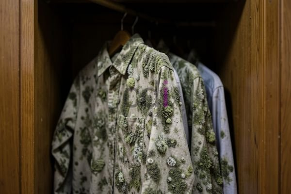

**Harga Lemari Baju Aluminium: Investasi Cerdas untuk Ruang Tidur Anda** - Hai Mitra CDI! Punya rencana menata ulang kamar tidur? Atau mungkin sedang mencari solusi penyimpanan pakaian yang tahan lama dan minim perawatan? Nah, lemari baju aluminium bisa jadi jawaban tepat. Lupakan masalah rayap atau lembap yang sering menghantui lemari kayu, atau rasa kurang kokohnya lemari plastik.

### Mengapa Pilih Lemari Baju Aluminium? Keunggulannya Dibanding Bahan Lain

Mitra, lemari aluminium menawarkan banyak kelebihan yang mungkin belum Anda ketahui. Ringan namun kuat, tahan karat, dan anti-rayap adalah beberapa keunggulan utamanya. Ini berarti lemari aluminium investasi jangka panjang yang sangat cocok untuk iklim tropis seperti di (not detected). Selain daya tahannya, perawatan lemari aluminium juga super praktis – cukup lap dengan kain basah, bersih!

Banyak yang berpikir lemari aluminium tampilannya kurang menarik. Tapi, anggapan itu sudah ketinggalan zaman, lho! Sekarang aluminium bisa diproses dengan beragam finishing, termasuk *powder coating* yang memberikan pilihan warna dan tekstur yang cantik. Jadi, lemari aluminium bisa disesuaikan dengan gaya interior kamar tidur Anda. Pemilihan finishing yang tepat juga penting untuk melindungi lemari dari goresan dan mempercantik tampilannya.

### Apa Saja yang Mempengaruhi Harga Lemari Baju Aluminium?

Harga lemari baju aluminium itu fleksibel, tergantung beberapa hal. Ukuran adalah faktor utama – semakin besar lemari, semakin banyak material yang dibutuhkan, dan tentu saja harganya akan menyesuaikan. Desain juga berpengaruh; desain yang rumit dengan banyak detail akan membutuhkan proses pembuatan yang lebih lama dan teliti.

Jenis aluminium yang digunakan juga menentukan harga, lho. Ada berbagai grade aluminium dengan tingkat kekuatan dan ketahanan yang berbeda. Semakin tinggi grade-nya, semakin mahal harganya, tapi juga semakin awet. Berikut ini perkiraan harga berdasarkan ukuran dan desain:

<table class="table">
  <caption>Estimasi Harga Lemari Baju Aluminium</caption>
  <thead>
    <tr><th>Ukuran (PxLxT)</th><th>Desain</th><th>Estimasi Harga (Rp)</th></tr>
  </thead>
  <tbody>
    <tr><td>120x50x180 cm</td><td>Minimalis 2 Pintu</td><td>1.800.000 - 2.500.000</td></tr>
    <tr><td>180x60x200 cm</td><td>Standar 3 Pintu</td><td>2.700.000 - 3.800.000</td></tr>
    <tr><td>240x60x200 cm</td><td>Full Sliding 4 Pintu</td><td>4.000.000 - 6.000.000</td></tr>
  </tbody>
</table>

Perlu diingat, harga di atas hanya estimasi dan bisa berubah sewaktu-waktu. Untuk mendapatkan penawaran terbaru dan paling akurat sesuai kebutuhan proyek Anda, silakan hubungi Kami!

### Creative Design Interior: Partner Terpercaya untuk Lemari Aluminium Custom

Kami di Creative Design Interior siap membantu Mitra CDI mewujudkan lemari baju aluminium impian. Dengan pengalaman lebih dari 10 tahun dalam membuat furniture custom, Kami menjamin kualitas dan ketepatan waktu pengerjaan. Apa yang Anda bayangkan, bisa Kami wujudkan! Kami menawarkan layanan desain custom sesuai dengan ukuran, warna, dan finishing yang Anda inginkan.

Kami hanya menggunakan material aluminium berkualitas tinggi dan proses pengerjaan yang teliti. Hasilnya? Lemari yang kuat, tahan lama, dan tentu saja, cantik! Harga all-in Kami sudah termasuk material, pengiriman, dan bongkar muat, jadi Anda tidak perlu khawatir dengan biaya tersembunyi. Kabar baiknya lagi, ada gratis ongkir untuk wilayah layanan Kami!

### Pesan Lemari Impian Anda Sekarang Juga dan Nikmati Kemudahan Pembayaran

Pesan lemari baju aluminium custom impian Anda sekarang juga melalui tombol WhatsApp atau Telepon di website Kami. Tim Kami siap membantu Anda dalam memilih desain, menentukan ukuran, dan memberikan penawaran harga yang kompetitif.

Kami menawarkan berbagai pilihan pembayaran yang fleksibel untuk kenyamanan Anda. Bisa COD, transfer bank, DP 50%, transfer setelah barang terkirim, bayar bertahap, atau transfer setelah pekerjaan selesai. Khawatir jika barang tidak sesuai? Jangan khawatir! Produk dapat ditukar jika tidak sesuai spesifikasi, asalkan belum dipakai atau dibongkar dan maksimal 1 hari setelah diterima. Untuk informasi lebih lengkap, daftar harga lengkap kami bisa Anda lihat di sini.

Butuh bantuan langsung untuk kebutuhan proyek di (not detected)? Jangan ragu untuk klik tombol **WhatsApp** atau **Telepon** di bawah. Kami siap membantu Anda! [Lemari Kayu 3 Pintu: Solusi Penyimpanan Optimal untuk Ruang Tidur Modern](/blog/lemari-kayu-3-pintu/) mungkin juga bisa jadi inspirasi untuk Anda.