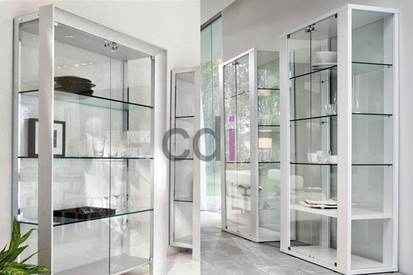

**Tersedia Harga Lemari Baju Kaca Custom di Jabodetabek** - Mitra CDI dimana saja berada, apakah Mitra sedang mencari lemari baju kaca yang sesuai dengan gaya dan kebutuhan ruangan? Memilih lemari baju kaca bukan hanya soal estetika, tetapi juga fungsionalitas. Data menunjukkan bahwa sekitar 60% orang Indonesia lebih memilih lemari dengan pintu kaca karena memberikan kesan ruangan lebih luas dan memudahkan dalam memilih pakaian. Oleh karena itu, memahami kisaran harga dan faktor-faktor yang mempengaruhinya akan membantu Mitra dalam membuat keputusan yang tepat.

## Estimasi Harga Lemari Baju Kaca: Apa Saja yang Mempengaruhi?

Harga lemari baju kaca sangat bervariasi, tergantung pada beberapa faktor utama. Ketebalan kaca yang digunakan merupakan salah satu penentu harga. Kaca dengan ketebalan 3mm biasanya digunakan untuk pintu lemari yang lebih kecil, sementara kaca 5mm atau 8mm lebih disarankan untuk pintu yang lebih besar untuk memastikan keamanan dan kekuatan. Jenis kaca juga berperan, apakah itu kaca bening, kaca frosted, atau kaca cermin. Selain itu, material rangka lemari (kayu solid, MDF, atau multipleks) serta desain yang kompleks juga akan mempengaruhi harga akhir.

Sebagai gambaran, harga lemari baju kaca standar dengan ukuran 2 meter x 2 meter dengan kaca 3mm dan rangka MDF dapat berkisar antara Rp2.500.000 hingga Rp4.000.000. Harga ini bersifat estimasi dan dapat berubah sewaktu-waktu — hubungi Kami untuk penawaran terbaru dan paling akurat sesuai kebutuhan proyek Mitra CDI. Kami di Creative Design Interior (CDI) memahami bahwa setiap ruangan dan setiap kebutuhan berbeda, sehingga kami menawarkan layanan custom yang fleksibel.

## Keunggulan Layanan Custom Lemari Baju Kaca dari CDI

Mitra CDI, CDI telah berpengalaman lebih dari 10 tahun dalam menyediakan layanan furniture custom, termasuk lemari baju kaca. Kami melayani wilayah Jakarta, Bogor, Depok, Tangerang, Bekasi, Cikarang, Karawang, Bandung, Serang, Purwakarta, Cilegon, Cikampek, Subang, dan Rangkasbitung. Keunggulan utama dari layanan custom Kami adalah Kami dapat menyesuaikan desain, ukuran, dan material sesuai dengan preferensi dan anggaran Mitra.

Kami menggunakan material berkualitas tinggi dan memiliki tim kerja berpengalaman dengan sistem kerja terjadwal agar pengerjaan tepat waktu dan kualitas terjaga. Selain itu, Kami menawarkan skema harga *all in one* yang sudah termasuk material, pengiriman, dan bongkar muat. Tersedia juga gratis ongkir (ketentuan mengikuti wilayah layanan). Pilihan pembayaran yang fleksibel, seperti COD, transfer bank, DP 50%, transfer setelah barang terkirim, bayar bertahap, atau transfer setelah pekerjaan selesai, juga menjadi nilai tambah bagi Mitra. Produk dapat ditukar jika tidak sesuai spesifikasi, selama belum dipakai atau dibongkar dan maksimal 1 hari.

## Pilihan Material dan Desain Lemari Baju Kaca: Perbandingan Singkat

Untuk membantu Mitra CDI dalam memilih material yang tepat, berikut adalah tabel perbandingan singkat antara beberapa opsi yang umum digunakan:

<table class="table">
  <caption>Perbandingan Material Lemari Baju Kaca</caption>
  <thead>
    <tr><th>Material</th><th>Kelebihan</th><th>Kekurangan</th><th>Estimasi Harga (per meter persegi)</th></tr>
  </thead>
  <tbody>
    <tr><td>MDF</td><td>Harga terjangkau, mudah dibentuk</td><td>Kurang tahan terhadap kelembaban</td><td>Rp 600.000 - Rp 800.000</td></tr>
    <tr><td>Multipleks</td><td>Kuat dan stabil, tahan lama</td><td>Permukaan kurang halus, perlu finishing</td><td>Rp 800.000 - Rp 1.200.000</td></tr>
    <tr><td>Kayu Solid</td><td>Tampilan mewah, tahan lama</td><td>Harga mahal, membutuhkan perawatan khusus</td><td>Rp 1.500.000 - Rp 3.000.000+</td></tr>
  </tbody>
</table>

Selain material, desain lemari juga penting untuk diperhatikan. Kami dapat membantu Mitra CDI dalam merancang lemari baju kaca dengan berbagai gaya, mulai dari minimalis modern hingga klasik elegan. Kami juga menawarkan berbagai fitur tambahan, seperti pencahayaan internal, laci internal, dan rak sepatu.

## Dapatkan Penawaran Harga Lemari Baju Kaca Custom Sekarang!

Mitra CDI, tunggu apa lagi? Dapatkan lemari baju kaca impian Mitra sekarang juga dengan layanan custom dari CDI! Kami siap membantu Mitra dalam mewujudkan desain lemari yang sempurna untuk kebutuhan dan anggaran Mitra. Untuk informasi lebih lanjut mengenai daftar harga, Mitra dapat mengunjungi halaman [Daftar Harga](/daftar-harga/). Jangan ragu untuk berkonsultasi dengan tim Kami untuk mendapatkan penawaran harga yang sesuai dengan kebutuhan proyek Mitra.

Untuk konsultasi lebih lanjut, tombol **Telepon** dan **WhatsApp** di bawah halaman ini dapat langsung digunakan untuk menghubungi Kami.
