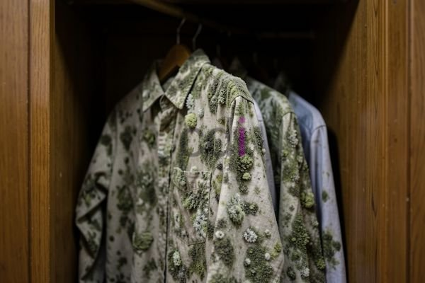

**Harga Lemari Baju Kayu: Cek Estimasi & Pesan Custom di Jabodetabek** - Halo, Mitra CDI! Apakah Anda sedang merencanakan memperbarui tampilan kamar tidur? Atau mungkin membutuhkan ruang penyimpanan yang lebih lega? Lemari baju kayu bisa jadi jawabannya! Seiring dengan meningkatnya minat masyarakat akan kualitas hidup, permintaan akan furniture kayu yang tahan lama – termasuk lemari baju – semakin tinggi. Nah, Creative Design Interior hadir untuk membantu Anda mewujudkan lemari baju impian dengan harga yang bersaing dan layanan yang prima, khususnya di wilayah Jabodetabek.

## Mengenal Faktor Penentu Harga Lemari Baju Kayu

Sebelum kita membahas lebih jauh, penting untuk memahami apa saja yang memengaruhi harga lemari baju kayu. Ini akan membantu Anda membuat keputusan yang tepat sesuai dengan anggaran dan kebutuhan. Beberapa faktor utama yang perlu dipertimbangkan antara lain: jenis kayu, ukuran dan desain lemari, serta jenis finishing yang dipilih.

Jenis kayu tentu sangat memengaruhi harga. Kayu solid seperti jati atau mahoni menawarkan kualitas terbaik dan keindahan alami, namun harganya relatif lebih mahal. Alternatifnya, kayu olahan seperti multipleks atau MDF bisa menjadi pilihan yang lebih ekonomis, meskipun dengan tingkat kekuatan dan daya tahan yang berbeda. Selanjutnya, desain lemari yang rumit dengan banyak detail akan membutuhkan lebih banyak waktu dan material, sehingga memengaruhi harga akhir. Terakhir, finishing juga berperan penting. Finishing cat duco misalnya, memerlukan proses yang lebih kompleks dan mahal dibandingkan finishing melamin.

Sebagai perkiraan, untuk lemari baju kayu dengan ukuran standar (lebar 120 cm, tinggi 180 cm, kedalaman 60 cm) berbahan multipleks berkualitas dengan finishing melamin, harganya berkisar antara Rp 2.500.000 hingga Rp 4.000.000. Jika Anda menginginkan lemari baju dengan material kayu jati solid dan desain custom, harganya bisa mencapai puluhan juta Rupiah. Harga ini hanyalah estimasi dan bisa berubah, jadi yuk, segera hubungi Kami untuk mendapatkan penawaran paling akurat sesuai dengan kebutuhan proyek Anda di Jabodetabek!

## Panduan Memilih Material Lemari Baju Kayu yang Sesuai

Memilih material yang tepat adalah kunci utama untuk mendapatkan lemari baju yang awet dan sesuai dengan gaya Anda, Mitra. Pertimbangkan beberapa opsi berikut ini:

*   **Kayu Jati:** Pilihan terbaik untuk mereka yang mengutamakan kualitas dan keindahan. Tahan lama, kuat, dan memiliki serat kayu yang khas. Ideal untuk lemari baju bergaya klasik atau mewah.
*   **Kayu Mahoni:** Alternatif yang lebih terjangkau dibandingkan jati, namun tetap menawarkan kekuatan dan keindahan tersendiri.
*   **Multipleks:** Material kayu olahan yang populer karena kekuatannya dan kemudahan dalam proses pengerjaan. Cocok untuk desain modern dan minimalis.
*   **MDF (Medium Density Fiberboard):** Pilihan paling ekonomis, namun kurang tahan lama dibandingkan opsi lainnya. Lebih cocok untuk lemari baju dengan budget terbatas.

Pertimbangkan gaya hidup Anda dan berapa lama Anda ingin menggunakan lemari tersebut. Jika Anda menginginkan investasi jangka panjang, kayu jati atau mahoni adalah pilihan yang tepat. Namun, jika Anda mencari solusi hemat biaya untuk sementara waktu, multipleks atau MDF bisa menjadi alternatif yang baik. Jangan ragu untuk berkonsultasi dengan tim ahli Kami untuk mendapatkan rekomendasi terbaik.

## Keunggulan Pesan Lemari Baju Kayu Custom di Creative Design Interior

Apa yang membuat Creative Design Interior berbeda? Kami menawarkan kebebasan penuh untuk merancang lemari baju impian Anda! Dengan layanan custom, Anda dapat menentukan sendiri ukuran, desain, material, dan finishing sesuai dengan selera dan kebutuhan spesifik Anda. Selain itu, Kami juga menawarkan kemudahan dalam pembayaran dan kepastian kualitas.

Kami menyediakan skema pembayaran yang fleksibel, seperti COD, transfer bank, DP 50%, transfer setelah barang terkirim, bayar bertahap, atau transfer setelah pekerjaan selesai. Ditambah lagi, Kami memberikan gratis ongkir untuk wilayah Jabodetabek (Jakarta, Bogor, Depok, Tangerang, Bekasi, Cikarang, Karawang, Bandung, Serang, Purwakarta, Cilegon, Cikampek, Subang, dan Rangkasbitung) dengan syarat dan ketentuan yang berlaku. Tim Kami yang berpengalaman dan berdedikasi akan memastikan pengerjaan tepat waktu dan dengan kualitas terbaik. Bahkan, Kami memberikan garansi tukar produk jika tidak sesuai dengan spesifikasi yang Anda inginkan (selama belum dipakai atau dibongkar, dan maksimal 1 hari).

Yuk, jangan tunda lagi! Wujudkan lemari baju kayu yang sempurna untuk Anda. Kunjungi daftar harga Kami untuk melihat pilihan yang tersedia, atau langsung hubungi Kami melalui tombol **WhatsApp** atau **Telepon** pada halaman ini untuk konsultasi gratis.

Apabila Anda masih memiliki pertanyaan, jangan sungkan untuk menghubungi Kami melalui tombol **WhatsApp** atau **Telepon** pada halaman ini. Kami siap membantu!