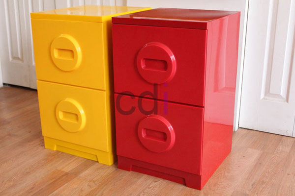

**Harga Lemari Baju Plastik: Pertimbangkan Ini Sebelum Membeli** - Hai Mitra CDI! Mencari lemari baju plastik yang ideal untuk hunian Anda di (not detected)? Memilih yang tepat memang perlu dipikirkan matang-matang. Yuk, kita bahas faktor-faktor penting yang perlu diperhatikan sebelum membeli, supaya lemari impian Anda sesuai dengan kebutuhan dan anggaran.

Memilih lemari baju plastik yang pas itu penting banget, lho. Selain bikin pakaian lebih tertata, lemari yang baik juga bisa memaksimalkan ruang di kamar Anda. Jelas ada banyak pilihan harga lemari baju plastik yang tersedia, tapi jangan cuma terpaku pada yang termurah, ya! Nah, di artikel ini, kami akan bantu Anda memahami apa saja yang memengaruhi harga dan kualitas lemari plastik supaya Anda bisa membuat keputusan yang tepat.

## Yuk, Kenali Faktor-Faktor yang Mempengaruhi Harga Lemari Baju Plastik

Beberapa hal penting memengaruhi harga lemari baju plastik. Kualitas bahan plastik yang digunakan adalah penentu utama. Semakin tebal dan berkualitas bahan plastiknya, tentu saja harganya juga akan lebih tinggi, tapi juga lebih awet. Ukuran lemari juga berpengaruh, lho. Semakin besar lemari, semakin banyak bahan yang digunakan, ya otomatis harganya juga naik.

Desain dan fitur tambahan juga ikut menentukan harga. Lemari dengan desain yang lebih rumit, lengkap dengan laci, gantungan khusus, atau bahkan cermin, umumnya lebih mahal dari model yang sederhana. Kami di Creative Design Interior (CDI) paham betul bahwa setiap kebutuhan itu unik. Oleh karena itu, kami menyediakan beragam pilihan lemari plastik dengan desain dan ukuran yang bervariasi, menyesuaikan dengan *budget* dan selera Anda. Kalau Anda mencari alternatif yang lebih elegan, Tersedia Harga Lemari Baju Kaca Custom di Jabodetabek bisa jadi pilihan menarik.

## Membandingkan Jenis Plastik: Apa Bedanya dan Bagaimana Pengaruhnya pada Harga?

Ada beberapa jenis plastik yang sering dipakai untuk membuat lemari baju, yang paling umum adalah *polypropylene* (PP) dan *polystyrene* (PS). Plastik PP dikenal kuat dan tahan benturan, sedangkan PS lebih ringan dan harganya lebih terjangkau.

Umumnya, lemari baju plastik berbahan PP akan lebih mahal dibandingkan yang berbahan PS. Tapi, investasi pada lemari berbahan PP seringkali lebih masuk akal dalam jangka panjang karena lebih tahan lama. Berikut tabel perbandingan singkatnya:

<table class="table">
  <caption>Perbandingan Jenis Plastik Lemari Baju</caption>
  <thead>
    <tr><th>Jenis Plastik</th><th>Kelebihan</th><th>Kekurangan</th><th>Estimasi Harga (per unit)</th></tr>
  </thead>
  <tbody>
    <tr><td>Polypropylene (PP)</td><td>Kuat, tahan benturan, tahan terhadap bahan kimia</td><td>Harga cenderung lebih tinggi</td><td>Rp 300.000 - Rp 1.500.000</td></tr>
    <tr><td>Polystyrene (PS)</td><td>Ringan, harga ekonomis</td><td>Kurang kuat, rentan pecah</td><td>Rp 150.000 - Rp 600.000</td></tr>
  </tbody>
</table>

Perlu diingat bahwa harga di atas hanyalah estimasi dan bisa berubah sewaktu-waktu. Untuk mendapatkan penawaran terbaru dan akurat sesuai dengan kebutuhan proyek Anda di (not detected), jangan ragu untuk menghubungi kami!

## Solusi Furniture Custom dari Creative Design Interior

Kami di Creative Design Interior (CDI) menawarkan solusi furniture custom, termasuk lemari baju plastik yang bisa disesuaikan persis dengan kebutuhan dan anggaran Anda. Kami menyediakan berbagai pilihan material, ukuran, dan desain yang bisa dipersonalisasi. Dengan pengalaman lebih dari 10 tahun di bidang pembuatan furniture interior, kami menjamin kualitas dan ketepatan waktu pengerjaan.

CDI juga menyediakan layanan pengadaan material bangunan, jasa pengecoran, dan jasa bangun rumah. Skema harga *all in one* kami mencakup material, pengiriman, dan bongkar muat, jadi Anda tidak perlu khawatir dengan biaya tambahan yang tak terduga. Plus, kami menawarkan pilihan pembayaran yang fleksibel, mulai dari COD, transfer bank, hingga opsi cicilan yang memudahkan. Kami siap melayani Anda di seluruh wilayah Jabodetabek, Bandung, Serang, dan sekitarnya.

Ingin solusi penyimpanan pakaian yang lebih tahan lama dan mewah? Yuk, pertimbangkan juga Harga Lemari Baju Aluminium: Investasi Cerdas untuk Ruang Tidur Anda. Jangan sungkan untuk berkonsultasi dengan tim kami untuk mendapatkan rekomendasi terbaik.

Butuh bantuan langsung untuk mewujudkan proyek impian Anda di (not detected)? Klik tombol **WhatsApp** atau **Telepon** di bawah ini untuk berkonsultasi dengan tim ahli kami! Jangan tunda lagi, yuk mulai desain kamar impian Anda sekarang.