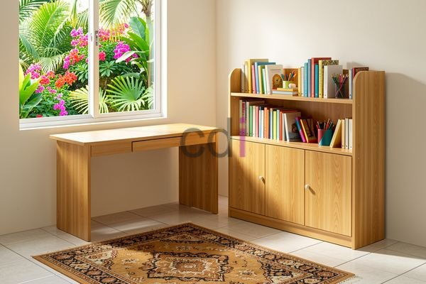

**Tersedia Harga Lemari Belajar Kayu Custom, Solusi Ruang Efisien** - Mitra CDI, apakah Mitra sedang mencari solusi penyimpanan cerdas untuk mendukung kegiatan belajar di rumah? Lemari belajar kayu merupakan investasi yang tepat untuk menciptakan ruang belajar yang rapi, teratur, dan inspiratif. Kami dari Creative Design Interior (CDI) menyediakan berbagai pilihan lemari belajar kayu yang dapat disesuaikan dengan kebutuhan dan anggaran Mitra.

### Memahami Faktor Penentu Harga Lemari Belajar Kayu

Mitra, sebelum memutuskan pembelian, penting untuk memahami faktor-faktor yang memengaruhi harga lemari belajar kayu. Jenis kayu yang digunakan merupakan faktor utama. Kayu solid seperti jati, mahoni, atau kayu keras lainnya akan memiliki harga yang lebih tinggi dibandingkan dengan kayu olahan seperti MDF atau particle board. Ukuran dan desain lemari juga berperan signifikan. Semakin kompleks desainnya dan semakin besar ukurannya, tentu saja biayanya akan meningkat.

Selain itu, finishing lemari juga memengaruhi harga. Finishing melamin cenderung lebih ekonomis, sementara finishing cat duco atau natural varnish akan memberikan tampilan yang lebih mewah dan tahan lama, namun dengan harga yang lebih tinggi. Kami di CDI menyediakan berbagai pilihan finishing sesuai preferensi Mitra.

### Pilihan Material Kayu dan Estimasi Harganya

Untuk memberikan gambaran yang lebih jelas, berikut adalah beberapa pilihan material kayu yang umum digunakan dalam pembuatan lemari belajar beserta estimasi harganya per meter persegi (harga ini bersifat estimasi dan dapat berubah sewaktu-waktu — hubungi Kami untuk penawaran terbaru dan paling akurat sesuai kebutuhan proyek Mitra CDI):

<table class="table">
  <caption>Estimasi Harga Material Kayu (per Meter Persegi)</caption>
  <thead>
    <tr><th>Jenis Kayu</th><th>Harga (Estimasi)</th><th>Kelebihan</th><th>Kekurangan</th></tr>
  </thead>
  <tbody>
    <tr><td>MDF</td><td>Rp 300.000 - Rp 500.000</td><td>Harga terjangkau, mudah dibentuk</td><td>Kurang tahan lama, rentan terhadap kelembaban</td></tr>
    <tr><td>Particle Board</td><td>Rp 250.000 - Rp 400.000</td><td>Paling ekonomis, permukaan halus</td><td>Kekuatan rendah, mudah rusak jika terkena air</td></tr>
    <tr><td>Pinus</td><td>Rp 500.000 - Rp 700.000</td><td>Harga relatif terjangkau, tampilan natural</td><td>Kurang tahan terhadap rayap, perlu perawatan ekstra</td></tr>
    <tr><td>Mahoni</td><td>Rp 800.000 - Rp 1.200.000</td><td>Tahan lama, tampilan elegan</td><td>Harga lebih mahal</td></tr>
    <tr><td>Jati</td><td>Rp 1.500.000 - Rp 2.500.000</td><td>Sangat tahan lama, kualitas premium</td><td>Harga paling mahal</td></tr>
  </tbody>
</table>

Sebagai contoh, Mitra membutuhkan lemari belajar kayu ukuran 120 cm x 60 cm x 180 cm (tinggi) dengan material kayu mahoni dan finishing cat duco. Estimasi biayanya adalah sebagai berikut: Luas permukaan lemari = (1.2 m x 0.6 m) + (1.2 m x 0.6 m) + (1.2 m x 1.8 m) + (0.6 m x 1.8 m) = 0.72 m² + 0.72 m² + 2.16 m² + 1.08 m² = 4.68 m². Biaya material (mahoninya) = 4.68 m² x Rp 1.000.000/m² (rata-rata) = Rp 4.680.000. Biaya finishing (cat duco) = Rp 1.500.000. Biaya total = Rp 4.680.000 + Rp 1.500.000 = Rp 6.180.000 (harga ini belum termasuk biaya pengiriman dan perakitan).

### Kemudahan Mendapatkan Lemari Belajar Impian Bersama CDI

Mitra, Kami di Creative Design Interior (CDI) memahami bahwa setiap ruang belajar memiliki kebutuhan yang unik. Oleh karena itu, Kami menawarkan layanan custom lemari belajar kayu sesuai dengan preferensi Mitra. Mitra dapat memilih jenis kayu, ukuran, desain, finishing, dan fitur tambahan seperti laci, rak buku, atau papan tulis. Proses pemesanan sangat mudah. Mitra dapat menghubungi Kami melalui tombol **Telepon** atau **WhatsApp** yang tersedia di bawah untuk berkonsultasi dengan tim desain Kami secara gratis. Kami akan membantu Mitra merancang lemari belajar yang sempurna sesuai dengan anggaran dan kebutuhan Mitra. Kami juga menawarkan skema harga *all in one* yang sudah termasuk material, pengiriman, dan bongkar muat.

Dapatkan daftar harga lengkap Kami di [halaman Daftar Harga](URL). Mitra juga dapat menikmati gratis ongkir untuk wilayah Jabodetabek (ketentuan berlaku). Kami menerima berbagai pilihan pembayaran: COD, transfer bank, DP 50%, transfer setelah barang terkirim, bayar bertahap, atau transfer setelah pekerjaan selesai. Tim Kami siap membantu mewujudkan proyek Mitra CDI — silakan hubungi melalui tombol **Telepon** atau **WhatsApp** yang tersedia di bawah.
