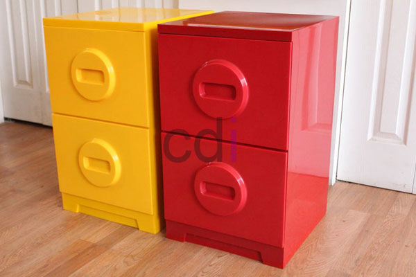

**Harga Lemari Belajar Plastik: Panduan Pemilihan dan Estimasi Biaya 2026** - Mitra CDI yang budiman, seringkali kita mendapati ruang belajar anak terasa berantakan karena kurangnya tempat penyimpanan yang efisien. Banyak yang langsung memilih lemari belajar plastik karena dianggap praktis dan terjangkau. Namun, tanpa pertimbangan matang, pembelian ini justru bisa menjadi bumerang karena kualitas yang tidak sesuai harapan atau ukuran yang tidak ideal.

### Memahami Ragam Lemari Belajar Plastik yang Tersedia

Mitra, lemari belajar plastik hadir dalam berbagai model dan ukuran. Secara umum, terdapat lemari dengan satu, dua, atau tiga laci, serta lemari dengan kombinasi laci dan rak terbuka. Pilihan desain pun sangat beragam, mulai dari yang minimalis hingga yang bertema karakter kartun favorit anak. Pemilihan model tentu saja harus disesuaikan dengan luas ruangan dan kebutuhan penyimpanan anak. Lemari dengan rak terbuka sangat cocok untuk menyimpan buku-buku yang sering digunakan, sementara laci berfungsi untuk menyimpan alat tulis, perlengkapan sekolah, dan barang-barang lain agar lebih terorganisir.

Selain itu, penting untuk memperhatikan bahan plastik yang digunakan. Beberapa produsen menggunakan plastik polypropylene (PP) yang dikenal lebih kuat dan tahan lama dibandingkan jenis plastik lainnya. Perhatikan juga ketebalan plastik; semakin tebal, semakin kokoh lemari tersebut. Kami menyarankan untuk memilih lemari dengan struktur yang stabil dan tidak mudah goyah, terutama jika anak Anda cenderung aktif.

### Estimasi Harga Lemari Belajar Plastik Berdasarkan Ukuran

Mitra, harga lemari belajar plastik sangat bervariasi tergantung ukuran, fitur, dan merek. Sebagai gambaran, berikut adalah estimasi harga berdasarkan ukuran dan tipe umum:

| Ukuran Lemari | Jumlah Laci/Rak | Estimasi Harga (Rp) |
|---|---|---|
| Kecil (lebar 60-80 cm) | 1-2 laci | 250.000 – 500.000 |
| Sedang (lebar 80-120 cm) | 2-3 laci / Rak + Laci | 500.000 – 1.200.000 |
| Besar (lebar 120-160 cm) | 3+ laci / Rak + Laci | 1.200.000 – 2.500.000 |

Harga ini bersifat estimasi dan dapat berubah sewaktu-waktu — hubungi Kami untuk penawaran terbaru dan paling akurat sesuai kebutuhan proyek Mitra CDI. Perlu diingat bahwa harga tersebut belum termasuk ongkos kirim. Sebagai perbandingan, lemari belajar kayu dengan ukuran serupa biasanya memiliki harga yang lebih tinggi, mulai dari Rp 800.000 hingga lebih dari Rp 5.000.000, tergantung jenis kayu, desain, dan finishing.

### Memilih Lemari Belajar Plastik yang Tepat: Apa yang Perlu Dipertimbangkan?

Mitra, sebelum memutuskan untuk membeli lemari belajar plastik, ada beberapa hal penting yang perlu dipertimbangkan. Pertama, perhatikan ukuran ruangan. Pastikan lemari yang Anda pilih tidak akan membuat ruangan terasa sempit dan tetap menyisakan ruang gerak yang cukup bagi anak. Kedua, pertimbangkan kebutuhan penyimpanan anak. Apakah anak Anda memiliki banyak buku? Apakah dia membutuhkan ruang untuk menyimpan alat tulis, perlengkapan seni, atau mainan? Ketiga, perhatikan kualitas bahan plastik. Pilihlah lemari yang terbuat dari plastik yang kuat dan tahan lama. Keempat, pertimbangkan desain dan warna lemari. Pilihlah desain dan warna yang sesuai dengan tema ruangan dan selera anak.

Kami di Creative Design Interior memahami bahwa setiap ruang belajar memiliki kebutuhan yang unik. Oleh karena itu, Kami menawarkan solusi lemari belajar custom yang dapat disesuaikan dengan keinginan Mitra. Dengan lemari custom, Mitra dapat menentukan ukuran, desain, warna, dan fitur yang paling sesuai dengan kebutuhan dan anggaran Mitra. [Daftar Harga](/daftar-harga/) tersedia di halaman Kami untuk referensi awal.

Selain menyediakan lemari belajar plastik dan custom, Kami juga melayani pembuatan furniture interior lainnya, seperti kitchen set, lemari pakaian, dan meja belajar. Kami berpengalaman lebih dari 10 tahun dalam bidang ini dan selalu mengutamakan kualitas dan kepuasan pelanggan. Skema harga all in one Kami sudah termasuk material, pengiriman, dan bongkar muat. Tersedia gratis ongkir (ketentuan mengikuti wilayah layanan).

Apabila terdapat pertanyaan lain seputar topik ini, tombol **Telepon** dan **WhatsApp** di bawah halaman ini siap Kami jawab.
