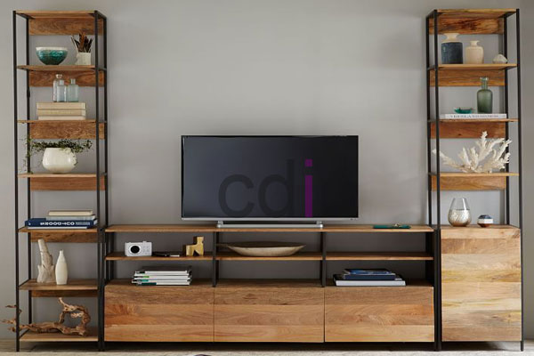

**Harga Lemari Besi Bekas: Pilihan Hemat dan Aman** - Hai Mitra CDI! Mencari cara aman menyimpan barang berharga tanpa bikin dompet jebol? Lemari besi bekas bisa jadi solusi tepat! Di (not detected), Kami hadir dengan opsi lemari besi bekas berkualitas yang terjamin keamanannya.

Memilih lemari besi bekas memang butuh perhatian khusus. Kondisi fisik, ukuran, dan tentu saja, tingkat keamanannya perlu jadi pertimbangan utama. Tapi tenang, dengan sedikit riset, Anda bisa menemukan lemari besi bekas yang masih prima dengan harga yang jauh lebih bersahabat daripada yang baru. Belum lagi, memilih barang bekas berarti Anda ikut berkontribusi dalam gerakan *sustainable living*, mengurangi limbah, dan memperpanjang usia produk.

## Kenapa Lemari Besi Bekas Jadi Pilihan Cerdas?

Pertimbangan utama biasanya adalah harga, kan? Nah, lemari besi baru, apalagi yang berukuran besar dan dilengkapi fitur keamanan canggih, bisa jadi investasi yang cukup besar. Membeli lemari besi bekas adalah cara cerdas untuk mendapatkan perlindungan serupa dengan anggaran yang lebih ramah kantong. Selain itu, mengurangi limbah dan mendukung konsumsi berkelanjutan juga merupakan nilai plus yang penting, lho!

Namun, jangan sembarangan memilih, ya. Perlu diingat, kualitas lemari besi bekas bisa sangat bervariasi. Jadi, pemeriksaan menyeluruh sebelum membeli itu wajib hukumnya. Cari tahu apakah ada karat parah, kerusakan pada bagian kunci atau engsel, dan pastikan mekanisme pengunciannya berfungsi optimal. Menanyakan riwayat penggunaan lemari besi kepada penjual juga bisa memberikan gambaran yang lebih jelas.

## Kisaran Harga Lemari Besi Bekas Berdasarkan Ukuran & Kondisi

Harga lemari besi bekas itu dinamis, tergantung ukuran, kondisi, dan mereknya. Secara umum, harganya berkisar antara Rp 500.000 hingga Rp 5.000.000 atau lebih. Lemari besi ukuran kecil dengan kondisi standar biasanya yang paling terjangkau. Sementara itu, lemari besi berukuran besar dengan fitur keamanan tinggi dan kondisi terawat baik tentu akan lebih mahal.

Berikut perkiraan harganya berdasarkan ukuran:

*   **Lemari Besi Kecil (tinggi ≤ 60 cm):** Rp 500.000 – Rp 1.500.000
*   **Lemari Besi Sedang (tinggi 60 – 120 cm):** Rp 1.000.000 – Rp 3.000.000
*   **Lemari Besi Besar (tinggi > 120 cm):** Rp 2.500.000 – Rp 5.000.000+

Harga di atas hanyalah estimasi dan bisa berubah sewaktu-waktu. Untuk mendapatkan penawaran terbaik dan paling akurat sesuai kebutuhan Anda di (not detected), hubungi Kami sekarang! Kalau Anda juga tertarik dengan opsi baru, Kami juga menyediakan harga lemari brangkas besi terbaru dengan berbagai model dan fitur unggulan.

## Tips Jitu Membeli Lemari Besi Bekas Berkualitas

Sebelum Anda memutuskan untuk membeli lemari besi bekas, perhatikan beberapa tips ini:

1.  **Periksa Kondisi Fisik Secara Detail:** Pastikan tidak ada karat yang serius, penyok yang mengganggu, atau kerusakan struktural lainnya. Cek juga kondisi pintu, engsel, dan mekanisme kunci dengan saksama.
2.  **Uji Fungsi Kunci dan Kombinasi:** Pastikan kunci dan kombinasi (jika ada) berfungsi dengan baik. Mintalah penjual mendemonstrasikan cara membuka dan menutup lemari besi untuk memastikan semuanya berjalan lancar.
3.  **Gali Informasi Riwayat Penggunaan:** Cari tahu sebanyak mungkin tentang riwayat penggunaan lemari besi tersebut. Apakah pernah menyimpan barang berharga yang sangat mahal? Pernahkah mengalami kerusakan akibat bencana atau percobaan pencurian?
4.  **Lakukan Perbandingan Harga:** Riset harga di berbagai tempat akan membantu Anda mendapatkan penawaran terbaik. Jangan ragu untuk menawar jika Anda merasa harga yang ditawarkan terlalu tinggi.

## Creative Design Interior: Solusi Keamanan Aset Terpadu

Kami dari Creative Design Interior menyediakan solusi lengkap untuk kebutuhan keamanan aset Anda. Gak cuma menyediakan lemari besi baru dan bekas, Kami juga menawarkan jasa pemasangan profesional dan perawatan berkala. Tim Kami yang berpengalaman dan terlatih akan memastikan lemari besi Anda terpasang dengan aman dan berfungsi optimal. Selain itu, Kami juga menyediakan berbagai material bangunan dan jasa pengecoran untuk menunjang proyek konstruksi Anda.

Dengan pengalaman lebih dari 10 tahun di bidang interior dan konstruksi di (not detected), Kami siap membantu Anda menciptakan ruang yang aman, nyaman, dan fungsional. Kami menawarkan skema harga *all in one* yang mencakup material, pengiriman, dan bongkar muat. Belum lagi, tersedia gratis ongkir untuk wilayah layanan Kami. Pilihan pembayaran pun fleksibel: COD, transfer bank, DP 50%, transfer setelah barang tiba, bayar bertahap, atau transfer setelah pekerjaan selesai. Kami melayani wilayah Jakarta, Bogor, Depok, Tangerang, Bekasi, Cikarang, Karawang, Bandung, Serang, Purwakarta, Cilegon, Cikampek, Subang, dan Rangkasbitung.

Butuh konsultasi gratis? Jangan sungkan untuk menghubungi Kami! Gunakan tombol **Telepon** atau **WhatsApp** yang tersedia di bawah halaman ini untuk berdiskusi langsung dengan tim ahli Kami. Yuk, wujudkan keamanan aset impian Anda bersama Creative Design Interior! [Bufet dapur gantung minimalis](/blog/bufet-dapur-gantung-minimalis/) juga bisa jadi pilihan untuk memaksimalkan ruang dapur Anda.