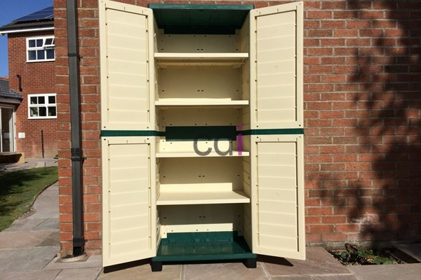

**Harga Lemari Boneka Plastik di Jabodetabek: Pilihan dan Estimasi Biaya** - Mitra CDI di mana pun berada, pernahkah Mitra mempertimbangkan untuk memberikan ruang penyimpanan yang khusus bagi koleksi boneka buah hati? Menyediakan lemari boneka yang tepat tidak hanya membantu menata ruangan agar lebih rapi, tetapi juga mengajarkan anak mengenai pentingnya kerapian dan organisasi sejak dini.

### Memahami Ragam Harga Lemari Boneka Plastik

Mitra, harga lemari boneka plastik sangat bervariasi, dipengaruhi oleh beberapa faktor utama. Ukuran adalah penentu utama; lemari dengan dimensi lebih besar dan kapasitas penyimpanan lebih banyak tentu akan memiliki harga yang lebih tinggi. Model juga berperan penting. Lemari dengan desain karakter kartun populer atau fitur tambahan seperti pintu geser atau laci seringkali ditawarkan dengan harga premium. Material plastik yang digunakan juga memengaruhi harga. Plastik dengan kualitas lebih baik, seperti polypropylene (PP) yang lebih tahan lama dan tidak berbau, umumnya lebih mahal dibandingkan plastik daur ulang.

Sebagai gambaran, lemari boneka plastik ukuran kecil (tinggi 60-80 cm, lebar 40-60 cm) dengan desain sederhana dapat ditemukan dengan harga mulai dari Rp 200.000 hingga Rp 500.000. Sementara itu, lemari ukuran sedang (tinggi 100-120 cm, lebar 60-80 cm) dengan desain lebih menarik dan fitur tambahan bisa mencapai Rp 600.000 hingga Rp 1.200.000. Untuk lemari ukuran besar (tinggi 150 cm ke atas, lebar 80 cm ke atas), harganya dapat melebihi Rp 1.500.000, tergantung pada kompleksitas desain dan kualitas material. Harga ini bersifat estimasi dan dapat berubah sewaktu-waktu — hubungi Kami untuk penawaran terbaru dan paling akurat sesuai kebutuhan proyek Mitra CDI.

### Pilihan Lemari Boneka Plastik Berdasarkan Ukuran dan Fungsi

Mitra, pemilihan lemari boneka plastik juga perlu mempertimbangkan fungsi dan kebutuhan spesifik. Untuk anak-anak yang baru mulai mengoleksi boneka, lemari ukuran kecil mungkin sudah cukup. Namun, jika koleksi boneka semakin bertambah, Mitra mungkin perlu mempertimbangkan lemari ukuran sedang atau besar. Selain ukuran, perhatikan juga fitur-fitur tambahan yang ditawarkan. Misalnya, lemari dengan rak yang dapat disesuaikan akan memudahkan Mitra untuk mengatur ruang penyimpanan sesuai dengan ukuran boneka yang berbeda-beda.

Untuk membantu Mitra CDI dalam memilih lemari boneka plastik yang tepat, Kami telah merangkum beberapa pilihan berdasarkan ukuran dan fungsi dalam tabel berikut:

<table class="table">
  <caption>Perbandingan Lemari Boneka Plastik Berdasarkan Ukuran</caption>
  <thead>
    <tr><th>Ukuran</th><th>Kapasitas</th><th>Estimasi Harga</th><th>Cocok untuk</th></tr>
  </thead>
  <tbody>
    <tr><td>Kecil (60-80 cm)</td><td>5-10 boneka</td><td>Rp 200.000 - Rp 500.000</td><td>Koleksi boneka kecil atau awal</td></tr>
    <tr><td>Sedang (100-120 cm)</td><td>10-20 boneka</td><td>Rp 600.000 - Rp 1.200.000</td><td>Koleksi boneka sedang</td></tr>
    <tr><td>Besar (150 cm ke atas)</td><td>20+ boneka</td><td>Rp 1.500.000+</td><td>Koleksi boneka besar atau koleksi variatif</td></tr>
  </tbody>
</table>

### Creative Design Interior: Solusi Lengkap untuk Kebutuhan Penyimpanan Anak

Mitra, di Creative Design Interior, Kami memahami pentingnya memiliki solusi penyimpanan yang praktis, tahan lama, dan aman untuk anak-anak. Kami menyediakan berbagai pilihan lemari boneka plastik dengan berbagai ukuran, desain, dan fitur. Selain itu, Kami juga menawarkan layanan custom furniture, sehingga Mitra dapat memesan lemari boneka plastik yang sesuai dengan kebutuhan dan preferensi spesifik. Kami berpengalaman lebih dari 10 tahun sebagai jasa kitchen set, pembuatan furniture interior, dan pengadaan material bangunan.

Kami menyediakan skema harga *all in one*, yang sudah termasuk material, pengiriman, dan bongkar muat. Tersedia juga gratis ongkir untuk wilayah tertentu. Pilihan pembayaran yang fleksibel, seperti COD, transfer bank, DP 50%, transfer setelah barang terkirim, bayar bertahap, atau transfer setelah pekerjaan selesai, dapat disesuaikan dengan kebutuhan Mitra.

Tertarik untuk mengetahui lebih lanjut tentang pilihan lemari boneka plastik Kami? Kunjungi [halaman Daftar Harga](/daftar-harga/) untuk melihat daftar harga lengkap. Atau, jangan ragu untuk menghubungi Kami melalui tombol **Telepon** atau **WhatsApp** di bawah halaman ini untuk konsultasi gratis dan penawaran terbaik. Tim kerja berpengalaman Kami akan siap membantu Mitra CDI menemukan lemari boneka plastik yang sempurna untuk buah hati.

Apabila terdapat pertanyaan lain seputar topik ini, tombol **Telepon** dan **WhatsApp** di bawah halaman ini siap Kami jawab.
