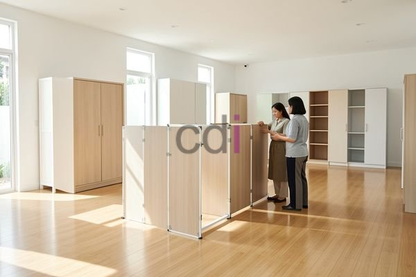

**Tersedia Harga Lemari Bongkar Pasang Terbaik untuk Ruang Optimal** - Mitra CDI yang berbahagia, apakah Mitra sedang mencari solusi penyimpanan yang fleksibel dan efisien? Lemari bongkar pasang atau *knockdown* menjadi pilihan populer karena kemudahan pemindahan dan pemasangannya. Data menunjukkan bahwa permintaan akan furniture knockdown meningkat hingga 25% dalam dua tahun terakhir, seiring dengan gaya hidup yang semakin dinamis dan mobilitas tinggi. Kami dari Creative Design Interior memahami kebutuhan akan solusi penyimpanan yang praktis dan berkualitas.

### Memahami Keunggulan Lemari Bongkar Pasang

Lemari bongkar pasang menawarkan beberapa keunggulan dibandingkan lemari tradisional. Kemudahan pembongkaran dan pemasangan memungkinkan Mitra untuk memindahkan lemari dengan praktis, misalnya saat berpindah tempat tinggal atau menata ulang ruangan. Selain itu, lemari ini umumnya lebih ringan dan mudah diangkut. Material yang digunakan pun beragam, mulai dari particle board, MDF, hingga kayu solid, dengan rentang harga yang bervariasi.

Sebagai informasi tambahan, konstruksi lemari bongkar pasang modern umumnya menggunakan sistem *camlock* atau dowel yang memudahkan proses perakitan tanpa memerlukan alat khusus. Hal ini menjadi nilai tambah bagi Mitra yang menginginkan kemudahan dalam instalasi. Pilihan desain dan finishing juga semakin beragam, sehingga Mitra dapat menyesuaikan lemari dengan gaya interior hunian.

### Faktor-faktor yang Mempengaruhi Harga Lemari Bongkar Pasang

Harga lemari bongkar pasang dipengaruhi oleh beberapa faktor utama. Ukuran lemari tentu saja menjadi pertimbangan utama. Semakin besar ukuran lemari, semakin banyak material yang dibutuhkan, dan harga pun akan meningkat. Material yang digunakan juga berperan signifikan. Particle board umumnya memiliki harga paling terjangkau, sedangkan kayu solid menawarkan kualitas dan durabilitas terbaik dengan harga yang lebih tinggi.

Desain lemari juga mempengaruhi harga. Lemari dengan desain yang rumit atau detail tambahan seperti ukiran akan membutuhkan proses pembuatan yang lebih lama dan kompleks, sehingga harganya pun lebih mahal. Selain itu, kualitas finishing juga berpengaruh. Finishing yang tahan lama dan estetis akan menambah nilai jual lemari.

Sebagai gambaran, harga lemari bongkar pasang ukuran standar (tinggi 180 cm, lebar 120 cm, kedalaman 50 cm) dengan material particle board berkisar antara Rp 800.000 hingga Rp 1.500.000. Untuk material MDF, harga dapat mencapai Rp 1.500.000 hingga Rp 2.500.000. Sementara itu, lemari bongkar pasang dengan material kayu solid dapat mencapai harga Rp 3.000.000 ke atas. Harga ini bersifat estimasi dan dapat berubah sewaktu-waktu — hubungi Kami untuk penawaran terbaru dan paling akurat sesuai kebutuhan proyek Mitra CDI.

### Solusi Custom dari Creative Design Interior

Kami di Creative Design Interior menyediakan solusi custom lemari bongkar pasang yang dapat disesuaikan dengan kebutuhan dan anggaran Mitra. Dengan pengalaman lebih dari 10 tahun dalam pembuatan furniture interior, Kami menawarkan kualitas produk yang terjamin dan layanan yang profesional. Kami menggunakan material berkualitas tinggi dan proses pembuatan yang teliti untuk menghasilkan lemari yang tahan lama dan estetis.

Kami menyediakan berbagai pilihan material, desain, dan finishing untuk lemari bongkar pasang. Mitra dapat memilih ukuran, warna, dan model lemari sesuai dengan preferensi dan gaya interior hunian. Selain itu, Kami juga menawarkan skema harga *all-in-one* yang sudah termasuk material, pengiriman, dan bongkar muat. Terdapat pula gratis ongkir untuk wilayah layanan Kami.

Sangat penting bagi Mitra untuk mengetahui bahwa Kami melayani berbagai wilayah di Jabodetabek, termasuk Jakarta, Bogor, Depok, Tangerang, Bekasi, Cikarang, Karawang, Bandung, Serang, Purwakarta, Cilegon, Cikampek, Subang, dan Rangkasbitung. Dengan tim kerja berpengalaman dan sistem kerja terjadwal, Kami memastikan pengerjaan tepat waktu dan kualitas terjaga. Produk dapat ditukar jika tidak sesuai spesifikasi, selama belum dipakai atau dibongkar dan maksimal 1 hari.

Apabila masih terdapat hal yang ingin ditanyakan, jangan ragu menghubungi Kami melalui tombol **WhatsApp** atau **Telepon** pada halaman ini.
