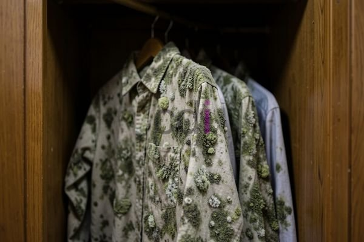

**Harga Lemari Box Baju: Estimasi & Pilihan Custom Terbaik** - Mitra CDI yang terhormat, pernahkah Mitra mempertimbangkan efisiensi ruang dalam menata koleksi pakaian? Lemari box baju bisa menjadi solusi cerdas untuk memaksimalkan ruang penyimpanan di kamar tidur, terutama bagi Mitra yang memiliki keterbatasan lahan.

Sebagai penyedia jasa desain interior dan furniture custom, Kami memahami betul kebutuhan Mitra akan solusi penyimpanan yang fungsional, estetis, dan tentu saja, sesuai dengan anggaran. Artikel ini akan mengulas berbagai aspek terkait harga lemari box baju, mulai dari faktor-faktor yang memengaruhi biaya, estimasi harga terkini, hingga layanan custom yang Kami tawarkan di wilayah Jabodetabek.

## Memahami Faktor Penentu Harga Lemari Box Baju

Harga lemari box baju tidaklah baku. Ada beberapa faktor utama yang memengaruhi besaran biaya yang perlu Mitra pertimbangkan:

*   **Material:** Pilihan material sangat krusial. Material seperti multipleks, MDF (Medium Density Fiberboard), particle board, atau kayu solid akan memiliki rentang harga yang berbeda. Kayu solid cenderung lebih mahal, tetapi menawarkan durabilitas dan tampilan yang lebih mewah. Sementara itu, MDF dan particle board lebih ekonomis, namun memerlukan perawatan ekstra.
*   **Ukuran dan Desain:** Ukuran lemari box baju, baik tinggi, lebar, maupun kedalaman, akan memengaruhi jumlah material yang dibutuhkan. Desain yang rumit dengan banyak laci, rak, atau detail dekoratif juga akan menambah biaya produksi.
*   **Finishing:** Jenis finishing, seperti cat duco, HPL (High Pressure Laminate), atau veneer, juga berpengaruh pada harga. Finishing yang lebih tahan lama dan estetis umumnya membutuhkan biaya lebih tinggi.
*   **Aksesori:** Penambahan aksesori seperti engsel soft close, rel laci berkualitas, atau handle premium akan meningkatkan fungsionalitas dan tampilan lemari, namun juga menambah biaya.

## Estimasi Harga Lemari Box Baju Berdasarkan Material

Untuk memberikan gambaran yang lebih jelas, berikut ini adalah estimasi harga lemari box baju berdasarkan material yang umum digunakan:

| Material      | Harga per Unit (Estimasi) | Kelebihan                                    | Kekurangan                                  |
|---------------|----------------------------|----------------------------------------------|---------------------------------------------|
| Particle Board| Rp 800.000 – Rp 1.500.000  | Paling ekonomis, mudah diproduksi            | Kurang tahan lama, rentan terhadap kelembaban |
| MDF           | Rp 1.200.000 – Rp 2.500.000 | Harga terjangkau, permukaan halus           | Rentan terhadap air, tidak sekuat kayu solid |
| Multipleks     | Rp 2.000.000 – Rp 4.000.000 | Kuat dan stabil, tahan lama                 | Harga lebih mahal dari MDF/particle board    |
| Kayu Solid    | Rp 3.500.000 – Rp 7.000.000+ | Sangat kuat, tahan lama, tampilan mewah     | Paling mahal, memerlukan perawatan khusus    |

Harga ini bersifat estimasi dan dapat berubah sewaktu-waktu — hubungi Kami untuk penawaran terbaru dan paling akurat sesuai kebutuhan proyek Mitra CDI. Kami sediakan juga layanan [harga lemari baju aluminium](/blog/harga-lemari-baju-aluminium/) sebagai alternatif pilihan yang tahan lama.

## Keunggulan Memesan Lemari Box Baju Custom dari Creative Design Interior

Mitra CDI, Kami di Creative Design Interior menawarkan solusi custom yang fleksibel untuk memenuhi kebutuhan spesifik Mitra. Dengan memesan lemari box baju custom, Mitra mendapatkan beberapa keuntungan:

*   **Desain Sesuai Keinginan:** Mitra dapat menentukan desain, ukuran, material, dan finishing sesuai dengan gaya interior dan preferensi pribadi.
*   **Optimasi Ruang:** Kami akan membantu Mitra mendesain lemari box baju yang memaksimalkan ruang penyimpanan yang tersedia, bahkan untuk area yang sulit dijangkau.
*   **Kualitas Terjamin:** Kami menggunakan material berkualitas tinggi dan dikerjakan oleh tim yang berpengalaman, sehingga Mitra mendapatkan produk yang awet dan tahan lama.
*   **Harga Kompetitif:** Kami menawarkan harga yang kompetitif dengan skema *all-in-one* yang sudah termasuk material, pengiriman, dan bongkar muat. Tersedia gratis ongkir untuk wilayah tertentu.

## Kemudahan Pemesanan dan Pembayaran di Creative Design Interior

Kami memahami bahwa proses pemesanan dan pembayaran haruslah praktis dan mudah. Oleh karena itu, Kami menyediakan berbagai pilihan pembayaran yang fleksibel, termasuk COD, transfer bank, DP 50%, transfer setelah barang terkirim, bayar bertahap, atau transfer setelah pekerjaan selesai. Mitra dapat berkonsultasi dengan tim Kami melalui tombol **Telepon** atau **WhatsApp** yang tersedia di halaman [daftar harga](/daftar-harga/) untuk mendapatkan penawaran terbaik dan informasi lebih lanjut.

Tim Kami siap membantu mewujudkan proyek Mitra CDI — silakan hubungi melalui tombol **Telepon** atau **WhatsApp** yang tersedia di bawah.
