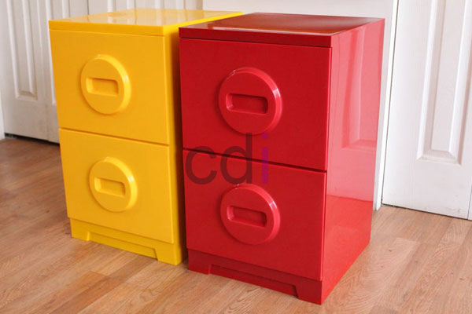

**Harga Lemari Box Plastik Jabodetabek: Pilih Ukuran dan Modelnya** - Hai Mitra CDI! Butuh solusi penyimpanan cerdas yang nggak bikin kantong bolong? Lemari box plastik jawabannya! Nah, artikel ini akan kupas tuntas soal harga lemari box plastik di Jabodetabek, mulai dari apa saja yang bikin harganya beda, perkiraan biayanya, sampai gimana caranya memilih lemari yang pas buat rumah Anda.

## Kenali Faktor yang Mempengaruhi Harga Lemari Box Plastik

Harga lemari box plastik itu nggak sama rata, lho. Ada beberapa hal yang bikin harganya bisa naik turun. Pertama, tentu saja ukurannya. Semakin besar lemari, biasanya harganya juga ikut naik. Ukuran standar lemari box plastik itu bervariasi, mulai dari 40 cm x 40 cm sampai 120 cm x 60 cm. Selain itu, jenis plastik yang dipakai juga berpengaruh. Plastik berkualitas tinggi kayak *polypropylene* (PP) atau *high-density polyethylene* (HDPE) harganya memang lebih mahal, tapi awet dan nggak gampang pecah.

Desain dan fitur tambahan juga jadi penentu harga. Lemari yang desainnya rumit, misalnya model susun dengan banyak laci atau ada kunci pengamannya, biasanya lebih mahal daripada yang sederhana. Merek juga penting, lho. Merek terkenal dengan reputasi baik cenderung menawarkan harga yang lebih tinggi, tapi kualitasnya juga biasanya lebih terjamin.

## Perkiraan Harga Lemari Box Plastik di Jabodetabek

Supaya lebih jelas, ini dia perkiraan harga lemari box plastik yang biasa ditemui di wilayah Jabodetabek:

<table class="table">
  <caption>Estimasi Harga Lemari Box Plastik Jabodetabek (2026)</caption>
  <thead>
    <tr><th>Ukuran</th><th>Model</th><th>Estimasi Harga (Rp)</th></tr>
  </thead>
  <tbody>
    <tr><td>40x40 cm</td><td>1 Laci</td><td>150.000 - 250.000</td></tr>
    <tr><td>60x40 cm</td><td>2 Laci</td><td>250.000 - 400.000</td></tr>
    <tr><td>80x40 cm</td><td>3 Laci</td><td>350.000 - 550.000</td></tr>
    <tr><td>120x60 cm</td><td>4 Laci</td><td>600.000 - 1.000.000</td></tr>
  </tbody>
</table>

Harga di atas cuma perkiraan ya, dan bisa berubah sewaktu-waktu. Untuk penawaran terbaru dan paling akurat sesuai kebutuhan proyek Anda, jangan ragu hubungi Kami. Harga juga bisa beda-beda tergantung toko, promo yang lagi jalan, dan kualitas materialnya.

## Pilihan Lemari Box Plastik Berkualitas dari Creative Design Interior

Di Creative Design Interior, Kami menyediakan berbagai pilihan lemari box plastik yang kualitasnya terjamin. Kami bantu Anda cari solusi penyimpanan yang praktis dan hemat biaya, sesuai dengan kebutuhan dan anggaran Anda. Selain menawarkan produk yang sudah jadi, Kami juga bisa bikin lemari box plastik *custom* sesuai desain dan ukuran yang Anda mau. Kami cuma pakai material plastik berkualitas tinggi yang tahan lama dan ramah lingkungan.

Yang bikin Kami beda? Kemudahan dalam pemesanan dan pembayaran. Anda bisa pilih berbagai opsi pembayaran yang nyaman, termasuk COD, transfer bank, DP 50%, transfer setelah barang sampai, bayar bertahap, atau transfer setelah pekerjaan selesai. Belum lagi gratis ongkir untuk wilayah tertentu di Jabodetabek! Kami sudah lebih dari 10 tahun berpengalaman membuat *furniture custom*, termasuk lemari box plastik, dan selalu prioritaskan kualitas serta kepuasan pelanggan.

Kalau Anda butuh solusi penyimpanan yang lebih lengkap, Kami juga punya pilihan lemari plastik lainnya, kayak [lemari baju plastik](/blog/harga-lemari-baju-plastik/) atau [lemari belajar plastik](/blog/harga-lemari-belajar-plastik/). Jangan sungkan tanya-tanya, ya! Kami siap bantu Anda memilih lemari yang paling pas.

## Yuk, Dapatkan Penawaran Harga Terbaik dari Kami!

Dengan pengalaman lebih dari 10 tahun di bidang jasa pembuatan *furniture* dan pengadaan material bangunan, Kami siap jadi mitra Anda dalam menemukan lemari box plastik yang sempurna untuk rumah di (not detected). Tim Kami yang handal siap memberikan konsultasi gratis dan bantu Anda memilih desain, ukuran, serta material yang paling sesuai dengan kebutuhan Anda. Dijamin pengerjaan tepat waktu dan kualitasnya nomor satu! Produk bisa ditukar kalau ada yang nggak sesuai spesifikasi, selama belum dipakai atau dibongkar dan maksimal 1 hari setelah barang diterima.

Butuh bantuan lebih lanjut untuk proyek Anda? Klik tombol **WhatsApp** atau **Telepon** di bawah untuk konsultasi langsung dengan tim Kami! Jangan ragu, ya!