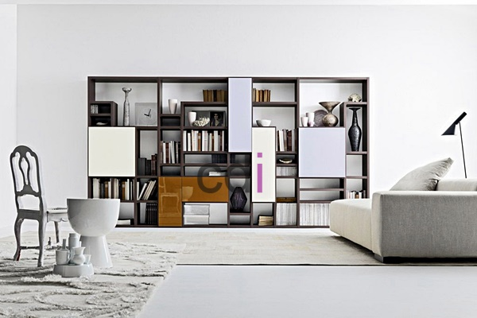

**Harga Lemari Buku Aluminium: Solusi Hemat Ruang untuk Rumah Modern** - Hai Mitra CDI! Punya banyak buku tapi ruang terasa makin sempit? Atau sedang mencari lemari yang awet, minim perawatan, dan pas dengan desain rumah modern? Lemari buku aluminium bisa jadi pilihan cerdas! Di artikel ini, kita akan kupas tuntas soal harga lemari buku aluminium, apa saja keunggulannya, dan bagaimana Creative Design Interior (CDI) bisa bantu Mitra mewujudkan lemari impian.

## Kenapa Pilih Lemari Buku Aluminium? Kelebihannya Bikin Nagih!

Pasti ada yang penasaran: kenapa harus aluminium, bukan kayu atau bahan lain? Nah, aluminium punya segudang kelebihan, lho. Pertama, aluminium itu anti karat dan nggak dimakan rayap. Cocok banget buat iklim tropis kayak di (not detected) ini! Kedua, materialnya ringan tapi kokoh, jadi gampang dipindah-pindah dan awet dipakai bertahun-tahun. Ketiga, desainnya fleksibel banget dan bisa disesuaikan persis sesuai selera Mitra. Ditambah lagi, harganya relatif lebih terjangkau dibandingkan kayu solid.

Nggak cuma itu, lemari aluminium juga super gampang dibersihkan! Tinggal lap pakai kain lembab, debu langsung hilang. Nggak perlu khawatir soal noda atau perubahan warna akibat matahari langsung—aluminium tetap kinclong seperti baru. Berbeda kan dengan bahan lain yang butuh perawatan ekstra?

## Bocoran Harga Lemari Buku Aluminium: Apa Saja yang Mempengaruhi?

Soal harga, lemari buku aluminium bervariasi tergantung beberapa hal. Ukuran lemari jelas berpengaruh; lemari yang lebih besar butuh lebih banyak material dan waktu pengerjaan. Desain yang rumit atau custom juga akan menambah biaya. Lalu, ketebalan aluminium juga penting. Biasanya, aluminium 0,3mm lebih murah, tapi kekuatannya nggak sebanding dengan yang 0,4mm atau 0,5mm.

Sebagai gambaran awal, lemari buku aluminium standar ukuran 120x240x40 cm (panjang x tinggi x kedalaman) dengan desain simpel, kisaran harganya antara Rp 1.500.000 sampai Rp 3.000.000. Tapi ingat ya, harga ini cuma perkiraan dan bisa berubah sewaktu-waktu. Untuk penawaran paling akurat dan sesuai proyek Mitra CDI, yuk hubungi Kami! Kami sangat menyarankan konsultasi langsung agar bisa mendapatkan perhitungan detail.

## CDI: Solusi Lengkap Lemari Buku Aluminium Custom Impian Mitra!

Creative Design Interior (CDI) sudah berpengalaman lebih dari 10 tahun dalam desain interior, pembuatan furniture custom, dan penyediaan material bangunan di wilayah Jabodetabek. Kami hadir sebagai solusi *all-in-one* untuk lemari buku aluminium: mulai dari material, desain, pengerjaan, pengiriman, sampai bongkar muat. Kami juga melayani jasa pengecoran dan menyediakan berbagai bahan bangunan seperti pasir, split, dan batako.

Kami paham betul kalau setiap ruangan punya kebutuhan yang beda-beda. Makanya, Kami menawarkan layanan desain custom yang bisa disesuaikan persis dengan keinginan Mitra. Tim desain Kami akan bekerja sama dengan Mitra untuk menciptakan lemari buku aluminium yang pas ukurannya, warnanya, dan gayanya. Mitra bisa pilih berbagai finishing, seperti *powder coating* atau anodizing, supaya tampilannya lebih menarik dan tahan lama. Kami juga memudahkan Mitra dengan opsi pembayaran yang fleksibel, termasuk COD, transfer bank, DP 50%, transfer setelah barang terkirim, bayar bertahap, atau transfer setelah pekerjaan selesai. [Alasan Memilih Lemari Aluminium 3 Pintu untuk Ruang Tidur Modern](/blog/lemari-aluminium-3-pintu/) bisa jadi inspirasi desain, lho!

## Pesan Mudah di Jabodetabek & Nikmati Layanan Terbaik Kami

Mitra CDI bisa langsung memesan lemari buku aluminium custom lewat tombol **Telepon** atau **WhatsApp** yang ada di website Kami. Kami melayani area Jakarta, Bogor, Depok, Tangerang, Bekasi, Cikarang, Karawang, Bandung, Serang, Purwakarta, Cilegon, Cikampek, Subang, dan Rangkasbitung. Dengan tim profesional dan jadwal kerja teratur, Kami menjamin pengerjaan yang tepat waktu dan kualitas nomor satu.

Untuk memastikan kepuasan Mitra, Kami berikan garansi produk yang bisa ditukar jika ada ketidaksesuaian dengan spesifikasi, selama belum digunakan atau dibongkar dan dalam waktu maksimal 1 hari. Silakan cek Daftar Harga Kami untuk gambaran biaya yang lebih jelas. 

Tim Kami siap mewujudkan lemari buku impian Mitra CDI! Jangan ragu hubungi Kami melalui tombol **Telepon** atau **WhatsApp** di bawah ini. Yuk, wujudkan ruangan yang lebih rapi dan nyaman bersama CDI! [Lemari Pakaian Pintu Geser: Solusi Penyimpanan Modern untuk Ruang Optimal](/blog/lemari-pakaian-pintu-geser/) juga bisa menjadi solusi penyimpanan yang menarik untuk ruangan Anda.