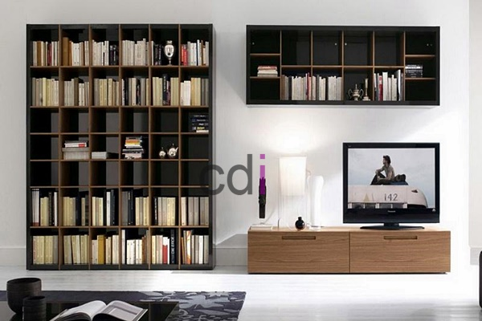

**Harga Lemari Buku Jati Jabodetabek: Panduan & Estimasi 2026** - Mitra CDI dimana saja berada, tahukah Mitra bahwa permintaan akan lemari buku jati terus meningkat setiap tahunnya? Data internal Kami menunjukkan peningkatan pesanan lemari buku jati hingga 25% pada tahun 2025, seiring dengan kesadaran masyarakat akan pentingnya ruang baca dan penyimpanan buku yang rapi. Hal ini menjadikan lemari buku jati bukan hanya sekadar perabot, melainkan juga investasi jangka panjang untuk mempercantik dan menunjang aktivitas intelektual di rumah.

## Kenapa Memilih Lemari Buku Jati? Keunggulan dan Pertimbangan

Lemari buku jati menawarkan kombinasi unik antara estetika, durabilitas, dan nilai investasi. Kayu jati dikenal dengan serat alaminya yang indah, kuat, dan tahan terhadap serangan rayap. Mitra CDI mungkin sudah familiar dengan ketahanan kayu jati yang sudah teruji waktu, menjadikannya pilihan ideal untuk furnitur yang akan digunakan selama bertahun-tahun. Selain itu, lemari buku jati mudah dipadukan dengan berbagai gaya interior, mulai dari klasik hingga modern.

Namun, penting untuk mempertimbangkan beberapa hal sebelum memutuskan untuk membeli lemari buku jati. Pertama, harga lemari buku jati cenderung lebih tinggi dibandingkan dengan lemari buku berbahan lain seperti MDF atau particle board. Kedua, perawatan lemari buku jati memerlukan perhatian khusus agar keindahannya tetap terjaga. Kami menyarankan untuk menggunakan *furniture polish* secara berkala dan menghindari paparan sinar matahari langsung yang berlebihan. Untuk solusi lengkap dan tanpa khawatir, Kami di Creative Design Interior siap membantu Mitra CDI memilih dan merawat lemari buku jati impian.

## Estimasi Harga Lemari Buku Jati di Jabodetabek: Faktor Penentu

Harga lemari buku jati di Jabodetabek sangat bervariasi, tergantung pada beberapa faktor. Ukuran lemari buku, desain, kualitas kayu jati yang digunakan, dan tingkat kerumitan pengerjaan adalah faktor utama yang memengaruhi harga. Sebagai gambaran, lemari buku jati ukuran standar (tinggi 180 cm, lebar 80 cm, kedalaman 40 cm) dengan desain sederhana dapat memiliki harga mulai dari Rp 3.500.000 hingga Rp 7.000.000.

Untuk lemari buku jati dengan ukuran lebih besar, desain yang lebih rumit, atau penggunaan kayu jati berkualitas tinggi, harganya dapat mencapai puluhan juta rupiah. Selain itu, biaya tambahan seperti pengiriman dan pemasangan juga perlu diperhitungkan. Harga ini bersifat estimasi dan dapat berubah sewaktu-waktu — hubungi Kami untuk penawaran terbaru dan paling akurat sesuai kebutuhan proyek Mitra CDI. Kami memahami bahwa anggaran setiap orang berbeda-beda, oleh karena itu Kami menawarkan solusi custom yang dapat disesuaikan dengan *budget* dan preferensi desain Mitra.

## Creative Design Interior: Solusi All-in-One untuk Lemari Buku Jati Impian

Di Creative Design Interior, Mitra CDI akan menemukan berbagai pilihan lemari buku jati yang berkualitas tinggi dan desain yang menarik. Kami menyediakan layanan custom, sehingga Mitra dapat memesan lemari buku jati sesuai dengan ukuran, desain, dan kebutuhan penyimpanan yang diinginkan. Kami menggunakan kayu jati pilihan yang telah melalui proses pengeringan dan pengolahan yang cermat untuk memastikan kualitas dan ketahanannya.

Kami juga menawarkan skema harga *all-in-one*, yang sudah termasuk biaya material, pengerjaan, pengiriman, dan bongkar muat. Dengan demikian, Mitra CDI tidak perlu khawatir akan biaya tambahan yang tidak terduga. Kami juga menyediakan berbagai pilihan pembayaran yang fleksibel, mulai dari COD, transfer bank, DP 50%, hingga bayar bertahap. Untuk kemudahan Mitra CDI, Kami menyediakan daftar harga lengkap di halaman [Daftar Harga](/daftar-harga/). Tersedia gratis ongkir untuk wilayah tertentu. Dengan pengalaman lebih dari 10 tahun di bidang furniture interior, Kami menjamin kepuasan Mitra CDI.

Tim Kami siap membantu mewujudkan proyek Mitra CDI — silakan hubungi melalui tombol **Telepon** atau **WhatsApp** yang tersedia di bawah.
