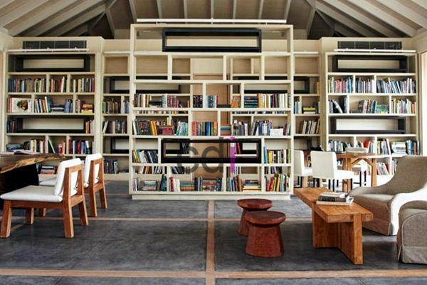

**Harga Lemari Buku Perpustakaan: Pilih Ukuran & Material Terbaik** - Mitra CDI yang berbahagia, mitra CDI yang berbahagia, memiliki perpustakaan pribadi adalah impian banyak orang. Namun, mewujudkannya membutuhkan perencanaan yang matang, termasuk pemilihan lemari buku yang tepat. Artikel ini akan membahas berbagai aspek terkait harga lemari buku perpustakaan dan bagaimana Kami di Creative Design Interior dapat membantu Mitra CDI mewujudkannya.

## Memahami Faktor Penentu Harga Lemari Buku Perpustakaan

Banyak faktor yang memengaruhi harga lemari buku perpustakaan. Material merupakan salah satu faktor utama. Lemari buku dari kayu solid, seperti jati atau mahoni, umumnya memiliki harga yang lebih tinggi dibandingkan lemari buku dari partikel board atau MDF. Ukuran lemari buku juga berpengaruh signifikan. Semakin besar dan kompleks desainnya, tentu saja semakin tinggi biayanya. Selain itu, detail finishing, seperti cat duco, veneer, atau penggunaan aksen dekoratif, juga dapat meningkatkan harga.

Mitra CDI perlu mempertimbangkan kebutuhan dan anggaran yang tersedia. Jika menginginkan lemari buku yang tahan lama dan berkelas, kayu solid adalah pilihan tepat. Namun, jika anggaran terbatas, lemari buku dari MDF atau partikel board dengan finishing yang baik tetap bisa menjadi alternatif yang menarik. Kami di Creative Design Interior menyediakan berbagai pilihan material dan desain untuk menyesuaikan dengan kebutuhan dan anggaran Mitra CDI.

## Estimasi Harga Lemari Buku Perpustakaan Berdasarkan Material

Untuk memberikan gambaran yang lebih jelas, berikut adalah estimasi harga lemari buku perpustakaan berdasarkan material (harga ini bersifat estimasi dan dapat berubah sewaktu-waktu — hubungi Kami untuk penawaran terbaru dan paling akurat sesuai kebutuhan proyek Mitra CDI):

<table class="table">
  <caption>Estimasi Harga Lemari Buku Perpustakaan (Per Meter)</caption>
  <thead>
    <tr><th>Material</th><th>Harga (Estimasi)</th><th>Kelebihan</th><th>Kekurangan</th></tr>
  </thead>
  <tbody>
    <tr><td>Kayu Solid (Jati/Mahoni)</td><td>Rp 2.500.000 – Rp 4.000.000</td><td>Tahan lama, tampilan mewah, nilai investasi tinggi</td><td>Harga relatif mahal, perawatan khusus</td></tr>
    <tr><td>MDF (Medium Density Fiberboard)</td><td>Rp 800.000 – Rp 1.500.000</td><td>Harga terjangkau, mudah dibentuk, finishing beragam</td><td>Kurang tahan lama jika terkena air, mudah melengkung</td></tr>
    <tr><td>Partikel Board</td><td>Rp 500.000 – Rp 1.000.000</td><td>Paling ekonomis, pilihan warna banyak</td><td>Kurang kuat, mudah rusak jika terkena air, tidak tahan beban berat</td></tr>
  </tbody>
</table>

Perlu diingat bahwa harga di atas adalah estimasi per meter dan belum termasuk biaya desain, pemasangan, dan pengiriman. Kami di Creative Design Interior menawarkan skema harga *all-in-one* yang sudah termasuk material, pengiriman, dan ongkos pemasangan.

## Layanan Custom Lemari Buku Perpustakaan dari Creative Design Interior

Kami memahami bahwa setiap perpustakaan memiliki karakteristik dan kebutuhan yang unik. Oleh karena itu, Kami menawarkan layanan custom lemari buku perpustakaan yang dapat disesuaikan dengan selera dan ruang yang tersedia. Mitra CDI dapat memilih ukuran, material, desain, dan finishing sesuai dengan preferensi masing-masing.

Kami memiliki tim desain interior yang berpengalaman dan siap membantu Mitra CDI dalam merancang lemari buku perpustakaan yang ideal. Kami juga menyediakan berbagai pilihan material berkualitas tinggi, mulai dari kayu solid hingga MDF dan partikel board. Proses pengerjaan Kami dilakukan dengan cermat dan teliti, sehingga Mitra CDI dapat yakin akan mendapatkan produk yang awet dan berkualitas.

Selain itu, Kami juga menawarkan layanan konsultasi gratis untuk membantu Mitra CDI menentukan desain dan material yang paling sesuai dengan kebutuhan dan anggaran. Jangan ragu untuk menghubungi Kami jika Mitra CDI memiliki pertanyaan atau ingin mendapatkan penawaran harga. Kami menyediakan pilihan pembayaran yang fleksibel termasuk COD, transfer bank, DP 50%, transfer setelah barang terkirim, bayar bertahap, atau transfer setelah pekerjaan selesai.

Tertarik untuk mewujudkan perpustakaan impian Mitra CDI? [Kunjungi halaman Daftar Harga](/daftar-harga/) Kami untuk melihat estimasi harga atau konsultasikan langsung dengan tim ahli Kami. Kami siap membantu Mitra CDI menemukan solusi terbaik untuk kebutuhan desain interior.

Tim Kami siap membantu mewujudkan proyek Mitra CDI — silakan hubungi melalui tombol **Telepon** atau **WhatsApp** yang tersedia di bawah.
