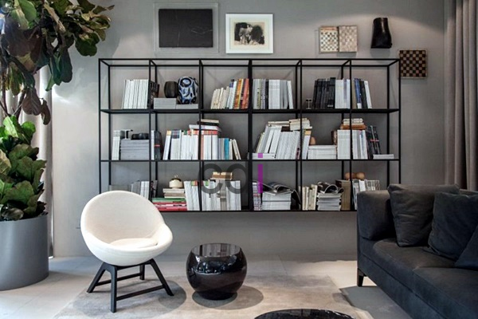

**Harga Lemari Buku Plastik: Pilih Ukuran & Warna Sesuai Kebutuhan** - Hai Mitra CDI! Mencari lemari buku yang praktis, awet, dan ramah di kantong? Nah, Anda datang ke tempat yang tepat! Artikel ini akan membahas seluk-beluk harga lemari buku plastik, membantu Anda memilih ukuran dan warna yang pas dengan kebutuhan ruang dan anggaran. Creative Design Interior siap menjadi mitra terpercaya Anda dalam menciptakan ruang penyimpanan yang optimal di (not detected).

### Mengapa Lemari Buku Plastik Jadi Pilihan Cerdas?
Banyak yang bertanya, kenapa harus pilih lemari buku plastik? Jawabannya sederhana: fleksibilitas dan kepraktisan. Bobotnya ringan, jadi gampang dipindah-pindah sesuai kebutuhan. Harganya pun biasanya lebih bersahabat dibandingkan material lain seperti kayu atau logam. Ditambah lagi, lemari buku plastik umumnya tahan terhadap lembab, cocok dipakai di berbagai ruangan—bahkan kamar mandi! Mitra CDI akan menemukan banyak pilihan desain dan warna yang bisa disesuaikan dengan gaya interior Anda.

### Apa Saja yang Mempengaruhi Harga Lemari Buku Plastik?
Harga lemari buku plastik itu relatif, lho. Ada beberapa faktor yang membuat harganya bisa naik atau turun. Ukuran jelas berpengaruh; semakin besar lemari, semakin banyak ruang penyimpanan, dan biasanya harganya juga lebih mahal. Jenis plastik yang digunakan juga penting. Plastik berkualitas tinggi seperti *polypropylene* (PP) atau *acrylonitrile butadiene styrene* (ABS) memang lebih tahan lama, tapi biasanya harganya sedikit lebih tinggi. Fitur tambahan seperti pintu, laci, atau rak yang bisa diatur juga bisa menambah biaya.

Nah, sebagai gambaran, yuk kita lihat perkiraan harga berdasarkan ukuran:

<table class="table">
  <caption>Estimasi Harga Lemari Buku Plastik (2026)</caption>
  <thead>
    <tr><th>Ukuran</th><th>Estimasi Harga (Rp)</th><th>Keterangan</th></tr>
  </thead>
  <tbody>
    <tr><td>Kecil (2-3 susun)</td><td>150.000 - 300.000</td><td>Ideal untuk buku anak-anak atau koleksi bacaan yang tidak terlalu banyak</td></tr>
    <tr><td>Sedang (4-5 susun)</td><td>300.000 - 600.000</td><td>Cocok untuk ruang belajar, kantor rumahan, atau menyimpan buku-buku kesukaan Anda</td></tr>
    <tr><td>Besar (6 susun atau lebih)</td><td>600.000 - 1.200.000+</td><td>Pilihan tepat bagi Anda yang punya koleksi buku super banyak atau ingin membuat perpustakaan mini di rumah</td></tr>
  </tbody>
</table>

Waspada! Harga-harga ini hanya perkiraan. Untuk mendapatkan penawaran harga yang paling akurat dan sesuai dengan kebutuhan proyek Anda di (not detected), silakan hubungi Kami langsung.

### Apa yang Ditawarkan Creative Design Interior?
Di Creative Design Interior, Kami menyediakan beragam pilihan lemari buku plastik dengan kualitas terjamin. Tersedia berbagai ukuran, warna, dan desain untuk memenuhi kebutuhan spesifik Mitra CDI.  Bahkan, Kami juga melayani pembuatan lemari buku plastik *custom*—sesuai dengan dimensi dan gaya interior yang Anda inginkan. Kami hanya menggunakan material plastik berkualitas tinggi dan proses produksi yang teliti untuk memastikan produk tahan lama. [[TABEL_MULAI]] {"title": "Spesifikasi Plastik Berkualitas Tinggi", "headers": ["Jenis Plastik", "Kelebihan", "Kekurangan"]} {"row": ["Polypropylene (PP)", "Tahan panas, ringan, lentur", "Kurang tahan terhadap sinar UV"]} {"row": ["Acrylonitrile Butadiene Styrene (ABS)", "Kuat, tahan benturan, tahan goresan", "Relatif lebih mahal"]} [[TABEL_SELESAI]]

Penasaran dengan pilihan lemari buku plastik dari Kami? Anda bisa melihat daftar harga dan detail produk lainnya di halaman Daftar Harga. Jangan sungkan untuk berkonsultasi dengan tim Kami—Kami siap memberikan rekomendasi terbaik! [Contoh Lemari Rak Buku: Pilih Desain & Ukuran Ideal Bersama CDI](/blog/contoh-lemari-rak-buku/) bisa jadi inspirasi awal untuk Anda.

### Pemesanan & Pembayaran? Semudah Itu!
Kami mengerti betapa pentingnya kemudahan dalam proses pemesanan dan pembayaran bagi Mitra CDI. Karena itu, Kami menawarkan berbagai pilihan pembayaran yang fleksibel—COD, transfer bank, DP 50%, transfer setelah barang diterima, bayar bertahap, atau transfer setelah pekerjaan selesai. Kami juga menyediakan layanan pengiriman ke seluruh wilayah Jabodetabek, Cikarang, Karawang, Bandung, Serang, Purwakarta, Cilegon, Cikampek, Subang, dan Rangkasbitung. 

Ingin memesan atau bertanya lebih lanjut? Silakan klik tombol **WhatsApp** atau **Telepon** yang tersedia di halaman ini. Jangan ragu untuk menghubungi Kami melalui tombol **WhatsApp** atau **Telepon** jika Anda memiliki pertanyaan. Kami siap membantu Anda menemukan lemari buku plastik impian di (not detected)!