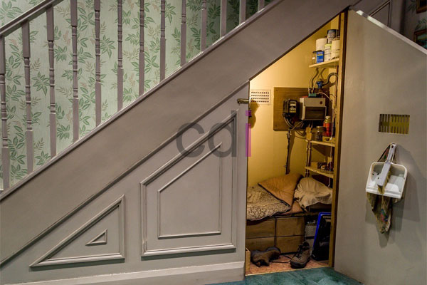

**Harga Lemari Dapur Bawah: Estimasi Biaya & Pilihan Material 2026** - Mitra CDI dimana saja berada, dapur adalah jantung rumah. Kualitas dapur sangat memengaruhi kenyamanan dalam menyiapkan makanan sehari-hari. Sebuah survei internal yang Kami lakukan menunjukkan bahwa 78% responden menganggap lemari dapur sebagai perabot paling penting di dapur, melebihi kulkas atau kompor. Oleh karena itu, perencanaan yang tepat mengenai desain dan biaya lemari dapur bawah sangatlah krusial.

## Estimasi Harga Lemari Dapur Bawah di Tahun 2026

Mitra CDI, menentukan anggaran untuk lemari dapur bawah adalah langkah awal yang bijak. Harga lemari dapur bawah sangat bervariasi, bergantung pada beberapa faktor utama, yaitu material, ukuran, dan kompleksitas desain. Pada tahun 2026, Kami memprediksi kisaran harga lemari dapur bawah custom berkisar antara Rp 2.500.000 hingga Rp 7.000.000 per meter lari. Harga ini bersifat estimasi dan dapat berubah sewaktu-waktu — hubungi Kami untuk penawaran terbaru dan paling akurat sesuai kebutuhan proyek Mitra CDI.

Faktor yang memengaruhi perbedaan harga tersebut antara lain: material dasar lemari (multiplek, MDF, kayu solid), finishing (HPL, melamik, cat duco), serta penggunaan aksesoris seperti engsel *soft close* dan rel laci. Perlu diingat, harga tersebut sudah termasuk biaya pemasangan di wilayah Jabodetabek. Jika Mitra CDI berada di luar area layanan Kami, akan ada biaya tambahan untuk transportasi.

## Pilihan Material Lemari Dapur Bawah dan Perbandingannya

Mitra CDI, pemilihan material lemari dapur bawah tidak hanya memengaruhi estetika, tetapi juga daya tahan dan biaya. Berikut adalah tabel perbandingan beberapa material yang umum digunakan:

<table class="table">
  <caption>Perbandingan Material Lemari Dapur Bawah</caption>
  <thead>
    <tr><th>Material</th><th>Kelebihan</th><th>Kekurangan</th><th>Estimasi Harga (Rp/meter lari)</th></tr>
  </thead>
  <tbody>
    <tr><td>Multiplek</td><td>Kuat, stabil, tahan lama</td><td>Kurang tahan terhadap kelembapan jika tidak difinishing dengan baik</td><td>2.500.000 - 3.500.000</td></tr>
    <tr><td>MDF</td><td>Permukaan halus, mudah dicat, harga terjangkau</td><td>Kurang kuat dibandingkan multiplek, mudah mengembang jika terkena air</td><td>2.000.000 - 3.000.000</td></tr>
    <tr><td>Kayu Solid</td><td>Tahan lama, tampilan alami, prestisius</td><td>Harga mahal, perawatan khusus</td><td>5.000.000 - 7.000.000+</td></tr>
  </tbody>
</table>

Kami di Creative Design Interior merekomendasikan penggunaan multiplek berkualitas tinggi sebagai pilihan yang paling seimbang antara kekuatan, daya tahan, dan harga. Selain itu, Kami juga menyediakan opsi lemari dapur bawah dari kayu solid untuk Mitra CDI yang menginginkan tampilan mewah dan eksklusif.

## Kemudahan Pemesanan dan Pembayaran di Creative Design Interior

Mitra CDI, Kami memahami bahwa proses pemesanan dan pembayaran seringkali menjadi kendala bagi banyak orang. Oleh karena itu, Kami menyediakan berbagai pilihan pembayaran yang fleksibel, antara lain COD (Cash on Delivery), transfer bank, DP 50%, transfer setelah barang terkirim, bayar bertahap, atau transfer setelah pekerjaan selesai. Kami juga menawarkan gratis ongkir untuk wilayah tertentu di Jabodetabek, sesuai dengan ketentuan yang berlaku.

Untuk mendapatkan daftar harga lengkap dan penawaran khusus, Mitra CDI dapat mengunjungi halaman [Daftar Harga](/daftar-harga/). Kami juga menyediakan layanan konsultasi gratis dengan tim desain interior Kami yang berpengalaman. Konsultasi ini dapat dilakukan secara langsung di showroom Kami, melalui telepon, atau melalui aplikasi pesan instan.

## Mengapa Memilih Creative Design Interior untuk Lemari Dapur Bawah Anda?

Mitra CDI, Creative Design Interior telah berpengalaman lebih dari 10 tahun dalam menyediakan jasa desain interior, pembuatan furniture custom, dan pengadaan material bangunan di wilayah Jabodetabek dan sekitarnya. Kami menawarkan skema harga *all in one* yang sudah termasuk material, pengiriman, dan bongkar muat. Tim kerja Kami berpengalaman dan bekerja dengan sistem terjadwal, sehingga Kami dapat menjamin pengerjaan yang tepat waktu dan kualitas yang terjaga. Produk Kami juga dapat ditukar jika tidak sesuai spesifikasi, selama belum dipakai atau dibongkar dan maksimal 1 hari. Jika Mitra CDI memerlukan jasa pengecoran atau material bangunan lainnya, Kami juga dapat menyediakannya. Jangan ragu untuk menghubungi Kami untuk informasi lebih lanjut.

Tim Kami siap membantu mewujudkan proyek Mitra CDI — silakan hubungi melalui tombol **Telepon** atau **WhatsApp** yang tersedia di bawah.
