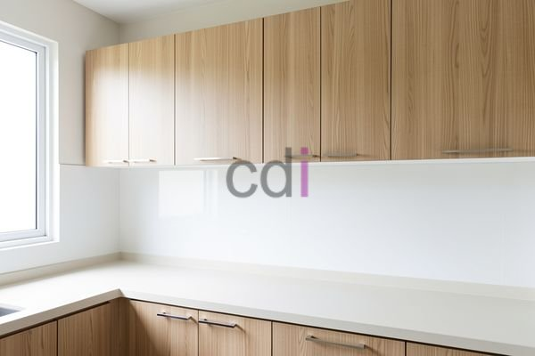

**Harga Lemari Dapur Jati: Pertimbangkan Ini Sebelum Membeli** - Hai Mitra CDI! Memikirkan penataan dapur idaman di (not detected)? Memilih lemari dapur jati yang pas memang penting banget, lho. Bukan cuma soal mempercantik tampilan, tapi juga investasi jangka panjang untuk kenyamanan keluarga Anda. Nah, yuk kita bahas lebih lanjut!

## Apa Saja yang Mempengaruhi Harga Lemari Dapur Jati?

Beberapa hal krusial menentukan harga lemari dapur jati. Yang pertama dan utama adalah kualitas kayu jati itu sendiri. Jati itu beragam kelasnya, mulai dari standar sampai grade A yang lebih awet dan seratnya cantik. Semakin bagus kelasnya, ya harganya pun ikut naik. Di Creative Design Interior, Kami cuma pakai kayu jati pilihan supaya hasil akhirnya memuaskan dan tahan lama.

Kemudian, desain lemari juga berpengaruh besar. Desain yang rumit, banyak ukiran, atau ada fitur tambahan kayak rak tarik atau pembagi laci, pasti butuh waktu dan tenaga lebih banyak. Ini otomatis memengaruhi harga. Kalau konsepnya minimalis, biasanya lebih ramah di kantong dibandingkan desain yang detail dan artistik.

Terakhir, ukuran dapur juga perlu diperhitungkan. Semakin luas area dapur yang mau ditutup lemari, semakin banyak material yang dipakai, dan biayanya juga ikutan bertambah. Jadi, perencanaan yang matang penting banget biar penggunaan ruang optimal dan pengeluaran tetap terkendali.

## Perkiraan Harga Lemari Dapur Jati Sesuai Ukuran & Desain

Buat gambaran yang lebih jelas, ini dia perkiraan harga lemari dapur jati berdasarkan ukuran dan desainnya:

<table class="table">
  <caption>Estimasi Harga Lemari Dapur Jati (2026)</caption>
  <thead>
    <tr><th>Ukuran Dapur</th><th>Desain</th><th>Perkiraan Harga</th></tr>
  </thead>
  <tbody>
    <tr><td>Dapur Kecil (2x3 meter)</td><td>Minimalis</td><td>Rp 8.000.000 - Rp 15.000.000</td></tr>
    <tr><td>Dapur Menengah (3x4 meter)</td><td>Standar</td><td>Rp 15.000.000 - Rp 25.000.000</td></tr>
    <tr><td>Dapur Besar (4x5 meter)</td><td>Kompleks</td><td>Rp 25.000.000 ke atas</td></tr>
  </tbody>
</table>

Perlu diingat, harga ini cuma perkiraan dan bisa berubah sewaktu-waktu. Untuk penawaran yang paling akurat sesuai kebutuhan proyek Anda, jangan sungkan hubungi Kami. Oh iya, harga di atas belum termasuk biaya tambahan seperti pemasangan meja countertop atau backsplash, ya.

## Kenapa Harus Pilih Creative Design Interior untuk Lemari Dapur Jati Anda?

Kami, Creative Design Interior, sudah lebih dari 10 tahun berkecimpung di dunia pembuatan furniture interior, termasuk kitchen set jati. Kami menawarkan solusi lengkap—dari desain, produksi, pengiriman, sampai pemasangan. Dengan sistem harga all in one, Anda nggak perlu khawatir ada biaya tersembunyi yang tiba-tiba muncul.

Kami juga menyediakan konsultasi gratis dengan desainer interior profesional lho! Mereka siap membantu merencanakan tata letak dapur yang optimal dan memilih desain yang pas dengan selera dan budget Anda. Komitmen Kami adalah memberikan produk berkualitas dengan harga yang bersaing. Selain itu, Kami juga punya opsi pembayaran yang fleksibel: COD, transfer bank, sampai cicilan.

## Mudah Memesan & Jangkauan Layanan Kami

Kami melayani wilayah Jakarta, Bogor, Depok, Tangerang, Bekasi, Cikarang, Karawang, Bandung, Serang, Purwakarta, Cilegon, Cikampek, Subang, dan Rangkasbitung. Kami siap memasang di seluruh wilayah tersebut, jadi Anda nggak perlu repot mikirin logistik dan biaya pengiriman.

Untuk lihat daftar harga lengkap dan informasi lebih lanjut tentang produk dan layanan Kami, silakan kunjungi halaman Daftar Harga. Tertarik dengan desain impian Anda? Jangan ragu untuk menghubungi Kami melalui tombol **Telepon** atau **WhatsApp** di bawah ini! Tim Kami siap membantu mewujudkan dapur idaman bagi Anda di (not detected) — hubungi Kami melalui tombol **Telepon** atau **WhatsApp** yang tersedia ya. [5 Pertimbangan Penting Sebelum Membeli Lemari Jati 2 Pintu](/blog/lemari-jati-2-pintu/) bisa menjadi acuan tambahan untuk memahami kualitas jati, lho!